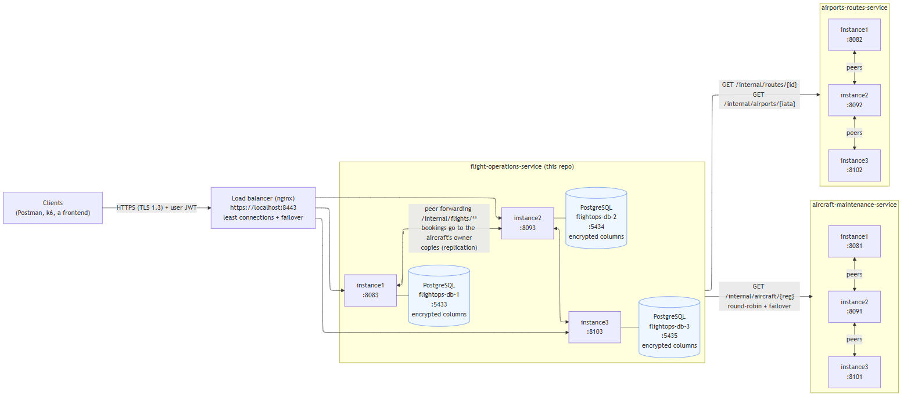
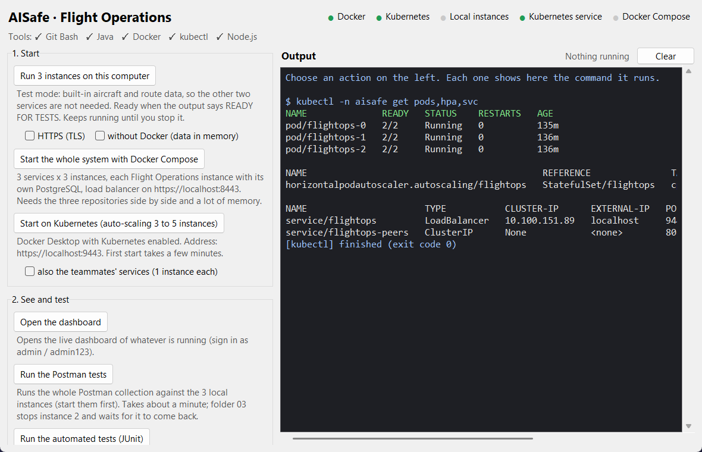
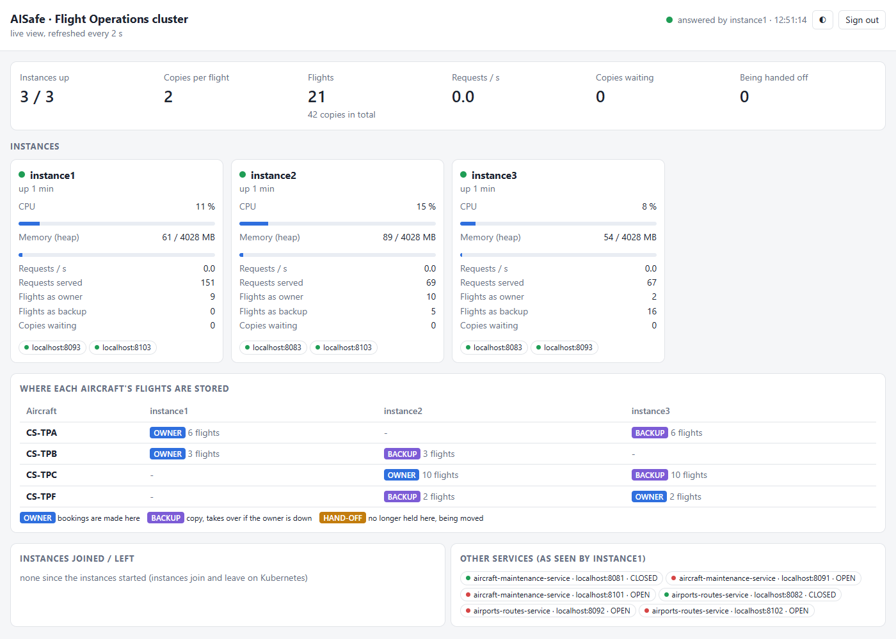
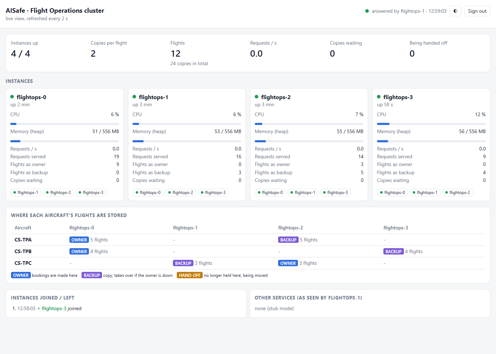
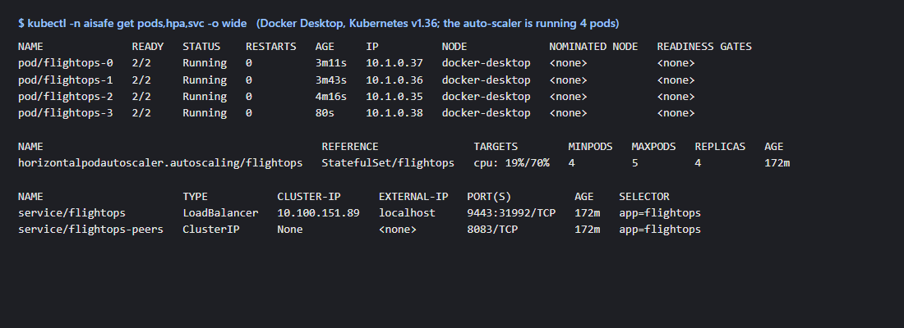
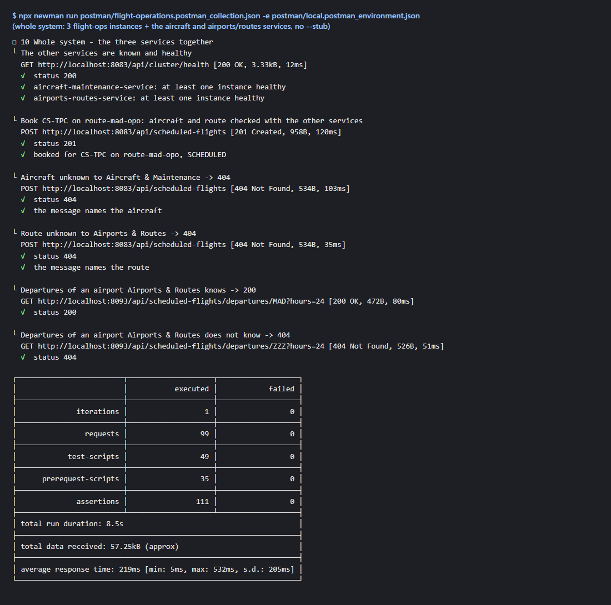

# flight-operations-service

AISafe Flight Management System – **Flight Operations** service (SIDIS 2026/27, Assignment 1).

Owns: scheduled flights, assigning aircraft to routes, availability checks, aircraft utilization (US223),
fuel efficiency (US227), departures board, and **user login** for the whole system.

Other services: [`aircraft-maintenance-service`](../aircraft-maintenance-service),
[`airports-routes-service`](../airports-routes-service). Contract between them: [docs/service-contracts.md](docs/service-contracts.md).



Architecture as a C4+1 model (context, containers, components, code, logical and development views, scenarios,
deployment): [docs/c4-model.md](docs/c4-model.md). Screenshots of the running system: [below](#screenshots).
Known limitations: [below](#known-limitations). Key benefits, performance measurements, consistency model and scaling
decisions: [docs/architecture.md](docs/architecture.md).

## Control panel (no commands needed)

**Windows:** double-click `Launcher.cmd`. **Mac / Linux:** `python3 launcher.py`. (Needs Python 3; the panel says
which other tools it finds: Git Bash, Java, Docker, kubectl, Node.js.)

A window with buttons to start the system (on this computer, with Docker Compose, or on Kubernetes), open the
dashboard, run the Postman and JUnit tests, generate load, and stop everything. Each button explains what it does
and shows the exact command it runs, so the commands below can also be learned from it. The lights at the top show
what is running.



## Run

```bash
# one standalone instance, plain HTTP, H2 in memory (port 8083) - handy while developing
./mvnw spring-boot:run

# certificates for HTTPS (once; output in certs/, which is git-ignored)
./scripts/generate-dev-certs.sh

# 3 instances without Docker (8083, 8093, 8103); Ctrl+C stops them. Add --tls for HTTPS, -n 2 for only two.
# Prints "READY FOR TESTS" once every instance has fully started.
./scripts/run-local.sh

# instances started another way (e.g. VS Code): wait until they are ready (-n 2, --tls as above)
./scripts/wait-ready.sh

# whole system, 3 instances per service (needs the 3 repos side by side)
docker compose up --build
# failure tests on the whole system (stops and starts containers; see "Postman" below)
./scripts/test-failures.sh

# only flight ops: 3 instances + their databases behind the load balancer (https://localhost:8443)
docker compose up --build flightops-lb

# Kubernetes (Docker Desktop) with auto-scaling between 3 and 5 instances: see "Kubernetes" below
./k8s/deploy.sh --stub

# load test (k6 in Docker, 1 CPU per instance); results in loadtest/results/
./loadtest/run.sh 2
./loadtest/run.sh 3

# local vs forwarded latency, availability while an instance is killed (with and without the load balancer)
./loadtest/performance.sh latency
./loadtest/performance.sh availability
./loadtest/performance.sh availability-lb
```

**Instances = Spring profiles.** Each instance has its own file with its own port, database and the list of all
instances (`flightops.cluster`): `application-instance1.properties` (8083, `flightops_db_1`), `application-instance2.properties`
(8093, `flightops_db_2`) and `application-instance3.properties` (8103, `flightops_db_3`). Start one with
`java -jar target/flight-operations-service-*.jar --spring.profiles.active=instance1` (add `,tls` for HTTPS).
Environment variables override the files, and docker-compose uses them for container hostnames.

**VS Code:** Run and Debug panel → "Flight Ops: 3 instances (HTTP)" or "(HTTPS)" starts the 3 instances
(`.vscode/launch.json`).

Port scheme and scaling decisions: [docs/architecture.md](docs/architecture.md).

In docker-compose clients use the **load balancer**, https://localhost:8443 (nginx, `lb/nginx.conf`: least
connections, an instance that fails is left out for 10 s, failover to another instance). The instances also stay
reachable directly on https://localhost:8083, https://localhost:8093 and https://localhost:8103, **HTTPS only (TLS 1.3)**. Docker checks
each instance's health every 10 s (`docker compose ps`) and restarts an instance whose process stops.
Swagger UI: https://localhost:8083/swagger-ui.html

To trust the dev CA: import `certs/ca.crt` into Postman (Settings → Certificates → CA certificates) or use
`curl --cacert certs/ca.crt` (on Windows also add `--ssl-no-revoke`, because a dev CA has no revocation list).

Login: `POST /api/auth/login` with `{"username":"atcc","password":"atcc123"}` (also `operator/operator123`, `admin/admin123`).

## How the distribution works

* **Sharding by aircraft** (P1 p.15): every instance knows all instances (`flightops.cluster`, or on Kubernetes
  found through DNS, see "Kubernetes" below) and ranks them for
  each aircraft by rendezvous hashing of its registration. A booking is made on the first of them, the **owner**,
  forwarded there if it arrived elsewhere (`X-Stored-On` says where); `GET /api/cluster/owner/{registration}` shows
  the owner and the backup.
* **Replication** (P1 p.2 "redundancy-based fault tolerance"): every flight is also kept on the second instance of
  the ranking, the **backup** (`flightops.replication.factor=2`, env `REPLICATION_FACTOR`; `X-Replicas` lists both).
  A change is saved together with an outbox task in one transaction and copied to the other holder right after the
  commit, retried while it is down; copies carry a `revision`, the newest wins. At startup (before reporting ready)
  and every 60 s each instance fetches the flights it should hold from its peers, so a restarted instance catches up
  even with an empty database. If the owner is down, its backup takes the aircraft's bookings.
  `GET /api/cluster/health` shows `replicationBacklog` (copies still waiting per instance).
* **Peer-to-peer reads**: a GET answers from the local DB and then asks the peers on `/internal/flights/**`:
  lists ask **all peers at the same time** (P1 p.12), a single flight asks them one by one until found (PL3 p.11).
  Results are merged and de-duplicated by `flightNumber` (newest copy wins). Internal endpoints answer from local
  data only, so there are no loops. A list built while a peer was unreachable is still `200` with
  `X-Unreachable-Peers: n`; `X-Partial-Result: true` is added only when data may really be missing (as many
  instances down as there are copies).
  Try: `GET http://localhost:8083/api/aircraft-utilization` and `GET http://localhost:8093/api/aircraft-utilization`.
  Both return the 10 sample flights once, although each is stored on two instances.
* **Fault tolerance**: an unreachable peer is skipped (logged as a warning). A stopped instance's flights are served
  from their copies. Only if no instance holding a flight answers is a single lookup `404` (PL3 p.11), with the
  number of unreachable peers in the message, because the flight may exist there.
* **Calls to other services** (`AircraftClient`, `AirportsRoutesClient`) go round-robin over their instances and
  fail over to the next one on timeout or 5xx. If none can be reached the answer is `404`, with
  "(… could not be reached)" in the message.
* **Resilience** (PL3 p.12, p.14; package `resilience`):
  * *Retry with exponential backoff*: a failed GET to another instance is retried up to 2 more times, after
    ~100 ms and ~200 ms (plus random jitter). A PATCH is never retried, because the first attempt may have worked.
  * *Circuit breaker*: after 3 failures in a row an instance is skipped for 10 s (fail fast; a struggling instance
    isn't flooded). Then one trial request is let through: success closes the circuit, failure skips it for twice
    as long (max 60 s).
  * *Health checks*: every 5 s each instance calls `/actuator/health` on its peers and on the other services'
    instances. A recovered instance is used again as soon as it answers.
  * *Load balancing*: incoming requests through nginx (least connections); between instances, the peer asked first
    for a single flight rotates per request; calls to other services go round-robin.
  * Status: `GET /api/cluster/health` (roles ADMIN, ATCC, BACKOFFICE_OPERATOR) lists every peer / remote instance
    with its circuit state and failure count. Settings: `sidis.resilience.*` in `application.properties`.
* **Consistency**: eventual - the other copy of a change arrives shortly after it is made (outbox, revisions,
  catch-up). "No double-booking" is guaranteed while one holder takes an aircraft's bookings (owner, or its backup
  while the owner is down, under a per-aircraft lock); if the two holders are cut off from each other, an overlap is
  reported as a replication conflict instead of being prevented (AP in CAP).
  Details, the known weak spots and how to fix them: [docs/architecture.md#consistency-model](docs/architecture.md#consistency-model).

## Security

| Requirement | How |
|---|---|
| Encryption in transit | `tls` profile: HTTPS, **TLS 1.3 only** (a TLS 1.2 client is refused), server and outgoing calls. Outgoing calls to peers and other services trust **only** the AISafe dev CA (`certs/truststore.p12`), and hostname verification stays on. The load balancer also speaks TLS 1.3 on both sides and verifies the instances' certificates. Certificates come from `scripts/generate-dev-certs.sh` (one CA, one certificate per service + the load balancer). |
| Encryption at rest | The route assignment of each flight (route, aircraft, model, airports) is stored **AES-256 encrypted** (`common.crypto`: deterministic authenticated encryption, SIV construction, so equality queries still work and tampering is detected). Key from `DATA_ENCRYPTION_KEY` (256 bit, base64), values versioned `enc:v1:` for key rotation; existing rows are encrypted at startup. `select aircraft_registration from scheduled_flight` shows only `enc:v1:...` |
| Inter-service authentication | Every service-to-service call carries a short-lived JWT (5 min, renewed automatically: rotating tokens, P1 p.16) with role `SERVICE` and the calling service as subject. `/internal/**` accepts only that role. |
| Access control | User roles from the login JWT (`@PreAuthorize`). A service token can't call `/api/**`, and a user token can't call `/internal/**`. |
| Audit logging | `AUDIT` logger: user, roles, method, URI, status, duration and client address for every request. |
| CORS (PL2 p.9) | Browsers may call `/api/**` from the origins in `CORS_ALLOWED_ORIGINS` (default `http://localhost:3000,http://localhost:5173`); the custom `X-...` headers are exposed. Not for `/internal/**`. |

## Testing (PL3 p.15-17)

### Automated tests (JUnit)

```bash
./mvnw test
```

| Test | What it covers |
|---|---|
| `services/*Test`, `resilience/*Test`, `cluster/ClusterTest`, `common/crypto/*Test`, `replication/ReplicaStoreTest`, `replication/ReplicaSyncTest`, `api/*Test` | Unit tests: forwarding/merge logic, scheduling rules, routing a booking to the aircraft's owner (and to its backup when the owner is down), retry/backoff, circuit breaker, rendezvous hashing (agreement, spread, minimal movement, replica sets), DNS discovery (pods joining and leaving), hand-off of flights an instance no longer holds, applying copies (newest wins, any order, conflicts reported), encryption, fuel efficiency and utilization (ported from PSOFT) |
| `ConcurrentBookingTest`, `EncryptionAtRestTest` | Real database: simultaneous bookings of one aircraft (exactly one succeeds), what is really stored (raw SQL shows only ciphertext) |
| `SecurityIntegrationTest` | One instance: login, 401/403 rules, service-only `/internal/**` |
| `TwoInstancesIntegrationTest` | **Two real instances** started on free ports, talking over HTTP, replication off (the week-3 behaviour on its own): local access, forwarding (`X-Data-Source`), the same request id in both instances' logs, cancel forwarded to the owner, a booking stored on the aircraft's owner, simultaneous bookings via both instances (one wins), instance 2 stopped → 404, partial lists flagged, circuit open |
| `ReplicationIntegrationTest` | **Three real instances**, 2 copies of each flight: a booking copied to the backup, the owner stopped → its flights still readable and lists complete, bookings go to the backup, a cancel while it is down; the owner restarts with an empty database and catches up; the backup's outbox empties; `/api/cluster/overview` shows the 3 instances and each flight once as owner and once as backup |

### Postman (PL3 p.17)

Files in `postman/`:
`flight-operations.postman_collection.json` (79 requests with test scripts) and two environments (one URL per
instance): `local.postman_environment.json` (HTTP) and `local-https.postman_environment.json` (HTTPS). Import all three.

1. Start 3 instances in **stub** mode (built-in aircraft/route data, so flights can be created without the other
   two services): `./scripts/run-local.sh --stub`, or in VS Code the compound "3 instances for the Postman tests".
   Wait for **READY FOR TESTS** (from VS Code: run `./scripts/wait-ready.sh` in a terminal).
2. Select the environment "Flight Ops - local (3 instances)".
3. Run the whole collection (about 30 s). Nothing to do by hand: folder **03 Resilience** stops instance 2 itself
   (`POST /actuator/shutdown`, only possible in stub/test mode and only for ADMIN), checks the failure behaviour, then
   waits until `run-local.sh` has restarted instance 2 and checks the automatic recovery.
   With the VS Code compound there is no automatic restart: the last request of folder 03 is then skipped.

The collection also runs against the **whole system** (no `--stub`: the real aircraft and airports/routes services,
e.g. `docker compose up`). The first folder detects the mode from `GET /api/cluster/health` (in stub mode no
instances of the other services are known): in the whole system, folder **10** checks requests that cross the three
services, and folder 03 is skipped (it needs `/actuator/shutdown`, which only stub mode exposes). The failure tests
for the whole system are folder **11**, run by a script that stops and starts the containers between its phases
(Postman can't stop a container):

```bash
docker compose up -d --build                        # whole system, wait until every instance is healthy
./scripts/test-failures.sh                          # 11a-11e, about 1.5 min; starts again whatever it stopped
./scripts/test-failures.sh --skip-other-services    # without 11e (aircraft/airports on other machines)
```

By hand (Postman app, e.g. in a demo): run 00 Setup, set the environment variable `failurePhase` to `a` and run
11a, `docker compose stop flightops-2`, set it to `b` and run 11b, and so on (each phase's description says what to
stop or start). In a normal run of the collection folder 11 is skipped.

Last runs (2026-10-29): stub mode 122 assertions, whole system 114 assertions plus 57 in folder 11 through the
script; 0 failed, and no request errors (folder 03 asks instance 1 whether instance 2 is up, instead of calling the
stopped instance itself).

| Folder | PL3 p.16 test |
|---|---|
| 01 Local Data Access | 01: data on instance 1, asked from instance 1 → 200, `X-Data-Source: local` (no peer query) |
| 02 Successful Forwarding | 02: data created on instance 2, asked from instance 1 → 200; `X-Data-Source: local` when instance 1 keeps a copy (2 instances, 2 copies), `peer:…` when it doesn't (3 instances, or `REPLICATION_FACTOR=1`) |
| 03 Resilience | 03 + P1 p.2 redundancy: instance 2 stopped → its flights still 200 from their copies, lists complete (`X-Unreachable-Peers: 1`, no `X-Partial-Result`), a booking for its aircraft taken by the backup and queued in its outbox; instance 2 restarted → trusted again, has caught up with that booking, outbox empty (PL3 p.14 automatic recovery). With `REPLICATION_FACTOR=1`: 404 and `X-Partial-Result` as in PL3 p.16 |
| 04 Load Distribution | 04: requests alternate between instances, `X-Instance` shows who answered, response times checked |
| 05 Edge Cases | 05: invalid ids, malformed JSON, missing fields, business rules (409), 401/403 |
| 06 Monitoring | PL3 p.19 metrics: local vs forwarded times (forwarded slower; skipped when every read is local because of the copies), forwarding success rate, peer health, both instances served requests |
| 07 Three instances | PL3 p.27 "test with 3+ instances": data created on instance 3 reachable from 1 and 2, every instance sees 2 healthy peers. Skipped when only 2 instances run (`-n 2`) |
| 08 Encryption in transit | HTTPS only: works with a verified certificate, plain HTTP to the same port is refused, peers are called over HTTPS. Only with the HTTPS environment |
| 09 Sharding by aircraft | P1 p.15: owner lookup, a booking sent to instance 1 stored on its owner instance 2 (`X-Stored-On`, `X-Replicas` owner first), simultaneous bookings of the same aircraft via both instances → one 201, one 409 |
| 10 Whole system | Week 5 slides p.14 "cross-component tests" (whole system only): the other services are known and healthy; a booking checked with both services → 201; aircraft unknown to Aircraft & Maintenance and route unknown to Airports & Routes → 404; departures of an airport the airports service knows → 200, doesn't know → 404 |
| 11 Whole system - failures | Week 5 p.14 "stop container, verify 404", Week 4 p.11, PL3 p.14/p.16 (whole system, `scripts/test-failures.sh`). **11a** CS-TPC's holders recorded (owner instance2), flights booked. **11b** flightops-2 stopped: its flight read from the copy (`X-Data-Source: peer:…`), list complete (`X-Unreachable-Peers: 1`), the backup takes a booking and queues it for instance 2. **11c** the backup stopped too: **404** "could not be reached", list flagged `X-Partial-Result`, other aircraft unaffected, a booking still accepted where it was received (AP). **11d** both started: caught up (`X-Data-Source: local`), outbox empty, the left-over copy handed off. **11e** aircraft-1 and airports-1 stopped: bookings still 201 (their other instances) |

**Over HTTPS** (evidence of encryption in transit): start the instances with `./scripts/run-local.sh --tls --stub`
and select "Flight Ops - local HTTPS (3 instances)". Postman must trust the dev CA: Settings → Certificates →
CA certificates → on → select `certs/ca.crt` (created by `./scripts/generate-dev-certs.sh`). If that setting isn't
available (Postman on the web), turn off Settings → General → "SSL certificate verification" instead: the traffic is
still encrypted, only the server's identity isn't checked. Command line:
`npx newman run postman/flight-operations.postman_collection.json -e postman/local-https.postman_environment.json --ssl-extra-ca-certs certs/ca.crt`.

From the command line (same files): `npx newman run postman/flight-operations.postman_collection.json -e postman/local.postman_environment.json --folder "01 Local Data Access"`.

Postman **on the web** reaches `localhost` only through the
[Postman Desktop Agent](https://www.postman.com/downloads/postman-agent/) (or use the Postman desktop app).

### Tracing a request across instances (PL3 p.15)

Every response has `X-Instance` (which instance answered) and `X-Request-Id`. The request id is passed on to peers,
and every log line shows `[instance] [request id]`, so one request can be followed through all instances:

```
INFO [instance1] [postman-forwarding-1] AUDIT : user=atcc ... uri=/api/scheduled-flights/2db4... status=200 durationMs=31
INFO [instance2] [postman-forwarding-1] AUDIT : user=flight-operations-service roles=[ROLE_SERVICE] ... uri=/internal/flights/2db4...
```

Send your own id with the `X-Request-Id` header to find a request easily (`grep postman-forwarding-1 logs/*.log`).

## Monitoring (PL3 p.19)

**Dashboard:** open `/dashboard` on any instance or on the load balancer (https://localhost:9443/dashboard on
Kubernetes, https://localhost:8443/dashboard with docker-compose) and sign in (e.g. `admin`). It refreshes every 2 s
and shows every instance (health, CPU, memory, requests per second, flights as owner / backup, copies waiting, its
view of the peers), where each aircraft's flights are stored, the instances that joined or left (Kubernetes) and the
other services' health. Its data is `GET /api/cluster/overview`: the instance that answers adds its own status to
its peers' (`/internal/cluster/status`, asked in parallel), so a stopped instance shows as "not answering". The page
loads nothing from the internet.

**Log format** (as on the slide, plus the request id), for every line of every instance:

```
15:30:16.431 [http-nio-8083-exec-3] INFO  [instance1] [16ad3a5d] AUDIT - user=admin ... uri=/api/cluster/metrics status=200 durationMs=12
```

The `AUDIT` line is the slide's "request tracer": method, URL, status and processing time of every request.
`DEBUG` lines of `PeerClient` show each forwarding step (enabled in the instance profiles).

**Metrics**: `GET /api/cluster/metrics` (roles ADMIN, ATCC, BACKOFFICE_OPERATOR) answers the slide's four points for
this instance, counted since it started:

| Slide | Field | Example |
|---|---|---|
| Response times: local vs forwarded | `lookupResponseTimes.local / forwarded / notFound` (count, avg, p95, max ms) | local 17 ms, forwarded 65 ms |
| Success rates: forwarding success % | `forwarding.successRatePercent` (found on a peer / lookups that had to ask peers) | 50 % |
| Peer health: availability, failure rates | `remoteInstances[]`: `healthy`, `circuit`, `callsByOutcome`, `failureRatePercent`, `avgCallMs` | instance 2: healthy, 9 % failures |
| Load distribution | `requestsServed.total` / `byStatus`: compare the instances | 34 requests on instance 1 |

Recorded with Micrometer (`common.metrics.FlightOpsMetrics`): timers `flightops.lookups` (tag `source`) and
`flightops.remote.calls` (tags `group`, `target`, `outcome`), gauge `flightops.remote.healthy`, plus Spring Boot's
`http.server.requests`. Raw values: `GET /actuator/metrics/flightops.lookups?tag=source:forwarded` (ADMIN).
The Postman folder "06 Monitoring" checks all of it.

## Database

Each instance has **its own PostgreSQL database**, running in its own container, so the data of one instance is
isolated from the others and **survives restarts**:

| Instance | Database container | Host port | Stored in (Docker volume) |
|---|---|---|---|
| 1 | `flightops-db-1` | 5433 | `flightops-db-1-data` |
| 2 | `flightops-db-2` | 5434 | `flightops-db-2-data` |
| 3 | `flightops-db-3` | 5435 | `flightops-db-3-data` |

* `docker compose up`, `./scripts/run-local.sh` and the VS Code "PostgreSQL" configurations start the database
  containers automatically. Docker Desktop must be running.
* The sample data is loaded only into an **empty** database, so restarts don't duplicate it.
* Stop the databases: `docker compose stop`. **Delete all data** (start fresh): `docker compose down -v`.
* Look inside a database: `docker compose exec flightops-db-1 psql -U flightops -d flightops`,
  then e.g. `select flight_number, aircraft_registration, status from scheduled_flight;` (the registration is
  encrypted: `enc:v1:...`, see Security)
* Without Docker: `./scripts/run-local.sh --h2` or the VS Code "H2 in-memory" configuration (data is lost on stop).
  The automated tests always use in-memory H2, so they need no setup.

## Kubernetes (auto-scaling)

`k8s/` runs the system on the Kubernetes of Docker Desktop (Settings → Kubernetes → Create cluster, **kubeadm**):

```bash
./scripts/generate-dev-certs.sh   # once (keeps an existing CA; adds the pod names to the certificates)
./k8s/deploy.sh --stub            # only Flight Operations (stub data); without --stub also the other two services
OTHER_INSTANCES=1 ./k8s/deploy.sh # all 3 services, 1 pod of each of the other two (less memory)
kubectl -n aisafe get pods,hpa -w # watch the instances and the auto-scaler
./k8s/deploy.sh --down            # remove everything
```

Clients use https://localhost:9443 (a Kubernetes `LoadBalancer` Service: it only sends requests to pods whose
readiness probe passes).

**Windows / WSL:** Kubernetes 1.35+ needs cgroup v2. If Docker Desktop stays on "Starting Kubernetes" and its log
(`%LOCALAPPDATA%\Docker\log\vm\init.log`) says `kubelet is configured to not run on a host using cgroup v1`, create
`%USERPROFILE%\.wslconfig` with

```ini
[wsl2]
kernelCommandLine = cgroup_no_v1=all
```

then quit Docker Desktop, run `wsl --shutdown`, and start it again (or update WSL: `wsl --update`).

* **Each instance is a pod** of the StatefulSet `flightops` (`k8s/flightops.yaml`): `flightops-0`, `flightops-1`, ...
  The pod name is the instance name, so an aircraft keeps its owner when a pod restarts. The pod also runs the
  instance's **own PostgreSQL** (a second container) with its own disk: a pod added by the auto-scaler brings its
  database along.
* **Service discovery instead of a fixed list** (PL3 p.25): the `k8s` profile replaces `flightops.cluster` by
  `flightops.discovery.url-pattern`. Every 5 s each instance looks up `flightops-{i}.flightops-peers` (the DNS names
  the headless Service gives the pods); the names that exist are the instances (`cluster.DnsDiscovery`).
* **Auto-scaling** (`k8s/hpa.yaml`): a HorizontalPodAutoscaler keeps 3 to 5 instances, adding one when the average
  CPU of the application containers passes 70 % of what they request, and removing one after 2 minutes of low load,
  one pod at a time.
* **Rebalancing**: when an instance joins, rendezvous hashing gives it only the aircraft it wins; it fetches their
  flights before it reports ready. As soon as the new instance answers its first health check (and also 10 s after
  any change, and every 60 s) the others run their catch-up again and hand off the flights they no longer hold
  (send them to the new holders, then delete their own copy). Until then, a lookup of such a left-over copy asks the
  aircraft's holders first, so it never answers an out-of-date copy while a holder can be reached. When an instance is removed,
  each of its flights is still on its other holder, which copies it to the new one. `GET /api/cluster/health` and the
  logs (`Discovery: ... joined`, `Rebalancing: ...`) show it happening.
* **Self-healing**: Kubernetes restarts a container whose liveness probe fails and recreates a deleted pod
  (`kubectl -n aisafe delete pod flightops-1`: it comes back with the same name and disk, then catches up).
* Secrets (JWT key, database password, encryption key, certificates) are Kubernetes Secrets created by `deploy.sh`,
  never in the manifests.

## Screenshots

**Dashboard, whole system** (`/dashboard`, 3 instances with the real aircraft and airports/routes services; one
instance of each other service was running, so their other two instances show `OPEN`):



**Dashboard on Kubernetes after the auto-scaler added a pod** (minimum raised to 4 for the screenshot):
`flightops-3` joined, became the backup of CS-TPB and received its flights; nothing is waiting to be handed off.





**Postman collection against the whole system** (newman; folder 10 and the summary):



## Known limitations

* **Eventual consistency.** The other copy of a change arrives moments later (outbox, retried while the target is
  down); until then the two copies can differ. Lists keep the newest copy; a single lookup answers from its own copy
  (or, for a copy this instance no longer holds, from the aircraft's holders first).
* **Network partition (AP).** If the owner and the backup of an aircraft can't reach each other, both may accept
  an overlapping booking. It is detected when the copies meet and logged as `REPLICATION CONFLICT`; both flights are
  kept and one must be cancelled by hand. Preventing it would need a quorum (CP for bookings).
* **Two copies per flight.** One instance down: everything is still served. Both holders of an aircraft down at the
  same time: its flights are unavailable (`404` saying how many instances could not be reached, lists flagged with
  `X-Partial-Result`) until one of them is back. A new booking for that aircraft is still accepted by the instance
  that receives it, with a best-effort overlap check; it reaches the holders when they are back (an overlap is then
  logged as `REPLICATION CONFLICT`). `REPLICATION_FACTOR` can raise the number of copies.
* **Reports ask every instance** (utilization, fuel efficiency), so they don't get faster with more instances
  (load test in [docs/architecture.md](docs/architecture.md#horizontal-scaling)).
* **Kubernetes rebalancing.** Removing two pods at once (e.g. `kubectl scale` by hand) could remove both holders of
  some aircraft before their flights are copied; the auto-scaler removes one pod per minute. For ~15 s after a pod
  joins or leaves, instances may disagree on an aircraft's owner (an overlap is then reported as above).
* **Docker Compose / scripts** use a fixed list of instances: adding one needs a configuration change and restarts
  (Kubernetes discovers instances by DNS instead).
* **Development defaults.** The JWT key, database password and encryption key have defaults in the configuration for
  local runs; a real deployment must override them (Kubernetes takes them from Secrets). Encryption keys can be
  versioned, but re-encrypting old data with a new key is not implemented.
* **Measured on one laptop.** Latencies and throughput have no real network between the instances; they show
  relative effects (local vs forwarded, 2 vs 3 instances), not production numbers.

## TODO

- [x] HTTPS for flight-ops replicas and their outgoing calls
- [x] HTTPS on aircraft-maintenance-service (its owner) and its URLs in docker-compose switched to `https://`
- [x] HTTPS on airports-routes-service (its owner) and its URLs and PEERS in docker-compose switched to `https://`
- [x] PostgreSQL container per instance in docker-compose
- [x] 3 instances per service; Kubernetes with service discovery and auto-scaling (k8s/)
- [x] Postman collection (postman/)
- [x] Architecture diagrams and performance analysis (docs/architecture.md)
- [x] Consistency model, failure scenarios (docs/architecture.md)
