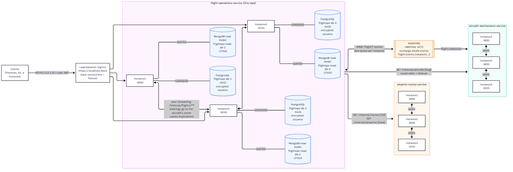
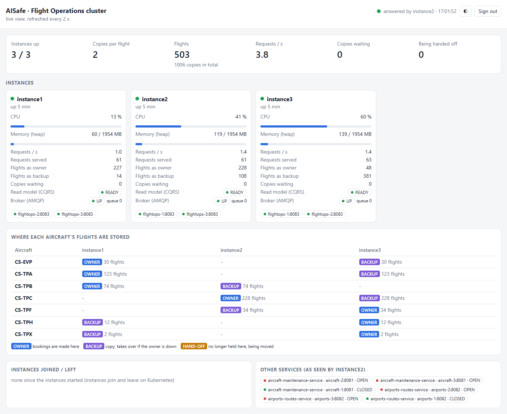
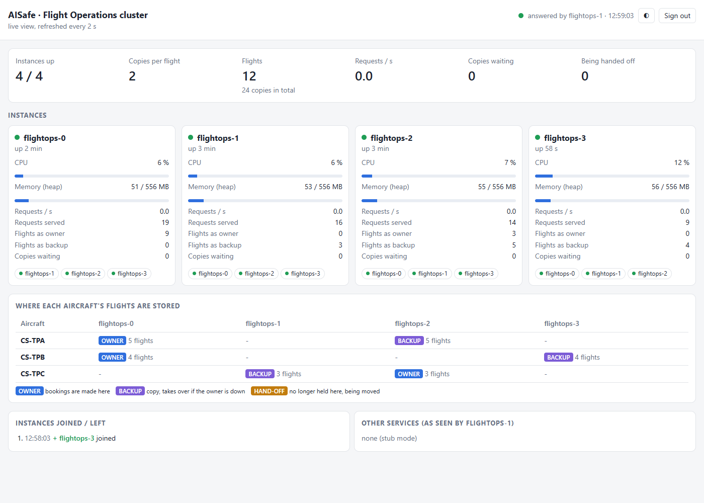
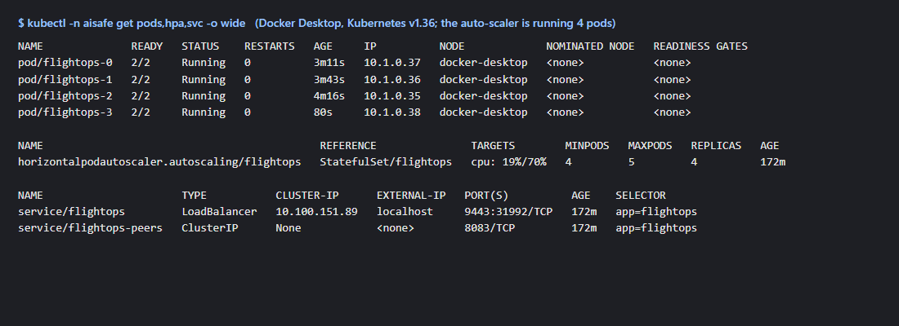

# flight-operations-service

**Flight Operations** service of the AISafe Flight Management System (SIDIS 2026/27, Assignments 1 and 2): scheduled
flights and assignment of aircraft to routes (US212, US213), availability checks, aircraft utilization (US223),
fuel efficiency (US227), the departures board, and user sign-in for the whole system.

It is one of three services, each developed by a different team member and run as several instances:
[`aircraft-maintenance-service`](../aircraft-maintenance-service), [`airports-routes-service`](../airports-routes-service)
and this one. They interact through the REST and AMQP contract in [docs/service-contracts.md](docs/service-contracts.md).



## Documentation

| | |
|---|---|
| **[Documentation guide](docs/README.md)** | Start here: document map, reading paths, and where each design question is answered |
| [Architecture](docs/architecture.md) | Distribution, consistency, CQRS, messaging, performance, scaling: mechanisms, guarantees and failures |
| [Decision records](docs/decisions/README.md) | 15 ADRs: context, decision, alternatives considered, consequences |
| [C4+1 model](docs/c4-model.md) | Context, containers, components, code, logical and development views, scenarios, deployment |
| [Running](docs/running.md) · [Testing](docs/testing.md) · [Operations](docs/operations.md) | How to start it, how it is tested, how to observe it |
| [Security](docs/security.md) · [Limitations](docs/limitations.md) · [Glossary](docs/glossary.md) | Protections, accepted trade-offs, terminology |

## Architecture at a glance

| Concern | Design | Record |
|---|---|---|
| Data placement | Flights sharded by aircraft registration (rendezvous hashing); each flight on its owner and a backup instance | [0001](docs/decisions/0001-shard-flights-by-aircraft.md), [0002](docs/decisions/0002-two-copies-of-every-flight.md) |
| Consistency | Eventual between instances, read-your-writes locally; AP during partitions, double-bookings detected and reported | [0003](docs/decisions/0003-availability-over-consistency.md) |
| Failures | Timeouts, retries for reads, circuit breaker per instance, health checks; `503` (not `404`) for unreachable data | [0004](docs/decisions/0004-503-for-unreachable-data.md), [0006](docs/decisions/0006-resilience-on-remote-calls.md) |
| Storage | PostgreSQL (write side) and MongoDB (read side) per instance; no shared database | [0005](docs/decisions/0005-database-per-instance.md) |
| CQRS | Commands on the sharded write model; queries on a read model holding the whole cluster, with a fallback to the write side | [0009](docs/decisions/0009-cqrs-separate-read-database.md), [0010](docs/decisions/0010-read-model-fallback.md) |
| Messaging | RabbitMQ topic exchange `aisafe.events`, one queue per instance; transactional outbox, publisher confirms, idempotent consumers, dead letters | [0011](docs/decisions/0011-publish-subscribe-one-queue-per-instance.md) - [0013](docs/decisions/0013-at-least-once-idempotent-consumers.md) |
| Service independence | Local copies of aircraft, routes and airports fed by the other services' events; REST as the fallback | [0014](docs/decisions/0014-local-copies-of-other-services-data.md) |
| Scaling | Kubernetes StatefulSet, DNS discovery, auto-scaling 3-5 instances; optional query instances scale reads alone | [0008](docs/decisions/0008-kubernetes-statefulset-and-discovery.md), [0015](docs/decisions/0015-query-instances.md) |
| Security | TLS 1.3 only (HTTPS and AMQPS), AES-256-SIV at rest, user and short-lived service JWTs, audit log | [0007](docs/decisions/0007-encryption-in-transit-and-at-rest.md) |

## Assignment 2: requirements and evidence

Requirements from the statement (P2 p.2) and from the RabbitMQ slides (RMQ p.15, best practices), each with what was
built and how it can be verified. Postman folders: [testing.md](docs/testing.md#postman-pl3-p17).

| Requirement | What was done | Evidence |
|---|---|---|
| **CQRS** for the service's core resources | Commands (book, cancel, complete) on the write side, PostgreSQL. Queries (a flight, lists, reports, departures, unicorns) on the read side: a **MongoDB of its own per instance**, with every flight of the cluster. It is updated after each change and by the events, and rebuilt from the write side. If the read side can't answer, the write side answers instead | Postman **12**; headers `X-Read-Side`, `X-Read-Model`; `CqrsIntegrationTest`, `MongoReadModelTest`, `ReadDatabaseDownTest`; [CQRS](docs/architecture.md#cqrs-assignment-2) |
| Evidence of **independent read and write models** | Two databases with different engines and shapes: write = normalized rows, read = documents and reports already computed. Each query says which side answered | Postman **12** (`X-Read-Side: read-model`, `X-Data-Source`), `/api/cluster/metrics` → `lookupResponseTimes.readModel`; [Which side answered](docs/architecture.md#which-side-answered-evidence) |
| **AMQP and a message broker** between services | RabbitMQ (`rabbitmq:3-management`), topic exchange `aisafe.events`. Publishes `flight.scheduled`, `flight.cancelled` and `flight.completed` through a transactional outbox with publisher confirms. Consumes `aircraft.*`, `airport.*` and `route.*` into local copies, so a booking doesn't call the other services | Postman **13**, **15**, **16**; `MessagingIntegrationTest` (real broker), `AircraftEventsTest`, `RouteEventsTest`; RabbitMQ UI http://localhost:15672; [Messaging](docs/architecture.md#messaging-assignment-2) |
| **Demonstration of asynchronous communication** | A completed flight reaches another service's queue with its flight hours. A change made on one instance reaches the other instances' read models in milliseconds, and with the broker stopped it waits in the outbox | Postman **13** (`flight.completed` on the instance with no copy), **11f / 11g** (`scripts/test-failures.sh`) |
| External endpoints stay **HTTP REST** | Every client endpoint is REST (`/api/**`); AMQP only between services and instances | Swagger UI `/swagger-ui.html`; every Postman folder |
| **Database per service instance** | Each instance has its own PostgreSQL (write) and its own MongoDB (read), not shared with anyone. The other services' data is reached by REST or by their events, never by their databases | `docker-compose.yml` (`flightops-db-<i>`, `flightops-read-db-<i>`), `k8s/flightops.yaml` (both databases in each pod); [Database](docs/operations.md#data-stores) |
| **Data isolation across instances** | Flights sharded by aircraft (each on its owner plus one backup); every other instance asks the holders | Postman **09** (sharding), **07** (three instances); `TwoInstancesIntegrationTest`, `ReplicationIntegrationTest` |
| **At least two instances** of each service | 3 instances (Docker Compose and `run-local.sh`); Kubernetes: 3 to 5 with auto-scaling | Postman **07**; dashboard; [Kubernetes](docs/running.md#kubernetes-auto-scaling) |
| **Integration tests** in Postman | 151 requests with test scripts, including the failure phases run by `scripts/test-failures.sh` | `postman/`; [Postman](docs/testing.md#postman-pl3-p17) |
| Mock **`/api/v2/unicorns`**, and how it fits CQRS | The airplanes' moods (FLYING, EXCITED, TIRED, BORED, HAPPY): a query computed from the read model, never a write | Postman **14**; `UnicornMoodTest`, `CqrsIntegrationTest`; [The unicorns endpoint: a query](docs/architecture.md#the-unicorns-endpoint-a-query) |
| Documentation: **design decisions, consistency model, communication patterns, fault tolerance** | 15 architecture decision records; each part of the architecture has its decisions and alternatives, failure table and consistency section | [Decision records](docs/decisions/README.md), [Consistency model](docs/architecture.md#consistency-model), [Topology](docs/architecture.md#topology), CQRS and Messaging "Decisions and alternatives" and "Failures", [C4 model](docs/c4-model.md), [contract](docs/service-contracts.md) |
| RabbitMQ: **ack after processing, dead letters, TTL and queue limits, monitor queue depth** (RMQ p.15) | AUTO ack when the listener returns; 3 attempts, then `flight.events.dlq`; `x-max-length` 100 000, `x-message-ttl` 1 day, `x-expires` 7 days; queue depth, consumers, dead letters and outbox shown per instance | `/api/cluster/health` → `messaging`; dashboard "Broker (AMQP)" chip; `MessagingIntegrationTest` (dead letter) |
| CQRS with **separate processes** (optional, beyond the statement) | Query instances: a read database only, not part of the sharding, no commands (405). The broker brings them every change and they rebuild their read model from the command instances when they start. The load balancer sends the GETs to them. Reads scale on their own (Kubernetes: 2 to 4) | Postman **17**; `QueryInstanceIntegrationTest`, `ClusterTest`; `run-local.sh --queries 2`, `docker compose --profile queries up`, `QUERY_INSTANCES=2 k8s/deploy.sh`; [Separate processes](docs/architecture.md#separate-processes-query-instances-optional) |
| Security of the new connections | The broker connection is encrypted too: AMQPS, TLS 1.3, the broker's certificate checked against the AISafe CA | Postman **13** (RabbitMQ management API: every instance connection on 5671 with `tlsv1.3`); [Security](docs/security.md) |
| **Source code and deployment instructions** | Docker Compose, `run-local.sh`, Kubernetes, control panel | [Running](docs/running.md), [Kubernetes](docs/running.md#kubernetes-auto-scaling) |

## Quick start

Requirements: Java 21, Docker Desktop, Git Bash on Windows. Without typing commands: double-click `Launcher.cmd`
(Windows) or run `python3 launcher.py` ([control panel](docs/running.md#control-panel-no-commands-needed)).

```bash
./scripts/generate-dev-certs.sh          # once: development CA and certificates (certs/, git-ignored)
./scripts/run-local.sh --tls --stub      # 3 instances with their databases and the broker; prints READY FOR TESTS
docker compose up --build                # or: the whole system, 3 instances per service (the 3 repositories side by side)
./k8s/deploy.sh --stub                   # or: Kubernetes (Docker Desktop) with auto-scaling
```

Then sign in with `POST /api/auth/login` and `{"username":"atcc","password":"atcc123"}` (also `operator/operator123`,
`admin/admin123`), open the dashboard at `/dashboard`, or run the Postman collection in `postman/`. Every run mode,
port and profile: [docs/running.md](docs/running.md). API reference: Swagger UI at `/swagger-ui.html` (OpenAPI document at
`/v3/api-docs`), on every instance.

## Screenshots

**Dashboard, whole system** (`/dashboard`, 3 instances with the real aircraft and airports/routes services; one
instance of each other service was running, so their other two instances show `OPEN`):



**Dashboard on Kubernetes after the auto-scaler added a pod** (minimum raised to 4 for the screenshot):
`flightops-3` joined, became the backup of CS-TPB and received its flights; nothing is waiting to be handed off.





**Postman collection against the whole system** (newman; folder 10 and the summary):


## Known limitations

The main trade-offs, all deliberate: eventual consistency between instances; double-bookings during a partition are
detected rather than prevented (AP); a flight is unavailable while both its holders are down; a single broker node
(a point of failure for the events only, not for commands or queries). The full list, with what would remove each
one: [docs/limitations.md](docs/limitations.md).
