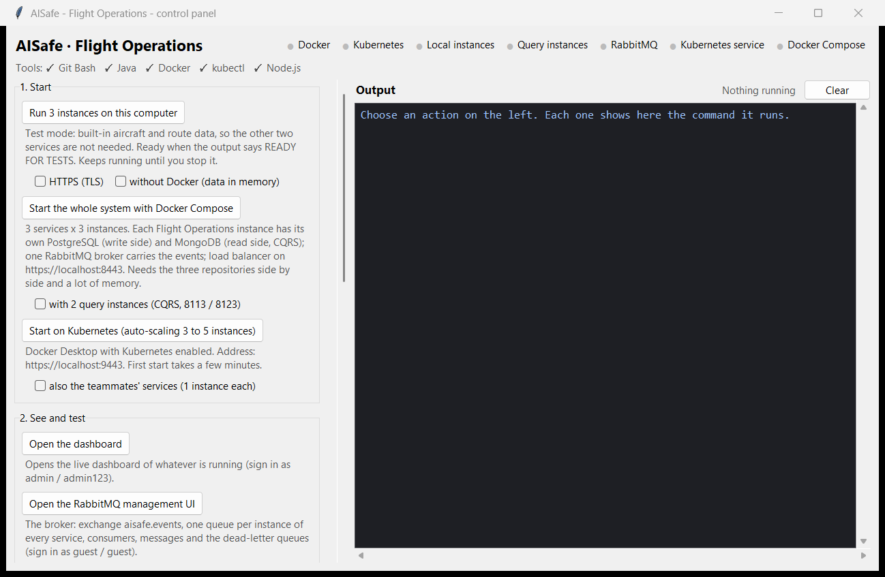
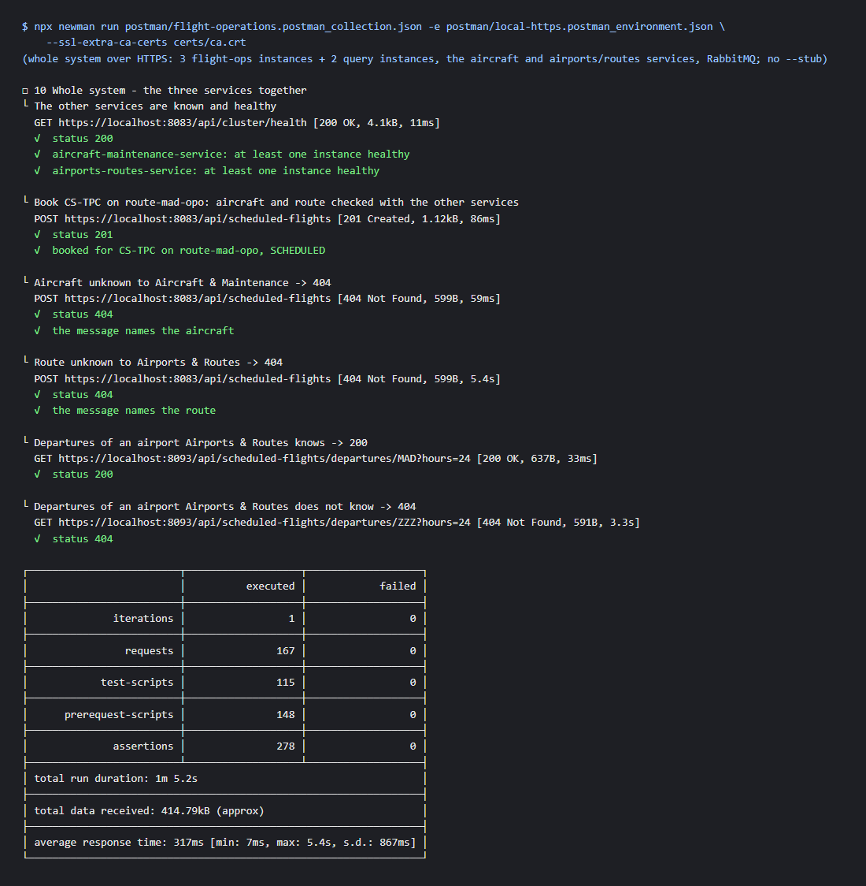

# flight-operations-service

AISafe Flight Management System – **Flight Operations** service (SIDIS 2026/27, Assignments 1 and 2).

Owns: scheduled flights, assigning aircraft to routes, availability checks, aircraft utilization (US223),
fuel efficiency (US227), departures board, and **user login** for the whole system.

Other services: [`aircraft-maintenance-service`](../aircraft-maintenance-service),
[`airports-routes-service`](../airports-routes-service). Contract between them: [docs/service-contracts.md](docs/service-contracts.md).


Architecture as a C4+1 model (context, containers, components, code, logical and development views, scenarios,
deployment): [docs/c4-model.md](docs/c4-model.md). Screenshots of the running system: [below](#screenshots).
Known limitations: [below](#known-limitations). Key benefits, performance measurements, consistency model and scaling
decisions: [docs/architecture.md](docs/architecture.md).

## Assignment 2: each requirement and its evidence

Requirements from the statement (P2 p.2) and from the RabbitMQ slides (RMQ p.15, best practices). Postman folders:
[Postman](#postman-pl3-p17). The design and the alternatives: [docs/architecture.md](docs/architecture.md).

| Requirement | What was done | Evidence |
|---|---|---|
| **CQRS** for the service's core resources | Commands (book, cancel, complete) on the write side, PostgreSQL. Queries (a flight, lists, reports, departures, unicorns) on the read side: a **MongoDB of its own per instance**, with every flight of the cluster. It is updated after each change and by the events, and rebuilt from the write side. If the read side can't answer, the write side answers instead | Postman **12**; headers `X-Read-Side`, `X-Read-Model`; `CqrsIntegrationTest`, `MongoReadModelTest`, `ReadDatabaseDownTest`; [CQRS](docs/architecture.md#cqrs-assignment-2) |
| Evidence of **independent read and write models** | Two databases with different engines and shapes: write = normalized rows, read = documents and reports already computed. Each query says which side answered | Postman **12** (`X-Read-Side: read-model`, `X-Data-Source`), `/api/cluster/metrics` → `lookupResponseTimes.readModel`; [Which side answered](docs/architecture.md#which-side-answered-evidence) |
| **AMQP and a message broker** between services | RabbitMQ (`rabbitmq:3-management`), topic exchange `aisafe.events`. Publishes `flight.scheduled`, `flight.cancelled` and `flight.completed` through a transactional outbox with publisher confirms. Consumes `aircraft.*`, `airport.*` and `route.*` into local copies, so a booking doesn't call the other services | Postman **13**, **15**, **16**; `MessagingIntegrationTest` (real broker), `AircraftEventsTest`, `RouteEventsTest`; RabbitMQ UI http://localhost:15672; [Messaging](docs/architecture.md#messaging-assignment-2) |
| **Demonstration of asynchronous communication** | A completed flight reaches another service's queue with its flight hours. A change made on one instance reaches the other instances' read models in milliseconds, and with the broker stopped it waits in the outbox | Postman **13** (`flight.completed` on the instance with no copy), **11f / 11g** (`scripts/test-failures.sh`) |
| External endpoints stay **HTTP REST** | Every client endpoint is REST (`/api/**`); AMQP only between services and instances | Swagger UI `/swagger-ui.html`; every Postman folder |
| **Database per service instance** | Each instance has its own PostgreSQL (write) and its own MongoDB (read), not shared with anyone. The other services' data is reached by REST or by their events, never by their databases | `docker-compose.yml` (`flightops-db-<i>`, `flightops-read-db-<i>`), `k8s/flightops.yaml` (both databases in each pod); [Database](#database) |
| **Data isolation across instances** | Flights sharded by aircraft (each on its owner plus one backup); every other instance asks the holders | Postman **09** (sharding), **07** (three instances); `TwoInstancesIntegrationTest`, `ReplicationIntegrationTest` |
| **At least two instances** of each service | 3 instances (Docker Compose and `run-local.sh`); Kubernetes: 3 to 5 with auto-scaling | Postman **07**; dashboard; [Kubernetes](#kubernetes-auto-scaling) |
| **Integration tests** in Postman | 151 requests with test scripts, including the failure phases run by `scripts/test-failures.sh` | `postman/`; [Postman](#postman-pl3-p17) |
| Mock **`/api/v2/unicorns`**, and how it fits CQRS | The airplanes' moods (FLYING, EXCITED, TIRED, BORED, HAPPY): a query computed from the read model, never a write | Postman **14**; `UnicornMoodTest`, `CqrsIntegrationTest`; [The unicorns endpoint: a query](docs/architecture.md#the-unicorns-endpoint-a-query) |
| Documentation: **design decisions, consistency model, communication patterns, fault tolerance** | Each part has its decisions and alternatives, failure table and consistency section | [Consistency model](docs/architecture.md#consistency-model), [Topology](docs/architecture.md#topology), CQRS and Messaging "Decisions and alternatives" and "Failures", [C4 model](docs/c4-model.md), [contract](docs/service-contracts.md) |
| RabbitMQ: **ack after processing, dead letters, TTL and queue limits, monitor queue depth** (RMQ p.15) | AUTO ack when the listener returns; 3 attempts, then `flight.events.dlq`; `x-max-length` 100 000, `x-message-ttl` 1 day, `x-expires` 7 days; queue depth, consumers, dead letters and outbox shown per instance | `/api/cluster/health` → `messaging`; dashboard "Broker (AMQP)" chip; `MessagingIntegrationTest` (dead letter) |
| CQRS with **separate processes** (optional, beyond the statement) | Query instances: a read database only, not part of the sharding, no commands (405). The broker brings them every change and they rebuild their read model from the command instances when they start. The load balancer sends the GETs to them. Reads scale on their own (Kubernetes: 2 to 4) | Postman **17**; `QueryInstanceIntegrationTest`, `ClusterTest`; `run-local.sh --queries 2`, `docker compose --profile queries up`, `QUERY_INSTANCES=2 k8s/deploy.sh`; [Separate processes](docs/architecture.md#separate-processes-query-instances-optional) |
| Security of the new connections | The broker connection is encrypted too: AMQPS, TLS 1.3, the broker's certificate checked against the AISafe CA | Postman **13** (RabbitMQ management API: every instance connection on 5671 with `tlsv1.3`); [Security](#security) |
| **Source code and deployment instructions** | Docker Compose, `run-local.sh`, Kubernetes, control panel | [Run](#run), [Kubernetes](#kubernetes-auto-scaling) |

## Control panel (no commands needed)

**Windows:** double-click `Launcher.cmd`. **Mac / Linux:** `python3 launcher.py`. (Needs Python 3; the panel says
which other tools it finds: Git Bash, Java, Docker, kubectl, Node.js.)

A window with buttons to start the system (on this computer, with Docker Compose, or on Kubernetes), open the
dashboard, run the Postman and JUnit tests, generate load, and stop everything. Each button explains what it does
and shows the exact command it runs, so the commands below can also be learned from it. The lights at the top show
what is running.



## Run

```bash
# one standalone instance, plain HTTP, H2 in memory (port 8083) - handy while developing
./mvnw spring-boot:run

# certificates for HTTPS (once; output in certs/, which is git-ignored)
./scripts/generate-dev-certs.sh

# 3 instances without Docker (8083, 8093, 8103); Ctrl+C stops them. Add --tls for HTTPS, -n 2 for only two.
# Prints "READY FOR TESTS" once every instance has fully started.
./scripts/run-local.sh

# CQRS with separate processes: also 2 query instances (8113, 8123), read database only, no commands
./scripts/run-local.sh --stub --queries 2

# instances started another way (e.g. VS Code): wait until they are ready (-n 2, --tls as above)
./scripts/wait-ready.sh

# whole system, 3 instances per service (needs the 3 repos side by side)
docker compose up --build
# failure tests on the whole system (stops and starts containers; see "Postman" below)
./scripts/test-failures.sh

# only flight ops: 3 instances + their databases behind the load balancer (https://localhost:8443)
docker compose up --build flightops-lb
# the same plus 2 query instances: the load balancer sends the queries (GET /api/**) to them
docker compose --profile queries up --build flightops-lb flightops-query-1 flightops-query-2

# Kubernetes (Docker Desktop) with auto-scaling between 3 and 5 instances: see "Kubernetes" below
./k8s/deploy.sh --stub

# load test (k6 in Docker, 1 CPU per instance); results in loadtest/results/
./loadtest/run.sh 2
./loadtest/run.sh 3

# local vs forwarded latency, availability while an instance is killed (with and without the load balancer)
./loadtest/performance.sh latency
./loadtest/performance.sh availability
./loadtest/performance.sh availability-lb
```

**Instances = Spring profiles.** Each instance has its own file with its own port, database and the list of all
instances (`flightops.cluster`): `application-instance1.properties` (8083, `flightops_db_1`), `application-instance2.properties`
(8093, `flightops_db_2`) and `application-instance3.properties` (8103, `flightops_db_3`). Start one with
`java -jar target/flight-operations-service-*.jar --spring.profiles.active=instance1` (add `,tls` for HTTPS).
Environment variables override the files, and docker-compose uses them for container hostnames.

**VS Code:** Run and Debug panel → "Flight Ops: 3 instances (HTTP)" or "(HTTPS)" starts the 3 instances
(`.vscode/launch.json`).

Port scheme and scaling decisions: [docs/architecture.md](docs/architecture.md).

In docker-compose clients use the **load balancer**, https://localhost:8443 (nginx, `lb/nginx.conf`: least
connections, an instance that fails is left out for 10 s, failover to another instance). The instances also stay
reachable directly on https://localhost:8083, https://localhost:8093 and https://localhost:8103, **HTTPS only (TLS 1.3)**. Docker checks
each instance's health every 10 s (`docker compose ps`) and restarts an instance whose process stops.
Swagger UI: https://localhost:8083/swagger-ui.html

To trust the dev CA: import `certs/ca.crt` into Postman (Settings → Certificates → CA certificates) or use
`curl --cacert certs/ca.crt` (on Windows also add `--ssl-no-revoke`, because a dev CA has no revocation list).

Login: `POST /api/auth/login` with `{"username":"atcc","password":"atcc123"}` (also `operator/operator123`, `admin/admin123`).

## How the distribution works

* **Sharding by aircraft** (P1 p.15): every instance knows all instances (`flightops.cluster`, or on Kubernetes
  found through DNS, see "Kubernetes" below) and ranks them for
  each aircraft by rendezvous hashing of its registration. A booking is made on the first of them, the **owner**,
  forwarded there if it arrived elsewhere (`X-Stored-On` says where); `GET /api/cluster/owner/{registration}` shows
  the owner and the backup.
* **Replication** (P1 p.2 "redundancy-based fault tolerance"): every flight is also kept on the second instance of
  the ranking, the **backup** (`flightops.replication.factor=2`, env `REPLICATION_FACTOR`; `X-Replicas` lists both).
  A change is saved together with an outbox task in one transaction and copied to the other holder right after the
  commit, retried while it is down; copies carry a `revision`, the newest wins. At startup (before reporting ready)
  and every 60 s each instance fetches the flights it should hold from its peers, so a restarted instance catches up
  even with an empty database. If the owner is down, its backup takes the aircraft's bookings.
  `GET /api/cluster/health` shows `replicationBacklog` (copies still waiting per instance).
* **Peer-to-peer reads**: a GET answers from the local DB and then asks the peers on `/internal/flights/**`:
  lists ask **all peers at the same time** (P1 p.12), a single flight asks them one by one until found (PL3 p.11).
  Results are merged and de-duplicated by `flightNumber` (newest copy wins). Internal endpoints answer from local
  data only, so there are no loops. A list built while a peer was unreachable is still `200` with
  `X-Unreachable-Peers: n`; `X-Partial-Result: true` is added only when data may really be missing (as many
  instances down as there are copies).
  Try: `GET http://localhost:8083/api/aircraft-utilization` and `GET http://localhost:8093/api/aircraft-utilization`.
  Both return the 10 sample flights once, although each is stored on two instances.
* **Fault tolerance**: an unreachable peer is skipped (logged as a warning). A stopped instance's flights are served
  from their copies. If every instance that may hold a flight is unreachable, a single lookup is `503 Service Unavailable` with
  `Retry-After: 10` and the number of unreachable instances in the message: the flight may exist there, so it is
  not a `404`. `404` only when the instances that could have it answered "not here" (docs/architecture.md
  "Status codes: 404 or 503?").
* **Calls to other services** (`AircraftClient`, `AirportsRoutesClient`) go round-robin over their instances and
  fail over to the next one on timeout or 5xx. If none can be reached the answer is `503`
  "… could not be reached"; a `404` from the service itself stays `404`.
* **Resilience** (PL3 p.12, p.14; package `resilience`):
  * *Retry with exponential backoff*: a failed GET to another instance is retried up to 2 more times, after
    ~100 ms and ~200 ms (plus random jitter). A PATCH is never retried, because the first attempt may have worked.
  * *Circuit breaker*: after 3 failures in a row an instance is skipped for 10 s (fail fast; a struggling instance
    isn't flooded). Then one trial request is let through: success closes the circuit, failure skips it for twice
    as long (max 60 s).
  * *Health checks*: every 5 s each instance calls `/actuator/health` on its peers and on the other services'
    instances. A recovered instance is used again as soon as it answers.
  * *Load balancing*: incoming requests through nginx (least connections); between instances, the peer asked first
    for a single flight rotates per request; calls to other services go round-robin.
  * Status: `GET /api/cluster/health` (roles ADMIN, ATCC, BACKOFFICE_OPERATOR) lists every peer / remote instance
    with its circuit state and failure count. Settings: `sidis.resilience.*` in `application.properties`.
* **Consistency**: eventual - the other copy of a change arrives shortly after it is made (outbox, revisions,
  catch-up). "No double-booking" is guaranteed while one holder takes an aircraft's bookings (owner, or its backup
  while the owner is down, under a per-aircraft lock); if the two holders are cut off from each other, an overlap is
  reported as a replication conflict instead of being prevented (AP in CAP).
  Details, the known weak spots and how to fix them: [docs/architecture.md#consistency-model](docs/architecture.md#consistency-model).

## CQRS (Assignment 2)

Commands and queries are handled by different code and **different databases** (details, decisions and
alternatives: [docs/architecture.md](docs/architecture.md#cqrs-assignment-2)):

* **Commands** - `POST /api/scheduled-flights`, `PATCH .../{n}/cancel`, `PATCH .../{n}/complete` - go to the
  **write side** (`FlightCommandService`, `ScheduleFlightCommand`, `CancelFlightCommand`, `CompleteFlightCommand`):
  each instance's PostgreSQL, sharded by aircraft with two copies, exactly as described above.
* **Queries** - every `GET` of flights and reports - are answered by the **read side** (`FlightQueries`): each
  instance's own **MongoDB** (`flightops-read-db-<i>`), the **read model**. It holds **every flight of the cluster**
  and the reports already computed (collections `flights`, `aircraft_stats`, `route_stats`), so a query never asks
  another instance.
* The read model is updated by the write side's `FlightChanged` events right after each commit (so you read your own
  change back at once), by the other instances' events from the message broker within milliseconds
  ([Messaging](#messaging-assignment-2)), and rebuilt from the write side of every instance at startup, every 30 s
  and whenever it may have missed something. Applying a change twice or out of order changes nothing (newest revision
  wins).
* If the read model can't be used (read database down, still building), queries take the **fallback path**: the
  write side, asking the instances as in Assignment 1. Send `X-Read-Side: write-side` to ask for that path on purpose.
* Response headers: `X-Read-Side` (`read-model` / `write-side`), `X-Read-Model` (`READY`, `STALE: reason`, ...),
  `X-Read-Model-Updated` (time of the last change applied). The dashboard and `GET /api/cluster/health` show each
  instance's read model.
* On with the `cqrs` profile (docker-compose, Kubernetes and `run-local.sh` without `--h2`). Without it (`--h2`, the
  unit tests) there is no read database and every query takes the fallback path.
* **Separate processes (optional): query instances.** Started with the `query` profile (`run-local.sh --queries 2`,
  `docker compose --profile queries`, `QUERY_INSTANCES=2 k8s/deploy.sh`). A query instance has only a read
  database. It is not in the command instances' cluster: it holds no flights and refuses commands (`405`,
  `Allow: GET, HEAD`). The broker brings it every change, and it builds its read model from the command instances
  before it reports ready. Behind the load balancer the GETs of `/api/**` go to the query instances, the rest to the
  command instances (`lb/nginx.conf`). On Kubernetes they are a Deployment with their own auto-scaler and address,
  https://localhost:9444. `GET /api/cluster/health` → `role`: `commands and queries` or `queries only`
  ([details](docs/architecture.md#separate-processes-query-instances-optional)).
* **`GET /api/v2/unicorns`** (and `/api/v2/unicorns/{registration}`): the mood of each airplane in JSON - `FLYING`,
  `EXCITED` (leaves within 24 h), `TIRED` (10 h or more in 7 days), `BORED` (nothing scheduled) or `HAPPY`. A query:
  it only reads the read model. Booking or completing a flight (commands) changes the mood
  ([details](docs/architecture.md#the-unicorns-endpoint-a-query)).

## Messaging (Assignment 2)

Changes are announced as **events through a RabbitMQ broker** (AMQP); the external API stays REST. Details, failures,
decisions and alternatives: [docs/architecture.md](docs/architecture.md#messaging-assignment-2); the format other
services rely on: [docs/service-contracts.md](docs/service-contracts.md#events-amqp-assignment-2).

* Every booking, cancel and completion publishes `flight.scheduled`, `flight.cancelled` or `flight.completed` to the
  topic exchange `aisafe.events`. The event is stored with the change in the same transaction (**outbox**, table
  `event_outbox`) and deleted only once the broker has **confirmed** it, so a broker that is down only delays it.
* **One queue per instance** (`flight.events.<instance>`, publish/subscribe): every instance receives the others'
  changes and updates its read model within milliseconds. Other services bind their own queues (Aircraft &
  Maintenance adds the flight hours of `flight.completed`).
* Acknowledged **after processing**, idempotent (newest revision wins); a message that keeps failing goes to the
  dead-letter queue `flight.events.dlq` after 3 attempts. Queue limits: 100 000 messages, 1 day per message.
* **Events of the other services**: the queues are also bound to `aircraft.#`, `airport.#` and `route.#`. Those
  events keep each instance's **own copy of the aircraft, airports and routes** (tables `aircraft_copy`,
  `airport_copy`, `route_copy`), and bookings read them instead of calling the other services. What is not in the
  copy is read once from the REST API; a copy that hasn't changed for an hour is read again, or used as it is if
  that service is down. An older event changes nothing.
* `PATCH /api/scheduled-flights/{n}/complete` (ATCC): the flight has landed (only a scheduled flight, not before its
  departure).
* `GET /api/cluster/health` -> `messaging` (broker up, queue depth, dead letters, outbox), `GET /api/cluster/metrics`
  -> `messages`, `aircraftLookups` and `routeLookups` (copy or REST), the dashboard's "Broker (AMQP)" chip, RabbitMQ's UI at http://localhost:15672 (`guest` / `guest`).
* On with the `amqp` profile (docker-compose, Kubernetes and `run-local.sh` without `--h2`, which also start the
  broker). Without it (`--h2`, the unit tests) nothing is published and the read models rely on the 30 s sync.

## Security

| Requirement | How |
|---|---|
| Encryption in transit | `tls` profile: HTTPS, **TLS 1.3 only** (a TLS 1.2 client is refused), server and outgoing calls. Outgoing calls to peers and other services trust **only** the AISafe dev CA (`certs/truststore.p12`), and hostname verification stays on. The load balancer also speaks TLS 1.3 on both sides and verifies the instances' certificates. The connection to the message broker too: **AMQPS** (port 5671, TLS 1.3, the broker's certificate checked against the same CA and hostname). Certificates come from `scripts/generate-dev-certs.sh` (one CA, kept when it is run again; one certificate per service, the load balancer and the broker). |
| Encryption at rest | The route assignment of each flight (route, aircraft, model, airports) is stored **AES-256 encrypted** (`common.crypto`: deterministic authenticated encryption, SIV construction, so equality queries still work and tampering is detected). Key from `DATA_ENCRYPTION_KEY` (256 bit, base64), values versioned `enc:v1:` for key rotation; existing rows are encrypted at startup. `select aircraft_registration from scheduled_flight` shows only `enc:v1:...` |
| Inter-service authentication | Every service-to-service call carries a short-lived JWT (5 min, renewed automatically: rotating tokens, P1 p.16) with role `SERVICE` and the calling service as subject. `/internal/**` accepts only that role. |
| Access control | User roles from the login JWT (`@PreAuthorize`). A service token can't call `/api/**`, and a user token can't call `/internal/**`. |
| Audit logging | `AUDIT` logger: user, roles, method, URI, status, duration and client address for every request. |
| CORS (PL2 p.9) | Browsers may call `/api/**` from the origins in `CORS_ALLOWED_ORIGINS` (default `http://localhost:3000,http://localhost:5173`); the custom `X-...` headers are exposed. Not for `/internal/**`. |

## Testing (PL3 p.15-17)

### Automated tests (JUnit)

```bash
./mvnw test
```

The tests that use MongoDB or RabbitMQ (`MongoReadModelTest`, `CqrsIntegrationTest`, `MessagingIntegrationTest`,
`QueryInstanceIntegrationTest`)
start them in Docker (Testcontainers) and are skipped when Docker is not running; CI runs them.

| Test | What it covers |
|---|---|
| `services/*Test`, `resilience/*Test`, `cluster/ClusterTest`, `common/crypto/*Test`, `replication/ReplicaStoreTest`, `replication/ReplicaSyncTest`, `api/*Test` | Unit tests: forwarding/merge logic, scheduling rules, routing a booking to the aircraft's owner (and to its backup when the owner is down), retry/backoff, circuit breaker, rendezvous hashing (agreement, spread, minimal movement, replica sets), DNS discovery (pods joining and leaving), hand-off of flights an instance no longer holds, applying copies (newest wins, any order, conflicts reported), encryption, fuel efficiency and utilization (ported from PSOFT) |
| `ConcurrentBookingTest`, `EncryptionAtRestTest` | Real database: simultaneous bookings of one aircraft (exactly one succeeds), what is really stored (raw SQL shows only ciphertext) |
| `SecurityIntegrationTest` | One instance: login, 401/403 rules, service-only `/internal/**` |
| `TwoInstancesIntegrationTest` | **Two real instances** started on free ports, talking over HTTP, replication off (the week-3 behaviour on its own): local access, forwarding (`X-Data-Source`), the same request id in both instances' logs, cancel forwarded to the owner, a booking stored on the aircraft's owner, simultaneous bookings via both instances (one wins), instance 2 stopped → 503 (+ `Retry-After`), partial lists flagged, circuit open; `201` with `Location` |
| `FlightQueriesTest`, `readmodel/ReadDatabaseDownTest` | CQRS query side: the read model answers while READY and the write side is not asked; a flight not yet in the read model, a read model not ready or a read database failing during a query → the write side answers; a failed projection makes the model STALE without failing the write |
| `readmodel/MongoReadModelTest` | **Real MongoDB** (Testcontainers): projection read back, fields encrypted at rest, newer revision wins and an old one is ignored, the same change twice counted once, reports recomputed on cancel, utilization by month, departures window, rebuild (removes flights nobody holds, keeps new projections, nothing removed when incomplete) |
| `CqrsIntegrationTest` | **Two real instances with the `cqrs` profile**, each with its own write database (H2) and read database (MongoDB), replication off so the write side is split: both read models hold every flight, read your own write at once (also a booking forwarded to the owner), a change made on the other instance reaches the read model, a cancel updates the reports on both, `/api/v2/unicorns` answered from the read model (the same moods from the write side), the read database paused → the write side answers (`X-Read-Model: STALE`) until it is back |
| `services/UnicornMoodTest` | The airplane moods: in the air now, leaving within 24 h, 10 h in the last week (only the part inside the week counts), nothing scheduled, a trip planned; cancelled flights ignored |
| `messaging/FlightEventTest`, `messaging/EventOutboxTest` | The events as other services see them (the fields Aircraft & Maintenance reads, flight hours only in `flight.completed`, the same change always the same `eventId`); the outbox with the broker down: a booking and a cancel each leave one event, encrypted at rest, a refused booking and a copy from another instance leave none |
| `clients/LocalAircraftCopyTest`, `messaging/AircraftEventsTest` | The aircraft copy: an aircraft from an event needs no REST call, one not in the copy is read once and kept, an old copy is read again or used when the REST API is down (503 only for an aircraft never seen); the events with the contract's JSON given to the listener: an aircraft unknown to the built-in data can be booked after its `aircraft.created`, `UNDER_MAINTENANCE` → booking 409 until it is `AVAILABLE` again, a duplicate or older event changes nothing, a broken event is rejected (dead-letter queue) |
| `clients/LocalRouteCopyTest`, `messaging/RouteEventsTest` | The route and airport copies: a route is read once with its two airports and kept, a route and airports from events need no REST call; with the JSON Airports & Routes publishes (`@type`, `AIRPORT_CREATED`, `airport.status`): a route unknown to the built-in data can be booked after its events, a closed airport → 409 until it is open again (an older event changes nothing), a certification added lets a new model fly there, a deactivated route → 409, a `route.created` without the requirements is left to the REST API, a broken event is rejected |
| `MessagingIntegrationTest` | **Real RabbitMQ** and two instances with the `cqrs` and `amqp` profiles, the 30 s sync turned off: one queue per instance with its consumer, a booking reaches the other instance's read model and another service's queue through the broker only, a completed flight announced with its flight hours (and completing it again → 409), the broker paused → bookings still 201 and their events wait in the outbox until it is back, a message that can't be read → dead-letter queue after the retries, `aircraft.created` / `aircraft.status.changed` sent the way Aircraft & Maintenance sends them reach both instances' aircraft copies (booking 201, then 409 under maintenance), and the same for `airport.created` / `route.created` / `route.deactivated` |
| `QueryInstanceIntegrationTest` | **Real RabbitMQ and MongoDB**, two command instances and a **query instance** (profile `query`), the 30 s sync turned off: the query instance is not a member (`role: queries only`) and has its own queue; a booking reaches it through the broker only; asked for the write side, a command instance answers (`X-Data-Source: peer:`); unicorns from its read model; a booking or a cancel sent to it → 405 (401 without a token, login works); commands work with it stopped, and a new query instance starts with the whole read model |
| `ReplicationIntegrationTest` | **Three real instances**, 2 copies of each flight: a booking copied to the backup, the owner stopped → its flights still readable and lists complete, bookings go to the backup, a cancel while it is down; the owner restarts with an empty database and catches up; the backup's outbox empties; `/api/cluster/overview` shows the 3 instances and each flight once as owner and once as backup |

### Postman (PL3 p.17)

Files in `postman/`:
`flight-operations.postman_collection.json` (151 requests with test scripts) and two environments (one URL per
instance): `local.postman_environment.json` (HTTP) and `local-https.postman_environment.json` (HTTPS). Import all three.

1. Start 3 instances in **stub** mode (built-in aircraft/route data, so flights can be created without the other
   two services): `./scripts/run-local.sh --stub`, or in VS Code the compound "3 instances for the Postman tests".
   Wait for **READY FOR TESTS** (from VS Code: run `./scripts/wait-ready.sh` in a terminal).
2. Select the environment "Flight Ops - local (3 instances)".
3. Run the whole collection (about 30 s). Nothing to do by hand: folder **03 Resilience** stops instance 2 itself
   (`POST /actuator/shutdown`, only possible in stub/test mode and only for ADMIN), checks the failure behaviour, then
   waits until `run-local.sh` has restarted instance 2 and checks the automatic recovery.
   With the VS Code compound there is no automatic restart: the last request of folder 03 is then skipped.

The collection also runs against the **whole system** (no `--stub`: the real aircraft and airports/routes services,
e.g. `docker compose up`). The first folder detects the mode from `GET /api/cluster/health` (in stub mode no
instances of the other services are known): in the whole system, folder **10** checks requests that cross the three
services, and folder 03 is skipped (it needs `/actuator/shutdown`, which only stub mode exposes). The failure tests
for the whole system are folder **11**, run by a script that stops and starts the containers between its phases
(Postman can't stop a container):

```bash
docker compose up -d --build                        # whole system, wait until every instance is healthy
./scripts/test-failures.sh                          # 11a-11g, about 2 min; starts again whatever it stopped
./scripts/test-failures.sh --skip-other-services    # without 11e (aircraft/airports on other machines)
```

By hand (Postman app, e.g. in a demo): run 00 Setup, set the environment variable `failurePhase` to `a` and run
11a, `docker compose stop flightops-2`, set it to `b` and run 11b, and so on (each phase's description says what to
stop or start). In a normal run of the collection folder 11 is skipped.

Last runs (2026-10-29): stub mode 122 assertions, whole system 114 assertions plus 57 in folder 11 through the
script; 0 failed, and no request errors (folder 03 asks instance 1 whether instance 2 is up, instead of calling the
stopped instance itself).

| Folder | PL3 p.16 test |
|---|---|
| 01 Local Data Access | 01: data on instance 1, asked from instance 1 → 200, `X-Data-Source: local` (no peer query) |
| 02 Successful Forwarding | 02: data created on instance 2, asked from instance 1 → 200; `X-Data-Source: local` when instance 1 keeps a copy (2 instances, 2 copies), `peer:…` when it doesn't (3 instances, or `REPLICATION_FACTOR=1`) |
| 03 Resilience | 03 + P1 p.2 redundancy: instance 2 stopped → its flights still 200 from their copies, lists complete (`X-Unreachable-Peers: 1`, no `X-Partial-Result`), a booking for its aircraft taken by the backup and queued in its outbox; instance 2 restarted → trusted again, has caught up with that booking, outbox empty (PL3 p.14 automatic recovery). With `REPLICATION_FACTOR=1`: 503 (not 404: the flight exists but can't be reached) and `X-Partial-Result` as in PL3 p.16 |
| 04 Load Distribution | 04: requests alternate between instances, `X-Instance` shows who answered, response times checked |
| 05 Edge Cases | 05: invalid ids, malformed JSON, missing fields, business rules (409), 401/403 |
| 06 Monitoring | PL3 p.19 metrics: lookups counted by source (read model, local, forwarded; the medians are logged), forwarding success rate, peer health, both instances served requests |
| 07 Three instances | PL3 p.27 "test with 3+ instances": data created on instance 3 reachable from 1 and 2, every instance sees 2 healthy peers. Skipped when only 2 instances run (`-n 2`) |
| 08 Encryption in transit | HTTPS only: works with a verified certificate, plain HTTP to the same port is refused, peers are called over HTTPS. Only with the HTTPS environment |
| 09 Sharding by aircraft | P1 p.15: owner lookup, a booking sent to instance 1 stored on its owner instance 2 (`X-Stored-On`, `X-Replicas` owner first), simultaneous bookings of the same aircraft via both instances → one 201, one 409 |
| 10 Whole system | Week 5 slides p.14 "cross-component tests" (whole system only): the other services are known and healthy; a booking checked with both services → 201; aircraft unknown to Aircraft & Maintenance and route unknown to Airports & Routes → 404; departures of an airport the airports service knows → 200, doesn't know → 404 |
| 12 CQRS - commands and queries | Assignment 2: the read model is READY; a booking (command) read back at once from the read model (`X-Read-Side: read-model`, `X-Data-Source: read-model`, `X-Read-Model-Updated`); the same query from the write side with `X-Read-Side: write-side`; another instance's read model gets it (eventual consistency, polled every 2 s); a cancel via instance 2 read back there at once; the utilization report and the departures board come from the read model. Skipped without a read database (`--h2`) |
| 13 Messaging - events through RabbitMQ | Assignment 2: instance 1 connected to the broker, its own queue with one consumer, empty outbox; a flight of CS-TPA booked to depart in 3 s, then completed (`flight.completed`), completing it again → 409; the instance holding **no copy** of CS-TPA sees it COMPLETED in its read model a second later (only the broker can have told it) and counts one more `flight.completed` received; RabbitMQ's management API: one durable queue per instance with its consumer, dead-letter exchange and limits, `flight.events.dlq`. Skipped without a broker (`--h2`) |
| 14 Unicorns | Assignment 2 mock endpoint (runs on its own: its first request checks whether there is a read model): `GET /api/v2/unicorns` returns a JSON list, each airplane with a known mood and a message, from the read model (`X-Read-Side`); CS-TPB booked to leave in 3 s is `FLYING`, and after completing the flight it isn't any more; unknown airplane → 404, no token → 401 |
| 15 Aircraft events | Assignment 2 (runs on its own, like 14 and 16): `aircraft.created` for CS-EVP (unknown to the built-in data) sent through RabbitMQ's management API → booking 201 from the copy; `aircraft.status.changed` → `UNDER_MAINTENANCE` → booking 409; a late, older `AVAILABLE` changes nothing (still 409); a newer `AVAILABLE` → 201; the owner's metrics: lookups from the copy, aircraft events received and the late one ignored. Skipped without a broker (`--h2`) |
| 16 Route and airport events | Assignment 2: `airport.created` FNC and PDL and `route.created` route-fnc-pdl (unknown to the built-in data), in the JSON Airports & Routes publishes → booking 201 from the copies; a 737 MAX → 409 (FNC not certified) until `airport.certification.added`; `airport.status` PDL CLOSED → 409, a late older OPERATIONAL changes nothing, a newer one reopens it; `route.deactivated` → 409; a `route.created` without the requirements (what the service sends today) is ignored and the REST API decides (404); the owner's metrics: lookups from the copy, events received and ignored. Skipped without a broker (`--h2`) |
| 17 CQRS - query instances | Assignment 2, separate processes (runs on its own; skipped without query instances: `run-local.sh --queries 2`, `docker compose --profile queries`, or on Kubernetes set `queryInstance` to https://localhost:9444): instance 1 is a command instance and the query instance is not a member; the query instance answers queries only, its read model READY, its own queue; a booking on instance 1 read on the query instance from its read model (it came through the broker, polled every second); with `X-Read-Side: write-side` a command instance answers (`peer:`); a booking sent to it → 405 `Allow: GET, HEAD`; unicorns from its read model; a cancel on instance 2 seen there as CANCELED |
| 11 Whole system - failures | Week 5 p.14 "stop container, verify 404", Week 4 p.11, PL3 p.14/p.16 (whole system, `scripts/test-failures.sh`). **11a** CS-TPC's holders recorded (owner instance2), flights booked. **11b** flightops-2 stopped: its flight read from the copy (`X-Data-Source: peer:…`), list complete (`X-Unreachable-Peers: 1`), the backup takes a booking and queues it for instance 2. **11c** the backup stopped too: **503** "could not be reached" with `Retry-After`, list flagged `X-Partial-Result`, other aircraft unaffected, a booking still accepted where it was received (AP). **11d** both started: caught up (`X-Data-Source: local`), outbox empty, the left-over copy handed off. **11e** aircraft-1 and airports-1 stopped: bookings still 201 (their other instances). **11f** the broker (rabbitmq) stopped: the instances stay UP and see it down, a booking still 201 and readable, its event waits in an outbox. **11g** the broker started: every outbox empty again, the flight in the read models |

**Over HTTPS** (evidence of encryption in transit): start the instances with `./scripts/run-local.sh --tls --stub`
and select "Flight Ops - local HTTPS (3 instances)". Postman must trust the dev CA: Settings → Certificates →
CA certificates → on → select `certs/ca.crt` (created by `./scripts/generate-dev-certs.sh`). If that setting isn't
available (Postman on the web), turn off Settings → General → "SSL certificate verification" instead: the traffic is
still encrypted, only the server's identity isn't checked. Command line:
`npx newman run postman/flight-operations.postman_collection.json -e postman/local-https.postman_environment.json --ssl-extra-ca-certs certs/ca.crt`.

From the command line (same files): `npx newman run postman/flight-operations.postman_collection.json -e postman/local.postman_environment.json --folder "01 Local Data Access"`.

Postman **on the web** reaches `localhost` only through the
[Postman Desktop Agent](https://www.postman.com/downloads/postman-agent/) (or use the Postman desktop app).

### Tracing a request across instances (PL3 p.15)

Every response has `X-Instance` (which instance answered) and `X-Request-Id`. The request id is passed on to peers,
and every log line shows `[instance] [request id]`, so one request can be followed through all instances:

```
INFO [instance1] [postman-forwarding-1] AUDIT : user=atcc ... uri=/api/scheduled-flights/2db4... status=200 durationMs=31
INFO [instance2] [postman-forwarding-1] AUDIT : user=flight-operations-service roles=[ROLE_SERVICE] ... uri=/internal/flights/2db4...
```

Send your own id with the `X-Request-Id` header to find a request easily (`grep postman-forwarding-1 logs/*.log`).

## Monitoring (PL3 p.19)

**Dashboard:** open `/dashboard` on any instance or on the load balancer (https://localhost:9443/dashboard on
Kubernetes, https://localhost:8443/dashboard with docker-compose) and sign in (e.g. `admin`). It refreshes every 2 s
and shows every instance (health, CPU, memory, requests per second, flights as owner / backup, copies waiting, its
view of the peers), where each aircraft's flights are stored, the instances that joined or left (Kubernetes) and the
other services' health. Its data is `GET /api/cluster/overview`: the instance that answers adds its own status to
its peers' (`/internal/cluster/status`, asked in parallel), so a stopped instance shows as "not answering". The page
loads nothing from the internet.

**Log format** (as on the slide, plus the request id), for every line of every instance:

```
15:30:16.431 [http-nio-8083-exec-3] INFO  [instance1] [16ad3a5d] AUDIT - user=admin ... uri=/api/cluster/metrics status=200 durationMs=12
```

The `AUDIT` line is the slide's "request tracer": method, URL, status and processing time of every request.
`DEBUG` lines of `PeerClient` show each forwarding step (enabled in the instance profiles).

**Metrics**: `GET /api/cluster/metrics` (roles ADMIN, ATCC, BACKOFFICE_OPERATOR) answers the slide's four points for
this instance, counted since it started:

| Slide | Field | Example |
|---|---|---|
| Response times: local vs forwarded | `lookupResponseTimes.local / forwarded / notFound` (count, avg, p95, max ms) | local 17 ms, forwarded 65 ms |
| Success rates: forwarding success % | `forwarding.successRatePercent` (found on a peer / lookups that had to ask peers) | 50 % |
| Peer health: availability, failure rates | `remoteInstances[]`: `healthy`, `circuit`, `callsByOutcome`, `failureRatePercent`, `avgCallMs` | instance 2: healthy, 9 % failures |
| Load distribution | `requestsServed.total` / `byStatus`: compare the instances | 34 requests on instance 1 |

Recorded with Micrometer (`common.metrics.FlightOpsMetrics`): timers `flightops.lookups` (tag `source`) and
`flightops.remote.calls` (tags `group`, `target`, `outcome`), gauge `flightops.remote.healthy`, plus Spring Boot's
`http.server.requests`. Raw values: `GET /actuator/metrics/flightops.lookups?tag=source:forwarded` (ADMIN).
The Postman folder "06 Monitoring" checks all of it.

## Database

Each instance has **its own PostgreSQL database**, running in its own container, so the data of one instance is
isolated from the others and **survives restarts**:

| Instance | Database container | Host port | Stored in (Docker volume) |
|---|---|---|---|
| 1 | `flightops-db-1` | 5433 | `flightops-db-1-data` |
| 2 | `flightops-db-2` | 5434 | `flightops-db-2-data` |
| 3 | `flightops-db-3` | 5435 | `flightops-db-3-data` |

* `docker compose up`, `./scripts/run-local.sh` and the VS Code "PostgreSQL" configurations start the database
  containers automatically. Docker Desktop must be running.
* The sample data is loaded only into an **empty** database, so restarts don't duplicate it.
* Stop the databases: `docker compose stop`. **Delete all data** (start fresh): `docker compose down -v`.
* Look inside a database: `docker compose exec flightops-db-1 psql -U flightops -d flightops`,
  then e.g. `select flight_number, aircraft_registration, status from scheduled_flight;` (the registration is
  encrypted: `enc:v1:...`, see Security)
* Without Docker: `./scripts/run-local.sh --h2` or the VS Code "H2 in-memory" configuration (data is lost on stop,
  and there is no read database: queries take the CQRS fallback path).
  The automated tests always use in-memory H2, so they need no setup.

### Read databases (CQRS)

Each instance also has **its own MongoDB**, the read model of CQRS (see [CQRS](#cqrs-assignment-2)):

| Instance | Read database container | Host port | Stored in (Docker volume) |
|---|---|---|---|
| 1 | `flightops-read-db-1` | 27018 | `flightops-read-db-1-data` |
| 2 | `flightops-read-db-2` | 27019 | `flightops-read-db-2-data` |
| 3 | `flightops-read-db-3` | 27020 | `flightops-read-db-3-data` |

* Started with the PostgreSQL containers (`docker compose up`, `./scripts/run-local.sh`). It can always be rebuilt
  from the write side: `docker compose down -v` (or deleting one volume) loses nothing the write databases don't have.
* Look inside: `docker compose exec flightops-read-db-1 mongosh -u flightops -p flightops --authenticationDatabase admin flightops_read`,
  then e.g. `db.flights.countDocuments()`, `db.aircraft_stats.findOne()` (registration, model and airports are
  encrypted, as in PostgreSQL).

### Message broker

One RabbitMQ for the whole system (see [Messaging](#messaging-assignment-2)): container `rabbitmq`, AMQPS (TLS 1.3)
on 5671 when the dev certificates exist (`rabbitmq/tls.conf`), plain AMQP on 5672 for the services without TLS,
management UI on http://localhost:15672 (`guest` / `guest`; `RABBITMQ_USER` / `RABBITMQ_PASSWORD` override them),
data in the Docker volume `rabbitmq-data`. Started with the databases (`docker compose up`, `./scripts/run-local.sh`).
Each instance's events wait in its table `event_outbox` until the broker confirms them. With the `tls` profile the
instances connect on 5671 (AMQPS); without it (`run-local.sh` without `--tls`) on 5672. RabbitMQ's UI shows it per
connection (Connections → TLS); Postman folder 13 checks it.

## Kubernetes (auto-scaling)

`k8s/` runs the system on the Kubernetes of Docker Desktop (Settings → Kubernetes → Create cluster, **kubeadm**):

```bash
./scripts/generate-dev-certs.sh   # once (keeps an existing CA; adds the pod names to the certificates)
./k8s/deploy.sh --stub            # only Flight Operations (stub data); without --stub also the other two services
OTHER_INSTANCES=1 ./k8s/deploy.sh # all 3 services, 1 pod of each of the other two (less memory)
QUERY_INSTANCES=2 ./k8s/deploy.sh --stub   # plus 2 query pods (CQRS with separate processes), https://localhost:9444
kubectl -n aisafe get pods,hpa -w # watch the instances and the auto-scaler
./k8s/deploy.sh --down            # remove everything
```

Clients use https://localhost:9443 (a Kubernetes `LoadBalancer` Service: it only sends requests to pods whose
readiness probe passes).

**Windows / WSL:** Kubernetes 1.35+ needs cgroup v2. If Docker Desktop stays on "Starting Kubernetes" and its log
(`%LOCALAPPDATA%\Docker\log\vm\init.log`) says `kubelet is configured to not run on a host using cgroup v1`, create
`%USERPROFILE%\.wslconfig` with

```ini
[wsl2]
kernelCommandLine = cgroup_no_v1=all
```

then quit Docker Desktop, run `wsl --shutdown`, and start it again (or update WSL: `wsl --update`).

* **Each instance is a pod** of the StatefulSet `flightops` (`k8s/flightops.yaml`): `flightops-0`, `flightops-1`, ...
  The pod name is the instance name, so an aircraft keeps its owner when a pod restarts. The pod also runs the
  instance's **own PostgreSQL** (write side) and **own MongoDB** (read side, CQRS), each with its own disk: a pod
  added by the auto-scaler brings its databases along.
* **Message broker**: one RabbitMQ pod (`k8s/rabbitmq.yaml`, StatefulSet with its own disk) at `rabbitmq:5671`
  (AMQPS; its certificate and `rabbitmq/tls.conf` come from a Secret and a ConfigMap made by `deploy.sh`); each
  instance has its queue `flight.events.flightops-<i>` (`kubectl -n aisafe exec rabbitmq-0 -- rabbitmqctl
  list_queues name consumers messages`). The pods run with `enableServiceLinks: false`: otherwise Kubernetes would
  set `RABBITMQ_PORT=tcp://<ip>:5672` for the `rabbitmq` Service and break the port setting.
* **Upgrading an Assignment 1 deployment**: `deploy.sh` sees that the StatefulSet's disks changed (the read database
  was added), deletes the StatefulSet and creates it again. The disks are kept, so no data is lost, but Flight
  Operations is down for about a minute, once.
* **Service discovery instead of a fixed list** (PL3 p.25): the `k8s` profile replaces `flightops.cluster` by
  `flightops.discovery.url-pattern`. Every 5 s each instance looks up `flightops-{i}.flightops-peers` (the DNS names
  the headless Service gives the pods); the names that exist are the instances (`cluster.DnsDiscovery`).
* **Auto-scaling** (`k8s/hpa.yaml`): a HorizontalPodAutoscaler keeps 3 to 5 instances, adding one when the average
  CPU of the application containers passes 70 % of what they request, and removing one after 2 minutes of low load,
  one pod at a time.
* **Rebalancing**: when an instance joins, rendezvous hashing gives it only the aircraft it wins; it fetches their
  flights before it reports ready. As soon as the new instance answers its first health check (and also 10 s after
  any change, and every 60 s) the others run their catch-up again and hand off the flights they no longer hold
  (send them to the new holders, then delete their own copy). Until then, a lookup of such a left-over copy asks the
  aircraft's holders first, so it never answers an out-of-date copy while a holder can be reached. When an instance is removed,
  each of its flights is still on its other holder, which copies it to the new one. `GET /api/cluster/health` and the
  logs (`Discovery: ... joined`, `Rebalancing: ...`) show it happening.
* **Self-healing**: Kubernetes restarts a container whose liveness probe fails and recreates a deleted pod
  (`kubectl -n aisafe delete pod flightops-1`: it comes back with the same name and disk, then catches up).
* **Query pods** (optional, `QUERY_INSTANCES=2`, `k8s/flightops-query.yaml`): a Deployment, not a StatefulSet. They
  hold no flights, so they need no stable name and no disk: their MongoDB is an `emptyDir`, rebuilt at every start
  from the command pods (found by the same DNS discovery) before the pod is ready. Their own auto-scaler (2 to 4) and
  their own `LoadBalancer` Service on https://localhost:9444 for the queries; commands stay on 9443 (a Kubernetes
  Service can't route by HTTP method, nginx does that in Docker Compose). Their label is `app: flightops-query`, so
  the command Services never send them a request. Each pod's queue is removed by the broker a minute after the pod
  goes (`x-expires`).
* Secrets (JWT key, database password, encryption key, certificates) are Kubernetes Secrets created by `deploy.sh`,
  never in the manifests.

## Screenshots

**Dashboard, whole system** (`/dashboard`, 3 instances with the real aircraft and airports/routes services; one
instance of each other service was running, so their other two instances show `OPEN`):


**Dashboard on Kubernetes after the auto-scaler added a pod** (minimum raised to 4 for the screenshot):
`flightops-3` joined, became the backup of CS-TPB and received its flights; nothing is waiting to be handed off.


**Postman collection against the whole system** (newman; folder 10 and the summary):



## Known limitations

* **Eventual consistency.** The other copy of a change arrives moments later (outbox, retried while the target is
  down); until then the two copies can differ. Lists keep the newest copy; a single lookup answers from its own copy
  (or, for a copy this instance no longer holds, from the aircraft's holders first).
* **Network partition (AP).** If the owner and the backup of an aircraft can't reach each other, both may accept
  an overlapping booking. It is detected when the copies meet and logged as `REPLICATION CONFLICT`; both flights are
  kept and one must be cancelled by hand. Preventing it would need a quorum (CP for bookings).
* **Two copies per flight.** One instance down: everything is still served. Both holders of an aircraft down at the
  same time: its flights are unavailable (`503` saying how many instances could not be reached, lists flagged with
  `X-Partial-Result`) until one of them is back. A new booking for that aircraft is still accepted by the instance
  that receives it, with a best-effort overlap check; it reaches the holders when they are back (an overlap is then
  logged as `REPLICATION CONFLICT`). `REPLICATION_FACTOR` can raise the number of copies.
* **Read model: lists are eventually consistent on the instances not involved in a change.** The instance that
  received a change has it in its read model at once; the others get it from the broker milliseconds later, or at
  their next sync (up to 30 s) if the broker is down. A single flight is always found (a miss is looked up on the
  write side), and `X-Read-Side: write-side` gives a read that sees every change.
* **One broker node.** RabbitMQ is a single point of failure for the events (not for bookings or queries): while it
  is down, events wait in the outboxes and the read models rely on the sync. A 3-node cluster with quorum queues
  would remove it.
* **The broker still accepts plain AMQP** (port 5672) for the other two services, which don't use TLS yet. Flight
  Operations uses AMQPS (5671). Once they move, 5672 can be closed.
* **Reports without a read model ask every instance** (utilization, fuel efficiency), so on the fallback path they
  don't get faster with more instances (load test in [docs/architecture.md](docs/architecture.md#horizontal-scaling)).
  With the read model they are precomputed and local.
* **Every instance stores every flight in its read database.** Fine for this system's size; a very large system
  would shard the read model too (and its lists would again ask several instances).
* **Kubernetes rebalancing.** Removing two pods at once (e.g. `kubectl scale` by hand) could remove both holders of
  some aircraft before their flights are copied; the auto-scaler removes one pod per minute. For ~15 s after a pod
  joins or leaves, instances may disagree on an aircraft's owner (an overlap is then reported as above).
* **Docker Compose / scripts** use a fixed list of instances: adding one needs a configuration change and restarts
  (Kubernetes discovers instances by DNS instead).
* **Development defaults.** The JWT key, database password and encryption key have defaults in the configuration for
  local runs; a real deployment must override them (Kubernetes takes them from Secrets). Encryption keys can be
  versioned, but re-encrypting old data with a new key is not implemented.
* **Measured on one laptop.** Latencies and throughput have no real network between the instances; they show
  relative effects (local vs forwarded, 2 vs 3 instances), not production numbers.

## TODO

- [x] HTTPS for flight-ops replicas and their outgoing calls
- [x] HTTPS on aircraft-maintenance-service (its owner) and its URLs in docker-compose switched to `https://`
- [x] HTTPS on airports-routes-service (its owner) and its URLs and PEERS in docker-compose switched to `https://`
- [x] PostgreSQL container per instance in docker-compose
- [x] 3 instances per service; Kubernetes with service discovery and auto-scaling (k8s/)
- [x] Postman collection (postman/)
- [x] Architecture diagrams and performance analysis (docs/architecture.md)
- [x] Consistency model, failure scenarios (docs/architecture.md)
- [x] Assignment 2: CQRS with a read database (MongoDB) per instance
- [x] Assignment 2: events through RabbitMQ (outbox, one queue per instance, dead letters)
- [x] Assignment 2: consume the aircraft events (local copy instead of a REST call when booking)
- [x] Assignment 2: consume the route and airport events (airports-routes-service)
- [x] Assignment 2: `/api/v2/unicorns`
- [x] AMQPS (TLS) to the broker
- [x] CQRS with separate processes: query instances (optional)
