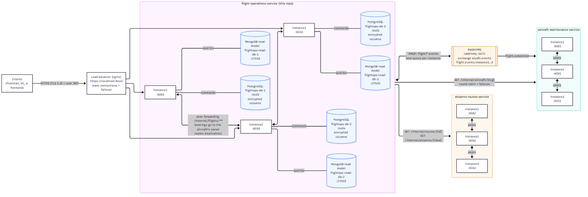
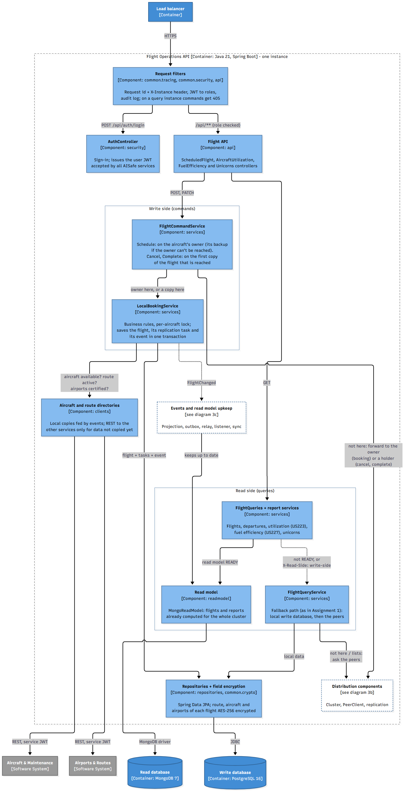
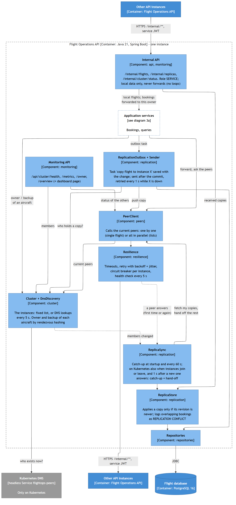
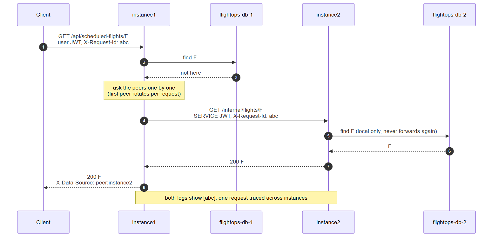
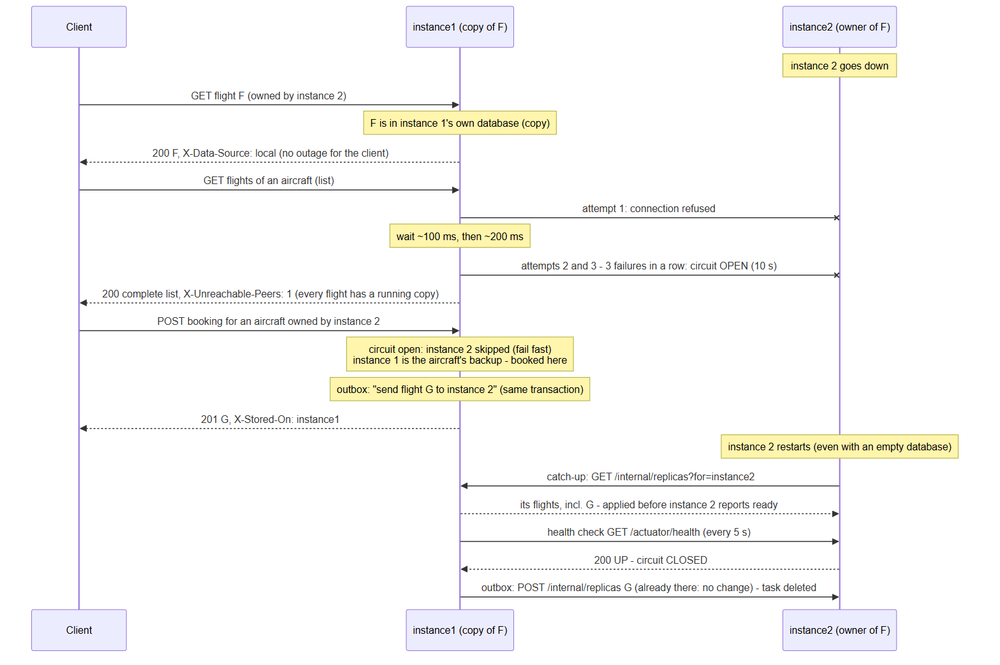
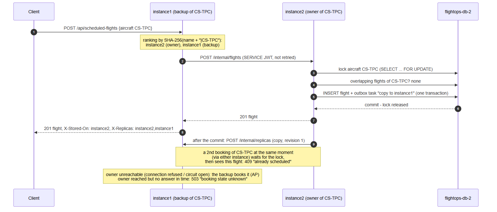
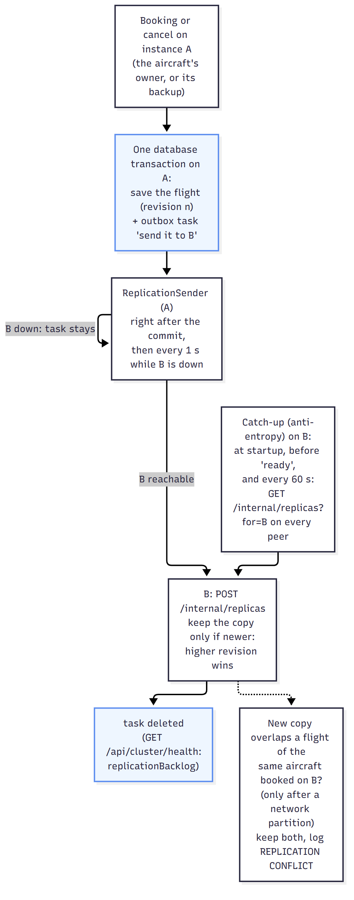
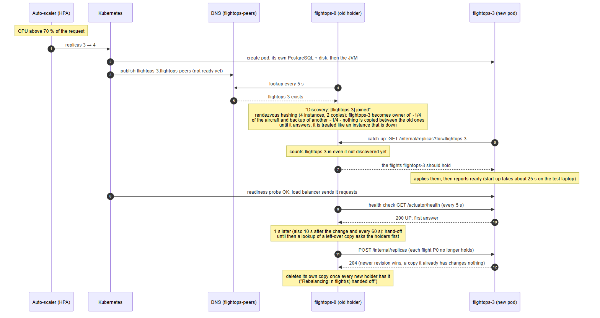

# Flight Operations – architecture notes

Contents: [System architecture (p.20)](#system-architecture-pl3-p20) · [Performance (p.21)](#performance-pl3-p21) · [Consistency model](#consistency-model) · [CQRS (Assignment 2)](#cqrs-assignment-2) · [Horizontal scaling](#horizontal-scaling) · [Kubernetes and auto-scaling](#kubernetes-and-auto-scaling)

## System architecture (PL3 p.20)

The full C4+1 model (context, containers, components, code, scenarios, deployment) is in [c4-model.md](c4-model.md).

Three components, each running as **3 instances** with their **own database**. Instances of the same component
forward GET requests to each other (peer forwarding); components call each other over HTTPS with a service token.
Flight Operations keeps every flight on **two instances** (replication), so the data of a stopped instance stays
available.
Diagram sources: `docs/diagrams/*.mmd` (Mermaid); images regenerated with
`npx @mermaid-js/mermaid-cli -i <file>.mmd -o <file>.png -b white -s 2`.

### 1. The system



### 2. Inside one instance (C4 level 3)

A client request:



Working with the other instances:



### 3. HTTP GET forwarding (PL3 p.11)



### 4. Failure and automatic recovery (PL3 p.14)



### 5. A booking is made on the aircraft's owner and copied to its backup (P1 p.15, sharding by registration)



### 6. Replication: how a change reaches every copy (P1 p.11, eventual consistency)



### Key architectural benefits (PL3 p.20)

| Benefit | How this system provides it | Limit (honest) |
|---|---|---|
| **High availability**: the service continues if instances fail | 3 instances per component behind a load balancer (nginx, or the Kubernetes Service: health-aware, fails over to another instance); any instance answers any request (stateless JWT); every flight kept on 2 instances, so a failed instance's data is still served from its copies; retries, circuit breaker; Docker / Kubernetes restart an instance whose process stops; a restarted instance catches up before taking traffic | With 2 copies, losing **both** holders of an aircraft at once makes its flights unavailable until one is back |
| **Horizontal scalability**: add instances as load grows | Kubernetes auto-scaler (3 to 5 instances, by CPU) with DNS service discovery; aircraft sharded over the instances by rendezvous hashing (adding one only moves the aircraft it wins, and their flights are copied to it automatically); requests spread by the load balancer | Reads that need *every* instance (utilization, fuel reports) do not get faster with more instances (load test, "Horizontal scaling" below) |
| **Fault isolation**: a problem in one instance doesn't cascade | Separate process + separate database per instance; timeouts on every remote call; circuit breaker stops calling a failing instance (no waiting on it, no flooding it); replication runs on its own thread, so a dead peer never slows down requests | Instances of one component share the same code, so a bug can affect all of them |
| **Geographic distribution**: instances in different regions | Instances only need each other's URL (peer lists, service URLs) and talk over HTTPS, so they could run anywhere | Not deployed that way; forwarding across regions would add real network latency to every forwarded request (see Performance) |

## Performance (PL3 p.21)

Measured with `./loadtest/performance.sh latency` and `./loadtest/performance.sh availability` (k6 in Docker;
every flight-ops instance limited to 1 CPU, HTTPS, PostgreSQL per instance; all on one laptop).
Raw output: `loadtest/results/latency.txt`, `loadtest/results/availability.txt`.

### Local vs forwarded response time

Each request looks up a flight either on the instance that stores it (**local**) or on the other one
(**forwarded**: one extra HTTPS call to the peer + its database lookup). Every answer was checked to really be
local / forwarded (`X-Data-Source` header): 100 % of 61 000 checks passed (run of 2026-10-02, after sharding by aircraft).

| | Local | Forwarded | Slide reference |
|---|---|---|---|
| 1 user, average (pure latency) | **2.5 ms** | **5.4 ms** | ~50 ms local, ~200 ms forwarded |
| 1 user, median / p95 | 1.9 / 3.8 ms | 4.0 / 9.5 ms | |
| 5 users (~264 req/s), average | 11.2 ms | 25.2 ms | |
| 5 users, median / p95 | 4.3 / 72 ms | 9.2 / 80 ms | |

* A forwarded request costs about **2×** a local one: the extra network hop and the peer's work (confirms quiz Q6:
  forwarded requests have higher latency).
* Both are far below the slide's reference values because all instances run on **one machine**: the "network" is
  local, a few tenths of a millisecond. Between machines or regions every forwarded request pays the real network
  round trip (~1 ms in a data centre, 20–150 ms between regions), which is why the slide expects ~200 ms.
* Under load the p95 of both rises to ~70–80 ms: that is queueing on a 1-CPU instance, not forwarding.

### Availability while an instance fails

*Measured on 2026-10-02 **before replication** (one copy of each flight). This is the measurement that showed the
gap replication now closes; see the end of this section.*

A steady 20 requests/s for 150 s, each asking for a random flight (half the flights are stored on each instance).
Instance 2 is **killed** (like a crash) at ~30 s and started again at ~50 s; it is ready ~30–45 s later.
`./loadtest/performance.sh availability` sends each request to a random instance;
`./loadtest/performance.sh availability-lb` sends everything to the **load balancer** (nginx).

| Window | Random instance, first try | Random instance + client failover | **Through the load balancer** |
|---|---|---|---|
| 0–30 s (both up) | 100 % | 100 % | 100 % |
| while instance 2 is down | ~25 % | ~50 % | **~50 %** |
| after instance 2 is back | 100 % | 100 % | 100 % |
| **Whole run (150 s)** | **65.5 %** | **76.3 %** | **84.5 %** |

"Client failover": when the instance asked first cannot be reached, the client asks the other one. The load
balancer does that for every client: in the run through it **no request reached the dead instance**
(`fail_instance_down = 0`); nginx notices the failure on the first request, retries it on instance 1 and leaves
instance 2 out for 10 s at a time. (The higher whole-run figure is also helped by a shorter outage in that run.)

What still failed during the outage was the **flights stored on instance 2**: the reachable instance answered 404
"could not be reached" for them (since then `503 Service Unavailable`: see "Status codes" below). Instance 1's own data stayed 100 % available the whole time, and recovery was
automatic: as soon as instance 2 answered again, everything was back to 100 % within one 10-s window.

**With replication** every flight is also on the other instance, so those reads are answered from the copy:
`ReplicationIntegrationTest` and the Postman folder "03 Resilience" check that a stopped instance's flights are
still returned (200, complete lists), that bookings for its aircraft go to the backup, and that the instance catches
up when it restarts with an empty database.

Measured again on 2026-10-07 with replication on (2 instances, through the load balancer,
`loadtest/results/availability-lb.txt`): **100 % of the 3 001 requests succeeded**, in every 10-s window,
including the ~20 s while instance 2 was down (0 failed HTTP requests). The slowest request took 2.0 s: the one
nginx sent to the dead instance before noticing (`proxy_connect_timeout 2s`) and then retried on instance 1.

### What 99.9 % would need (slide: "with proper instance distribution and health monitoring")

99.9 % allows ~43 minutes of failures per month. With a single instance failure, this system reaches 100 % for the
data of the surviving instance, but not for the whole service. The three gaps and their fixes:

| Gap | Effect measured | Status |
|---|---|---|
| Clients send requests to a dead instance | 25 % → 50 % during the outage | **Done**: nginx load balancer (`lb/nginx.conf`), passive health checks + failover |
| A crashed instance stays down | length of the outage | **Done** for crashes: `restart: unless-stopped` + container health check (a process that exits is back in ~12 s). A *killed* container or a dead machine still needs an orchestrator (Kubernetes / Swarm, PL3 p.25 "later") |
| Each flight exists on one instance only | the other 50 % (404 for the dead instance's data) | **Done**: every flight is kept on 2 instances (owner + backup), copied through a transactional outbox and repaired by a catch-up at startup and every 60 s. See "Consistency model" |

With replication factor 2 on top of the load balancer, one instance down no longer makes any flight unavailable; what
is left is the moment nginx takes to notice the failure (it retries that request on the other instance).

### Other considerations from the slide

* **Request timeouts**: every remote call has one (peers 1.5 s, forwarded bookings 10 s, other services 2 s,
  health checks 1 s, load balancer 2 s to connect / 15 s to answer), and the
  circuit breaker turns a dead instance from "wait for the timeout" into "skip immediately" (diagram 4).
* **Caching**: forwarded lookups could be cached for a few seconds to save the extra hop, at the cost of possibly
  serving a stale status (e.g. a flight cancelled on the other instance a moment ago). Not done: correctness of the
  flight status was preferred over the ~4 ms saved.
* **Geographic placement**: put the instances that forward to each other close together (same region), or place
  each aircraft's copies in different regions (rendezvous hashing could rank instances per region) so reads stay
  local and a whole region can fail.

## Consistency model

*(Assignment 1: "documentation of design decisions, consistency model and fault-tolerance mechanisms")*

### In one sentence

Every flight is kept on **two instances** - its aircraft's **owner** and a **backup** - and changes reach the other
copy shortly after they are made (**eventual consistency**). Bookings of an aircraft are made on one instance at a
time, so "no double-booking" is exact unless the two holders are cut off from each other; during failures the
system prefers **availability** (AP in CAP).

### How data is placed

* **Partitioned by aircraft** (P1 p.15 "data-based sharding: partition by operational identifiers, e.g. aircraft
  registration numbers"). Every instance knows the list of all instances (`flightops.cluster`) and ranks them for
  each aircraft with **rendezvous hashing** (SHA-256 of instance name + registration): all instances agree on the
  ranking without talking to each other, and adding an instance only moves the aircraft it wins.
* **Replicated** (P1 p.2 "redundancy-based fault tolerance", P1 p.10 "redundancy"). The first
  `flightops.replication.factor` instances of the ranking (default **2**) keep the aircraft's flights: the first is
  the **owner**, where bookings go; the second is the **backup** (`GET /api/cluster/owner/{reg}` shows both, and a
  booking's `X-Replicas` header lists them). Not every instance holds everything: with 3 instances each one holds
  about 2/3 of the aircraft (`ClusterTest`), matching the practical session's answer that instances do **not** keep
  identical copies of all data (PL3 p.24, quiz Q3). With 2 instances the backup of every aircraft is the other one.
* **No ID clashes.** Flight numbers are UUIDs, generated independently on each instance, so two instances can never
  create the same id (PL3 p.18 "Data inconsistency: same ID on multiple instances"). Sample flights get the same
  fixed number on every instance that loads them, so their copies match.
* **Snapshots of other services' data.** When a flight is scheduled, the aircraft model, route distance and airports
  are copied into it. They describe the flight *as scheduled* and are not updated if the aircraft or route changes
  later (deliberate: a scheduled flight keeps the data it was validated against).

### How a change reaches the other copy (diagram 6)

1. **Transactional outbox.** The instance that makes a change (booking or cancel) saves the flight *and* a task
   "send flight F to instance B" in the **same database transaction** (`replication_outbox` table,
   `ReplicationOutbox`). A change is therefore never stored without being queued for its other copy - not even if
   the process crashes right after the commit.
2. **Delivery.** `ReplicationSender` sends the flight's current state right after the commit
   (`POST /internal/replicas`) and deletes the task. While B is down the task stays and is retried every second;
   `GET /api/cluster/health` shows what is waiting (`replicationBacklog`).
3. **Versions.** Every flight has a `revision` that grows with each change (a cancel raises it). A copy only replaces
   the one an instance has if it is **newer** (higher revision; on a tie the later status, since a flight only goes
   from SCHEDULED to CANCELED/COMPLETED). Applying the same copy twice, or old copies arriving late, changes nothing,
   so all copies end up equal whatever order the messages arrive in (`ReplicaStoreTest`). PL3 p.18 names this
   option: "data versioning".
4. **Catch-up (anti-entropy).** At startup - *before* the instance reports ready - and then every 60 s, each
   instance asks its peers for the flights it should hold (`GET /internal/replicas?for=<me>`) and applies whatever
   it is missing or has an older version of. A restarted instance catches up even if it lost all its data
   (in-memory H2), and a new instance fetches its share when added. This also repairs anything the outbox could
   not deliver.

The window of inconsistency is short: a copy normally arrives within milliseconds; while an instance is down, its
copies arrive when it is back (in practice before it accepts traffic, thanks to the startup catch-up).

### Status codes: 404 or 503?

`404 Not Found` says **the resource does not exist**; `503 Service Unavailable` says **we can't tell right now,
try again later** (RFC 9110 15.5.5 / 15.6.4). An instance answers 404 only when it could ask every place the
resource may be (teacher's feedback at the A1 defense; PL3 p.11 used 404 for both cases).

* **One flight** (`GET /api/scheduled-flights/{n}`, `PATCH .../cancel`): the flight number doesn't say which
  aircraft it belongs to, so every instance is asked. Every flight is on `REPLICATION_FACTOR` instances. If fewer
  peers than that did not answer, at least one copy of every flight was asked: not found = `404`. If at least that
  many did not answer (with 2 copies and 3 instances: two instances down), all its copies may be there: `503`.
  With `REPLICATION_FACTOR=1`, one instance down is already enough for a `503`.
* **One aircraft's report** (`GET /api/aircraft-utilization/{reg}`, `/api/fuel-efficiency/aircraft/{reg}`):
  nothing found, this instance isn't one of its holders and the same rule says its holders may be among the
  unreachable ones: `503`.
* **Another service** (Aircraft & Maintenance, Airports & Routes): `404` only when the service itself answered 404;
  if none of its instances answers, `503`.
* **Lists** (flights of an aircraft, departures, reports of all aircraft) stay `200` with what the reachable
  instances have, flagged with `X-Unreachable-Peers` / `X-Partial-Result` (P1 p.12 "partial response scenarios").
* Every `503` carries `Retry-After: 10`, the time an open circuit breaker waits before trying the instance again.
* `201 Created` (a booking) carries `Location: /api/scheduled-flights/{n}`, the URL of the new flight.

### What a client can rely on

| Operation | Guarantee | Why |
|---|---|---|
| Read one flight (`GET /api/scheduled-flights/{n}`) | **200 while at least one copy is reachable**; `503` (+ `Retry-After`) if every copy may be on instances that don't answer; `404` only when it really doesn't exist | From the read model (`X-Data-Source: read-model`, see [CQRS](#cqrs-assignment-2)); if it is not there yet, or the read model can't be used, from the local copy (`local`) or forwarded to a peer that has one (`peer:<url>`) |
| Read your own write | **Yes** on the instance that received the change, at once; a single flight **from any instance**; lists on other instances **after a short delay** | The change is in the receiving instance's read model before the `201`/`200`; a single flight not yet in a read model is looked up on the write side; other read models get it at their next sync (see CQRS) |
| Cancel a flight | **Applied once per copy**; a second cancel is `409` | Made on one copy and replicated; `@Version` optimistic locking on each instance |
| Lists and reports (flights of an aircraft, departures, utilization, fuel) | **Every flight of the cluster, as of the read model's last update** (`X-Read-Model-Updated`); without a usable read model: **complete while fewer instances are down than there are copies**, `X-Unreachable-Peers: n` / `X-Partial-Result: true` as before | From this instance's read model, which holds every flight; fallback: scatter-gather over all instances, duplicates merged (newest wins) |
| "An aircraft is never in two flights at the same time" | **Guaranteed** while the aircraft's owner - or, if it is down, its backup - takes the bookings; **reported, not prevented** if the two holders are cut off from each other and both accept one | All bookings of an aircraft go to its first reachable holder, where the per-aircraft lock serialises them |

### The weak spot: double-booking an aircraft

The booking is made on the aircraft's **first reachable holder** (forwarded there if it arrived elsewhere). That
instance:

1. **locks the aircraft** on its own database: a row per aircraft in `aircraft_booking_lock`, locked with
   `SELECT ... FOR UPDATE` until the booking's transaction commits (`services.AircraftBookingLocks`). A second
   booking for the same aircraft on this instance waits, and then sees the first one's flight;
2. checks its **own** database for overlapping flights of that aircraft - with replication this includes the
   copies of the flights booked on the other holder, and
3. checks its **peers**, by asking them for that aircraft's active flights.

**Fixed: two bookings at the same moment on the same instance.** Locking the overlapping *flights* (the PSOFT
monolith's approach) is not enough: when there is no overlapping flight yet, there is nothing to lock, so both
bookings passed the check. `ConcurrentBookingTest` sends 2 simultaneous overlapping bookings, 20 times: before the
fix **both succeeded in all 20 rounds**; with the aircraft lock exactly one succeeds every time (also checked over
HTTP on PostgreSQL: 20 × "201 + 409"). If the lock can't be obtained within 10 s the booking gets a `409`
"another booking for this aircraft is in progress".

**Fixed: two bookings at the same moment on different instances.** Both are forwarded to the aircraft's owner,
whose lock lets only one through. `TwoInstancesIntegrationTest` sends simultaneous overlapping bookings of the same
aircraft to instance 1 *and* instance 2, 10 times: exactly one `201` and one `409` every time (Postman folder
"09 Sharding by aircraft" does the same).

**Owner down: the backup takes over.** If the booking certainly did not reach the owner (connection refused,
circuit open), the next holder - the backup - makes it. It holds copies of the aircraft's flights, so its overlap
check is just as complete as the owner's would have been. If the owner *was* reached but did not answer in time,
the outcome is unknown, so the client gets `503 "the booking may or may not have been made"` instead of risking a
second booking.

**Both holders down: the instance that received it takes it.** If none of the aircraft's holders can be reached
(connection refused, circuit open), the instance that received the booking makes it itself - availability first -
with the overlap check it can still do (its own database and the peers that answer), so that check is only best
effort. The booking is queued in its outbox for the holders; when they are back they receive it, and a holder that
already has an overlapping flight logs `REPLICATION CONFLICT` (as for a partition, below). The receiving instance
then hands its left-over copy off: sent to the holders, deleted once every holder has it (Postman folder 11c-11d).

**What remains: a network partition.** If owner and backup are both running but cannot reach each other, a client
on each side can book the same aircraft for the same time, and both bookings succeed (availability first). When the
copies meet, the instance receiving the second one notices the overlap and logs
`REPLICATION CONFLICT: aircraft ... has overlapping flights ...` (metric `flightops.replication{event=conflict}`).
Both flights are kept - nothing is lost or silently overwritten - and an operator cancels one of them.

**How it could be made fully consistent** (not implemented): **refuse instead of guess** - accept a booking only
when a majority of the aircraft's holders confirm it (a quorum, e.g. R + W > N with 3 copies). That turns bookings
from AP into CP: always correct, but bookings of that aircraft stop when the holders can't reach each other.

### During a failure (CAP)

With one instance down (a partition from the others' point of view):

* its flights are **still readable** from their copies, lists stay complete (Availability); the response says that a
  peer did not answer (`X-Unreachable-Peers`);
* bookings for its aircraft are taken by their backups (Availability), and queued for it in the backups' outboxes;
* the others keep working without waiting for it: the circuit breaker skips it after 3 failures (Partition
  tolerance).

When the instance comes back, it **catches up before it reports ready** (startup anti-entropy), then receives the
queued copies (no change, they are already there) - measured in "Availability while an instance fails" above, and
shown by `ReplicationIntegrationTest` and the Postman folder "03 Resilience".

Replication can be switched off (`REPLICATION_FACTOR=1`): then each flight has a single copy and the system behaves
as in the week-3 practical session (PL3 p.16 test 03: data whose instance is down can't be read, `X-Partial-Result`),
except that the lookup answers `503`, not `404` (see "Status codes").
The two-instance integration test runs that way to check the plain forwarding on its own.

## CQRS (Assignment 2)

*(Assignment 2, P2 p.2: "Adopt the Command-Query Responsibility Segregation (CQRS) pattern for the core domain
resources", "Evidence of independent read and write models (CQRS) and of data isolation across service instances".)*

### In one sentence

**Commands** (book, cancel, complete) change the **write model** - PostgreSQL, sharded by aircraft with two copies, exactly as
in Assignment 1 - and **queries** are answered from a **read model**: a separate **MongoDB** database per instance
that holds **every flight of the cluster** and the reports already computed, kept up to date by the write side's
events (eventual consistency).

### The two sides

| | Write side (commands) | Read side (queries) |
|---|---|---|
| Code | `services.FlightCommandService` handles `ScheduleFlightCommand` / `CancelFlightCommand` / `CompleteFlightCommand`; `LocalBookingService` applies them | `services.FlightQueries` (and the report services) read `readmodel.ReadModel` |
| Endpoints | `POST /api/scheduled-flights`, `PATCH .../{n}/cancel`, `PATCH .../{n}/complete` | every `GET` of flights and reports |
| Database | PostgreSQL, one per instance (`flightops-db-<i>`) | MongoDB, one per instance (`flightops-read-db-<i>`) |
| What each instance holds | only its aircraft's flights (owner + backup copies) | every flight of the cluster |
| Shape | normalised rows, transactions, a lock per aircraft (no double-booking) | one document per answer: `flights`, `aircraft_stats` (utilization by month, fuel), `route_stats` |
| Consistency | strong per aircraft (its holder serialises bookings) | eventual: at once on the instance that made the change, milliseconds later elsewhere (broker), at worst the sync interval |

### How the read model is kept up to date

1. Every change on the write side ends with a domain event, `events.FlightChanged`, published in the change's
   transaction: a booking or cancel made here, a copy received from another instance (replication), or a change a
   peer made for this request (a booking forwarded to the aircraft's owner - its answer is published here too).
2. `readmodel.ReadModelProjection` applies it **after the transaction commits** (`@TransactionalEventListener`), so a
   rolled-back change never reaches the read model, and it runs in the request's thread: the client reads its own
   change back at once from this instance.
3. `readmodel.ReadModelSync` repairs everything else: at startup (before the instance reports ready), every
   `flightops.read-model.sync-interval-ms` (30 s), every 5 s while the model is not READY and shortly after a peer
   becomes reachable, it rebuilds the read model from the write side of every instance (`GET /internal/flights/all`).
   It is the safety net: normally an instance learns the changes it was not involved in from the **message broker**
   within milliseconds ([Messaging](#messaging-assignment-2)): the instance that made the change publishes it, and
   every other instance projects it into its read model.

**Idempotent, in any order.** A flight's document is only replaced by a **newer** state - higher `revision`, or the
same revision and a later status: the rule the write side already uses for copies. The condition is part of the
upsert, so it is atomic. Applying the same change twice, or an old change after a newer one, changes nothing.
**Reports are recomputed, not incremented**: when a flight of CS-TPA changes, `aircraft_stats` of CS-TPA is computed
again from the `flights` collection. A "+1" would count a repeated event twice.

### Which side answered (evidence)

| Response header | Meaning |
|---|---|
| `X-Read-Side: read-model` | answered from this instance's read database |
| `X-Read-Side: write-side` | answered as in Assignment 1 (local copy or forwarded to the holders) |
| `X-Read-Model` | `READY`, `BUILDING`, `STALE: <reason>` or `DISABLED` (no read database configured) |
| `X-Read-Model-Updated` | when the last change was applied to the read model: how fresh the answer is |
| `X-Data-Source: read-model` | for a single flight, next to the A1 values `local` / `peer:<url>` |

A client that must see every change already made (e.g. right after making it on another instance) sends
**`X-Read-Side: write-side`** and gets the write side's answer. `GET /api/cluster/health` and the dashboard show
each instance's read model state; `GET /api/cluster/metrics` counts the lookups answered by the read model.

### Failures

| Failure | What happens |
|---|---|
| Read database of an instance down | Queries fall back to the write side within ~2 s (short Mongo timeouts), then at once (`X-Read-Model: STALE: read database unavailable`); commands are not affected. When it is back, the next sync rebuilds the read model and it is READY again |
| Write database down | Commands fail as before; queries keep being answered from the read model |
| An instance down | The other read models still have its flights (they hold every flight); a sync during the outage stays READY while fewer instances are down than there are copies, otherwise STALE and queries use the write side (which then answers `503` for data it can't reach) |
| Instance restarted with an empty read database | Rebuilt by the startup sync before the instance reports ready, so it never answers from an empty read model |
| A change that never reached a read model (broker down, event lost) | Repaired by the next sync |

### Decisions and alternatives

* **Separate database for reads (chosen) vs. separate models on the same database.** Two classes over the same
  table (or two tables in one PostgreSQL) would already split the code, but reads and writes would still compete for
  one database and fail together. A database of its own makes the read side independent: it can fail, be rebuilt or
  be scaled without touching the write side, as the failure table shows.
* **MongoDB (chosen) vs. a second PostgreSQL.** A read model is denormalised on purpose - each document is the answer
  (an aircraft's report embeds its months; in SQL that is a second table and a join on every read) - and it can be
  thrown away and rebuilt from the write side, so a fixed schema brings nothing. A different technology also makes
  sharing tables or entities between the two sides impossible ("polyglot persistence"). PostgreSQL stays on the
  write side: the per-aircraft lock and the overlap check need its transactions.
* **Every instance has the whole read model (chosen) vs. a read model sharded like the write side.** Sharded, every
  list would still be a scatter-gather over all instances. Whole, every query is local - the reason to separate reads
  from writes here. The cost: each instance stores every flight, and lists elsewhere are eventually consistent.
* **No event sourcing.** The write side keeps the current state, as in Assignment 1; events are only used to update
  the read model. Event sourcing (storing the events as the source of truth) would allow replaying history, but would
  change the whole write side and its replication.
* **Fallback to the write side vs. `503` when the read model can't be used.** Availability first, as in Assignment 1
  (AP): the fallback is slower, but its data is fresher, never older.
* **Encryption at rest on the read side too.** Registration, model, route and airports are stored encrypted with the
  same deterministic scheme as the write database, so the indexes (by aircraft, by airport) still work.

## Messaging (Assignment 2)

*(Assignment 2, P2 p.2: "AMQP and a message broker" for the communication between services; the external API stays
REST. RabbitMQ as in the classes' tutorial: `rabbitmq:3-management`, tutorials 1-6, best practices.)*

### In one sentence

Every change a flight-ops instance makes is stored together with its **event** (transactional outbox), published to
the topic exchange **`aisafe.events`** and confirmed by the broker. Every instance, and every other service, has
**its own queue** bound to it (publish/subscribe), so each one receives every event and reacts to it: the other
flight-ops instances update their read models, Aircraft & Maintenance adds the flight hours of `flight.completed`.

### Topology

```
                         aisafe.events (topic, durable)
flight-ops instance --->   flight.scheduled | flight.cancelled | flight.completed
  (outbox + relay)            | flight.#               | flight.#                  | flight.#
                              v                        v                           v
               flight.events.instance1   flight.events.instance2   aircraft.events.<instance>
                              |                        |                           |
                     read model of 1          read model of 2       flight hours (Aircraft & Maintenance)

failed / expired / overflow --> aisafe.dlx --(flight.events.dlq)--> flight.events.dlq
```

| | |
|---|---|
| Broker | one RabbitMQ for the whole system (`rabbitmq` in docker-compose, port 5672, UI 15672; `k8s/rabbitmq.yaml`) |
| Exchange | `aisafe.events`, topic, durable: every service publishes its events there (`<entity>.<what happened>`) |
| Queues | `flight.events.<instance>`, durable, one per instance, bound to `flight.#`; at most 100 000 messages, each kept 1 day; the queue is removed after 7 days without a consumer |
| Dead letters | `aisafe.dlx` -> `flight.events.dlq` (kept 7 days) |
| Contract | `docs/service-contracts.md` "Events": routing keys, JSON fields, rules for publishers and consumers |

### Publishing: outbox, relay, publisher confirms

1. The write side publishes `FlightChanged` in the change's transaction (as for CQRS). It says whether this instance
   **made** the change (`madeHere`) or only learnt it (a copy, a peer's answer). Only the instance that made it
   announces it, so every change is published once.
2. `messaging.EventOutbox` stores the event as an `OutboxMessage` (table `event_outbox`, payload encrypted at rest)
   **just before the transaction commits, in it**. Change and event are saved together or not at all: no event for a
   rolled-back change, no change without its event.
3. `messaging.EventRelay` (its own thread) sends the waiting events in order right after the commit and every second,
   as persistent messages, and **waits for the broker's confirmation** (publisher confirms) before deleting them. If
   the broker is down they wait; nothing is lost.

`eventId` is derived from the change (flight, revision, status), so an event sent twice has the same id.

### Consuming: ack after processing, idempotent, dead letters

`messaging.FlightEventListener` reads this instance's queue and projects each event of **another** instance into the
read model. Its own events come back too and are skipped (already projected after their commit).
* **Acknowledged after processing** (Spring AMQP AUTO mode: the ack is sent when the method returns).
* **Idempotent**: the read model keeps the newest revision, so a duplicate or a late event changes nothing. No table
  of processed ids is needed.
* A message that can't be read is tried **3 times** (0.5 s, then 1 s apart), then **rejected without requeue** and
  goes to `flight.events.dlq`. No message is retried forever (RabbitMQ best practices: "Use dead letter exchanges for
  failed messages").
* A read database that is down does not reject the message: the read model turns STALE, queries use the write side,
  and the sync rebuilds it. The write side is the source of truth.

### Consistency

Eventual, with a much smaller window than before: the instance that made the change sees it at once (projected after
its commit), the others **milliseconds** later (push), and at worst after the 30 s sync (pull) if an event is lost.
Order doesn't matter (newest revision wins). Delivery is **at least once**; duplicates are harmless.

### Failures

| Failure | What happens |
|---|---|
| Broker down | Bookings, cancels and queries keep working (the broker is not part of `/actuator/health`). Events wait in each instance's outbox (`messaging.outbox` on `/api/cluster/health`) and go out when it is back; meanwhile the 30 s sync keeps the read models up to date |
| Broker restarted | Durable exchange and queues, persistent messages: the queued events survive. The instances reconnect by themselves and declare the topology again |
| An instance down | Its queue keeps the events (durable, 1 day each); it reads them when it is back, after its startup sync, so they only change what is not newer |
| Crash after the broker confirmed, before the outbox row is deleted | The event is sent again with the same `eventId`; consumers ignore it |
| A message that can't be processed | 3 attempts, then the dead-letter queue (`messaging.deadLetters` on `/api/cluster/health`) |
| Queue full or message too old | Dead-lettered (limits: 100 000 messages, 1 day); the read model is repaired by the sync |
| Broker stops answering (paused, network cut) | Calls give up after 5 s (RPC and publisher-confirm timeouts), and heartbeats every 10 s notice the dead connection: nothing hangs for minutes |

### Evidence

* `GET /api/cluster/health` -> `messaging`: broker up, this instance's queue and its depth, its consumers, dead
  letters, events waiting in the outbox ("monitor queue depth").
* `GET /api/cluster/metrics` -> `messages`: published, received, ignored (own), failed, per routing key.
* The dashboard shows a "Broker (AMQP)" chip per instance; RabbitMQ's UI (http://localhost:15672) shows the exchanges,
  the queues and the message rates.
* Postman folder 13 and `MessagingIntegrationTest`.

### Decisions and alternatives

* **Publish/subscribe, one queue per instance (chosen) vs. one shared queue (work queues).** A shared queue hands each
  event to *one* instance (competing consumers, tutorial 2): right for tasks, wrong for state, because the other
  instances' read models would miss it. Every instance needs every change (tutorial 3, "state synchronization").
* **Transactional outbox (chosen) vs. publishing in the transaction or after the commit.** Sending inside the
  transaction announces changes that may still roll back. Sending after the commit loses the event if the instance
  stops in between, or if the broker is down at that moment. The outbox costs one row per change and a thread.
* **At least once + idempotent consumers (chosen) vs. exactly once.** Exactly once would need the broker and the
  database in one distributed transaction (2PC), which RabbitMQ does not offer. Idempotent processing gives the same
  result.
* **Replication of the write side stays HTTP (as in A1).** A copy must reach exactly the one or two instances that
  hold the aircraft, and the A1 outbox already retries per target. The broker carries what every instance and every
  service needs to know.
* **RabbitMQ (chosen) vs. Kafka.** RabbitMQ is the broker of the classes, and its queues with acks, dead letters and
  per-queue limits are what is needed here. Kafka (a log that can be replayed) would fit event sourcing, which is
  not used.
* **One broker node.** It is a single point of failure for the events only (see the table above): bookings and
  queries keep working and nothing is lost. A 3-node cluster with quorum queues would remove it.
* **JSON without type headers.** Consumers in other services don't need our Java classes (no `__TypeId__`), and
  unknown fields are ignored, so adding a field breaks no one.
* **`PATCH .../complete` (new command).** Aircraft & Maintenance consumes `flight.completed` (flight hours), so a
  flight can now be marked as landed: only a scheduled flight, and not before its departure.

## Horizontal scaling

### Instances and ports

Every component runs **3 instances**. The practical session suggests starting with 2 and scaling after load testing
(PL3 p.7); we moved to 3 (as recommended in class) because with only 2 instances and 2 copies of every flight both
instances hold *everything*, so the sharding and the peer-to-peer forwarding never really happen. With 3, each
instance holds about 2/3 of the aircraft (`ClusterTest`): reads of the other third are forwarded, and any one
instance can fail without any flight becoming unavailable.

| Component | Instance 1 | Instance 2 | Instance 3 |
|---|---|---|---|
| aircraft-maintenance-service | 8081 | 8091 | 8101 |
| airports-routes-service | 8082 | 8092 | 8102 |
| flight-operations-service | 8083 | 8093 | 8103 |

Port scheme: base port + 10 per extra instance. Each instance has its own database (data isolation), so instances
share nothing except the network: PostgreSQL containers `flightops-db-1/2/3` on host ports 5433/5434/5435
(in-memory H2 `flightops_db_1/2/3` when run without the `postgres` profile, e.g. in the automated tests).

### What makes it scalable

* **Stateless requests.** Authentication is a self-contained JWT, so there are no server sessions and any instance can
  serve any request.
* **Client-side load balancing.** Calls to another service rotate round-robin over its instances and fail over to
  the next one on timeout or 5xx (`ReplicatedServiceClient`).
* **Service discovery.** With docker-compose and the scripts: hardcoded lists, `CLUSTER` (all flight-ops instances,
  by name), `AIRCRAFT_SERVICE_URLS` and `AIRPORTS_ROUTES_SERVICE_URLS`. On Kubernetes: DNS (see "Kubernetes and
  auto-scaling"), so instances can be added and removed while the system runs.
* **Sharded and replicated data.** Each aircraft's flights are kept on 2 of the instances (owner + backup, by
  rendezvous hashing), not on all of them. Reads that need everything ask every peer and merge the answers, keeping
  the newest copy of each flight (scatter-gather, `FlightQueryService`).

### How to add an instance

On Kubernetes this is automatic (see "Kubernetes and auto-scaling"). With docker-compose or the scripts, by hand:

1. Start the new instance with its own port and database.
2. Give **every** instance (old and new) the same list of all instances in `CLUSTER`
   (`instance1=url,instance2=url,instance3=url`), and add the new one to the load balancer's upstream list.
3. Restart the existing instances so they pick up the new list. Aircraft are re-sharded by rendezvous hashing: only
   the aircraft the new instance wins move to it (~1/3 with 3 instances, `ClusterTest`). The new instance fetches
   the flights it should now hold from the others when it starts (catch-up), new bookings go to the new owner, and
   copies that an old instance no longer needs are handed off: sent to their holders, then deleted there (at startup
   and every 60 s, as on Kubernetes; kept while a holder is unreachable).

Limitation: with a hardcoded list, scaling needs a configuration change and restarts. On Kubernetes the instances
find each other through DNS instead, so the auto-scaler can add and remove them while the system runs.

### Load test

Tool: [k6](https://k6.io), run in Docker (`./loadtest/run.sh 2` and `./loadtest/run.sh 3`).

* **Workload:** 50 virtual users for 60 s, each request to a random instance (like a load balancer) and a random
  read endpoint: `/api/aircraft-utilization`, `/api/aircraft-utilization/CS-TPA`, `/api/fuel-efficiency/aircraft`,
  `/api/fuel-efficiency/routes`. All of them need the data of every instance, so they exercise the peer-to-peer
  path.
* **Conditions:**
  * Every flight-ops instance is limited to **1 CPU and 768 MB** (`loadtest/limits.yml`), to simulate one small
    machine per instance; all on one laptop.
  * HTTPS between all parties.
  * 2 × 30 s warm-up before measuring: on 1 CPU the JVM's JIT compilation otherwise dominates the first minute.

**Results (2026-10-02), each instance with its own PostgreSQL container:**

| Instances | Throughput | Median latency | p95 | p99 | Errors |
|---|---|---|---|---|---|
| 2 | **57 req/s** | 798 ms | 1.79 s | 2.29 s | 0 % |
| 3 | **57 req/s** | 766 ms | 2.08 s | 2.69 s | 0 % |

(An earlier run with in-memory H2 gave the same picture: 59 req/s with 2 instances, 53 with 3.)

Raw output: `loadtest/results/`.

### What the results mean

*(Measured before replication was added. With 2 copies the fan-out per request is the same - every instance is
still asked - so the conclusion below holds.)*

**For this workload, a third instance does not increase capacity.** Every request is a scatter-gather read:
the receiving instance does its local query *and* asks each of the other N−1 instances. The total work per request
therefore grows with N, at the same rate as the capacity added by the new instance, so throughput stays flat.

Conclusion: for *this* workload (only scatter-gather reports) more instances do not add throughput. We run 3 for
redundancy and so that the data really is sharded (see "Instances and ports"); the auto-scaler helps the requests
about one aircraft or one flight, which involve one or two instances only. For the reports, adding instances only
pays off once they stop fanning out to every peer:

1. **Route by owner.** Pick the instance that stores a flight from a hash of the aircraft registration (consistent
   hashing). Requests about one aircraft then go to one instance, with no fan-out, so capacity grows with N. This
   also removes the double-booking race, because all bookings for an aircraft are serialised on one instance.
2. **Replicate** (done for redundancy, with 2 copies): reads of one flight are now answered locally more often, and
   a flight survives the loss of the instance that holds it. Lists still ask every instance; answering them from
   the local copies only would need every instance to hold everything (more copies, more expensive writes).
3. **Cache aggregates.** Utilization and fuel reports change rarely; caching them for a few seconds per instance
   removes most of the fan-out.

### Performance problems found by load testing (fixed)

| Problem | Effect | Fix |
|---|---|---|
| JDK `HttpClient` completes responses asynchronously; on 1 CPU the JDK runs those completions on a **new thread per call** | thread creation dominated CPU | Apache HttpClient 5 (synchronous, pooled), pool sized explicitly (default is only 5 connections per peer) |
| jjwt does a ServiceLoader scan every time a parser or builder is created; the code built a parser 3× per request and signed a new service token per call | high CPU per request | parser built once and each token parsed once; service tokens cached (5 min lifetime, renewed 1 min before expiry) |
| Short runs on a cold JVM | numbers ~3× too low | warm-up runs before measuring |

## Kubernetes and auto-scaling

PL3 p.25 lists, for later, container orchestration (Kubernetes) and dynamic service discovery instead of hardcoded
peer lists. Both are in `k8s/` (run: `./k8s/deploy.sh`, see the README).

| Concern | docker-compose | Kubernetes (`k8s/`) |
|---|---|---|
| Instances | 3 fixed containers | StatefulSet `flightops`: pods `flightops-0..N-1`, N set by the auto-scaler (3 to 5) |
| Finding the peers | fixed list `CLUSTER` | DNS: every 5 s each instance looks up `flightops-{i}.flightops-peers` for i = 0..9 (`DnsDiscovery`); the headless Service publishes one name per pod |
| Database per instance | separate container `flightops-db-i` | second container in the same pod, with the pod's own disk (a new pod brings its database) |
| Load balancer | nginx, fixed upstream list | Service of type LoadBalancer (https://localhost:9443), follows the pods; only ready pods get traffic |
| Health and restarts | Docker health check, `restart: unless-stopped` | startup / readiness / liveness probes (Spring Boot); Kubernetes restarts or recreates pods |
| Secrets | environment variables with dev defaults | Kubernetes Secrets created by `deploy.sh` |

**Why a StatefulSet and not a Deployment.** Rendezvous hashing ranks instances by name, so a name must stay the same
when its pod restarts (otherwise every restart would move aircraft). A StatefulSet gives each pod a stable name, a
stable DNS entry and its own disk. The names are predictable (`flightops-0`, `-1`, ...), which is what makes DNS
discovery simple.

**Auto-scaling** (`k8s/hpa.yaml`): a HorizontalPodAutoscaler measures the CPU of the application containers
(metrics-server) and keeps 3 to 5 pods, adding one when the average passes 70 % of the requested CPU and removing
one after 2 minutes of low load. It changes one pod per minute, so each change is rebalanced before the next one.

**When a pod joins** (e.g. `flightops-3`):



1. Kubernetes creates the pod; the headless Service publishes `flightops-3.flightops-peers` straight away
   (`publishNotReadyAddresses`), before it is ready.
2. Within 5 s the other instances see it (log: `Discovery: [flightops-3] joined`). With 4 instances and 2 copies,
   rendezvous hashing makes it the owner of about 1/4 of the aircraft and the backup of another 1/4 (it holds about
   half); no flight is copied between the old instances. Until it answers it is
   treated like an instance that is down: the backups take its bookings, the outbox keeps its copies.
3. While starting, before it reports ready, it asks every peer for the flights it should hold (catch-up). A peer
   that has not discovered it yet still counts it in (`Cluster.replicasOf(registration, instance)`).
4. As soon as the new pod answers its first health check (1 s later), and also 10 s after the change and every
   60 s, every instance runs the catch-up again and **hands off** the flights it no longer holds: it sends them to
   their current holders and deletes its own copy once every holder has it (if one can't be reached, it keeps the
   copy and tries again later).
5. Until the hand-off, a lookup or cancel that reaches such a **left-over copy** goes to the aircraft's holders first
   (`FlightQueryService.isLeftover`); the copy is only used if no holder answers (AP: an old copy rather than an
   error). So a client never gets an out-of-date flight while a holder is reachable.

**When a pod leaves** (scale-down): each of its flights is also on another instance (replication factor 2). The
others notice within 5 s, and 10 s later the new holders fetch those flights from the instance that still has them.
Its disk is deleted (`whenScaled: Delete`): everything on it exists elsewhere.

**Tested on Docker Desktop (Kubernetes v1.36.1, kubeadm, 2026-10-16)** with `./k8s/deploy.sh --stub`:

* The 3 pods were ready 46 s after the deploy; each found the other two through DNS and called them over HTTPS.
* Load: k6 with 30 virtual users through https://localhost:9443. CPU went to 400 % of the request; the auto-scaler
  added `flightops-3` (10:10) and `flightops-4` (10:11). The others saw each new pod within 5 s
  (`Discovery: [flightops-3] joined`), and one instance handed 3 flights off to their new holders.
  9 514 requests, **0 failed**, average 0.4 s, while pods were being added.
* After the load stopped, the auto-scaler removed `flightops-4` (10:13) and `flightops-3` (10:14), one per minute.
* Back at 3 pods, every one of the 10 sample flights was on exactly the 2 instances that `GET /api/cluster/owner`
  names (checked with `X-Data-Source: local` on each pod), and on no other.
* **Whole system, no stub** (`OTHER_INSTANCES=1 ./k8s/deploy.sh`: 3 flight-ops pods + 1 pod of each other service):
  every booking calls the real aircraft and airports/routes services. Valid bookings 201; unknown aircraft and
  unknown route 404; aircraft under maintenance, model not certified at the origin airport, deactivated route and
  an overlapping booking 409 - the same answers as with the stub data. Flight-ops saw both services healthy.
* Hand-off timing, re-tested after the improvement (2026-10-16, 3 to 4 pods): `flightops-3` finished starting at
  11:11:29, the others saw it answer at 11:11:32-34 and `flightops-2` handed it 4 flights at **11:11:35**, ~6 s after
  it started (before: up to 60 s, the next periodic catch-up). 8 s later nothing was waiting anywhere; back at 3 pods
  the 12 flights were again each on their owner and one backup.
* 5 pods used most of the laptop's 16 GB: `maxReplicas` stays at 5 here only because the test machine allows it.

**Limits (honest):**

* The hand-off to a new pod waits until it answers (start-up takes about 25 s on the test laptop, plus up to 5 s until the next health
  check). Meanwhile its aircraft are served by their other holder and left-over copies aren't answered while a holder
  can be reached, so nothing is lost or read out of date; if no holder can be reached, the left-over copy is used.
* Removing two pods at once could remove both holders of some aircraft before the rebalance. The auto-scaler removes
  one pod per minute, but `kubectl scale` by hand could do it.
* For ~15 s after a change instances may disagree on an aircraft's owner, so two of them could accept overlapping
  bookings; that overlap is reported as a replication conflict, as in a network partition ("Consistency model").
* The other two services run on Kubernetes with fixed peer lists (3 pods each, no auto-scaling).
