# Flight Operations – C4+1 model

The architecture of the Flight Operations service at four zoom levels (C4: Context, Containers, Components, Code),
plus the views of Kruchten's 4+1 model (logical, development, process, physical) and the scenarios that tie them
together (the "+1"). The other two AISafe services are shown as external systems: they belong to other teams.

Contents: [Notation](#notation) · [L1 Context](#level-1--system-context) · [L2 Containers](#level-2--containers) ·
[L3 Components](#level-3--components) · [L4 Code](#level-4--code) · [Logical view](#logical-view-uml) ·
[Development view](#development-view-packages) · [+1 Scenarios](#1--scenarios) · [Deployment](#deployment)

| 4+1 view (Week 5 slides p.8) | Where |
|---|---|
| Logical view: entities and their relationships | [Logical view (UML)](#logical-view-uml) |
| Development view: packages, modules, dependencies | [Development view](#development-view-packages) |
| Process view: runtime behaviour, HTTP flows between instances | the sequence diagrams in [+1 Scenarios](#1--scenarios) |
| Physical view: deployment topology, containers, ports | [Deployment](#deployment) |
| +1 Scenarios: use cases tying the views together | [+1 Scenarios](#1--scenarios) |

Each level answers a different question for a different reader, like a map that zooms in: what the system is for
(L1), what runs where (L2), how one part is built (L3), which classes do the work (L4). Every diagram stays on one
level and leaves the rest to the next one.

## Notation

| Element | Colour | Meaning |
|---|---|---|
| Person | dark blue | someone who uses the system |
| Software system in scope | blue | Flight Operations |
| Container | mid blue | something that runs on its own: an application, a database, a page in the browser |
| Component | light blue | a group of classes inside a container, with one responsibility (the Java package is in brackets) |
| External | grey | another team's system, or infrastructure we use but don't build |
| Shown in another diagram | white, dashed | a placeholder that points to the diagram that details it |
| Dashed frame | – | the boundary of the system or container being zoomed into |

Arrows read "uses"; the label says what for and, from L2 down, how (`[protocol, authentication]`).
Sources: `docs/c4/*.mmd` and `docs/diagrams/*.mmd` (Mermaid, kept in git next to the code). Images:
`npx @mermaid-js/mermaid-cli -i <file>.mmd -o <file>.png -b white -s 2`.

## Level 1 – System context

*For anyone: what Flight Operations is for, who uses it and what it depends on. No technology.*

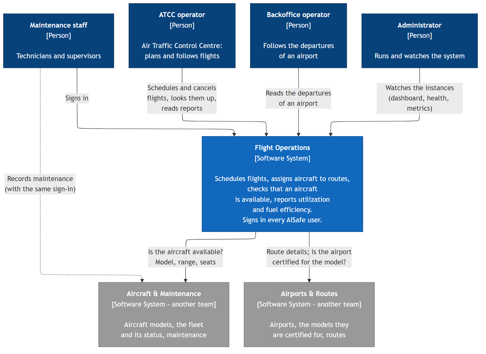

* **ATCC operators** schedule and cancel flights, look them up and read the utilization and fuel-efficiency
  reports. **Backoffice operators** read an airport's departures. **Administrators** watch the instances.
* **Every AISafe user signs in here.** The token is accepted by the other two services as well (same signing key),
  which is why maintenance staff, who work in Aircraft & Maintenance, also sign in through Flight Operations.
* Before a flight is booked, Flight Operations asks **Aircraft & Maintenance** whether the aircraft is available
  and what it can do (model, range, seats), and **Airports & Routes** whether the route is active and the airports
  are certified for the model. Neither of them calls Flight Operations.

## Level 2 – Containers

*For developers and operators: what runs, and how the parts talk.*

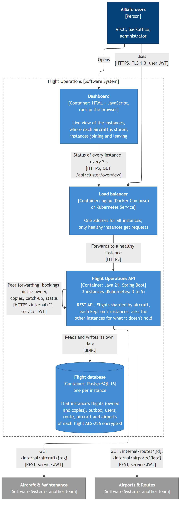

| Container | Technology | Responsibility |
|---|---|---|
| Flight Operations API | Java 21, Spring Boot | REST API. **3 instances** (Kubernetes: 3 to 5, auto-scaled). Flights are sharded by aircraft and each is kept on 2 instances (owner + backup); an instance asks the others for what it doesn't hold |
| Flight database | PostgreSQL 16 | **one per instance**: that instance's flights, the replication outbox, the users. Route, aircraft and airports of each flight are encrypted (AES-256) |
| Load balancer | nginx (Docker Compose) or a Kubernetes Service | one address for the clients; requests go to healthy instances only |
| Dashboard | HTML + JavaScript in the browser (served by the API) | live view of all instances, refreshed every 2 s |

Clients, the load balancer and the API instances talk HTTPS with TLS 1.3 only. Calls to the other two services
use HTTPS with TLS 1.3 too (the same dev CA), also between their own instances. Users carry a user
JWT; instances calling each other or the other services carry a short-lived service JWT (role `SERVICE`), and
`/internal/**` accepts only that.

## Level 3 – Components

*For developers: how one instance of the API is built.* Split in two so that each diagram stays readable: the path
of a client request, and the parts that make the instances work together.

### 3a – A client request (bookings, queries, reports)

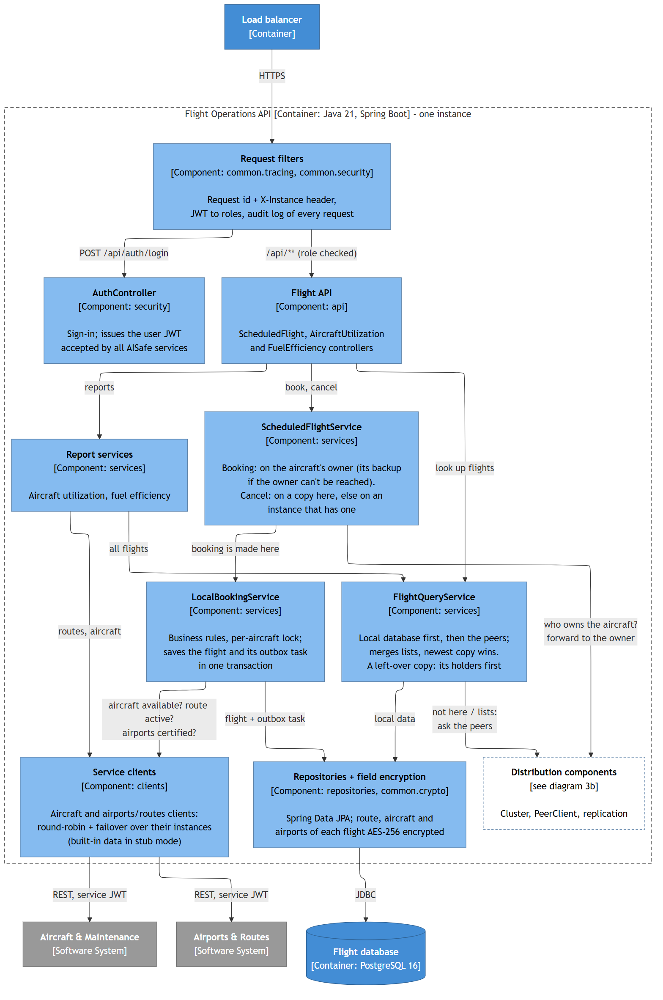

* A booking goes to `ScheduledFlightService`, which asks `Cluster` who owns the aircraft. If it is this instance,
  `LocalBookingService` checks the business rules (with the other two services), locks the aircraft and saves the
  flight together with its outbox task; otherwise the booking is forwarded to the owner (diagram 5).
* A lookup goes to `FlightQueryService`: the local database first, then the peers. Lists ask every peer at once
  and keep the newest copy of each flight. A left-over copy of an aircraft this instance no longer holds (after
  instances joined, before its hand-off) is not answered while one of the aircraft's holders can be asked.

### 3b – Working with the other instances (sharding, replication, resilience)

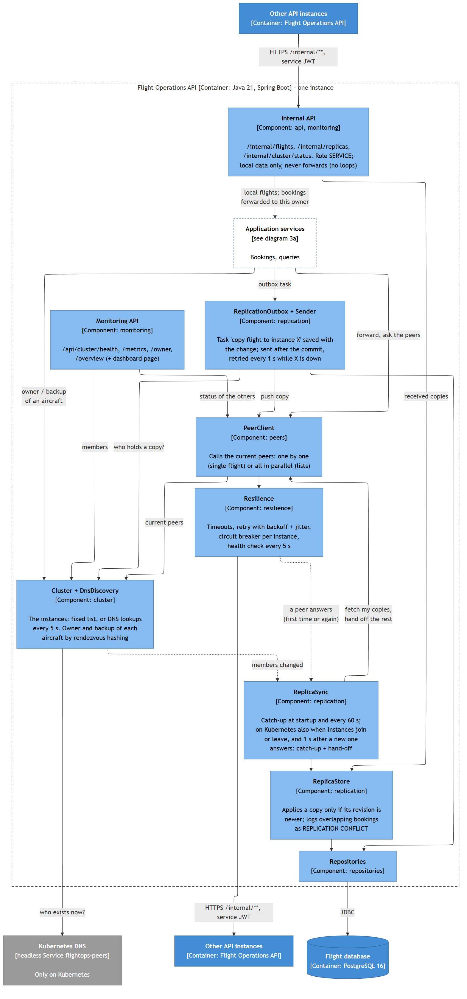

* `Cluster` knows the instances (a fixed list, or DNS lookups on Kubernetes) and ranks them for each aircraft by
  rendezvous hashing: the first is the owner, the second the backup. Every instance computes the same ranking
  without asking anyone.
* Replication: the outbox task saved with a change is sent by `ReplicationSender` after the commit (retried while
  the target is down); `ReplicaStore` keeps a copy only if its revision is newer; `ReplicaSync` catches up at
  startup and every 60 s and, on Kubernetes, rebalances when instances join or leave and as soon as a new
  instance answers.
* The **Internal API** answers from local data only and never forwards, so a query can't loop between instances.
* Every call to another instance goes through `PeerClient` and **Resilience** (timeouts, retries for reads,
  circuit breaker per instance, health checks).

## Level 4 – Code

*For developers changing the distribution code: the significant classes only.*

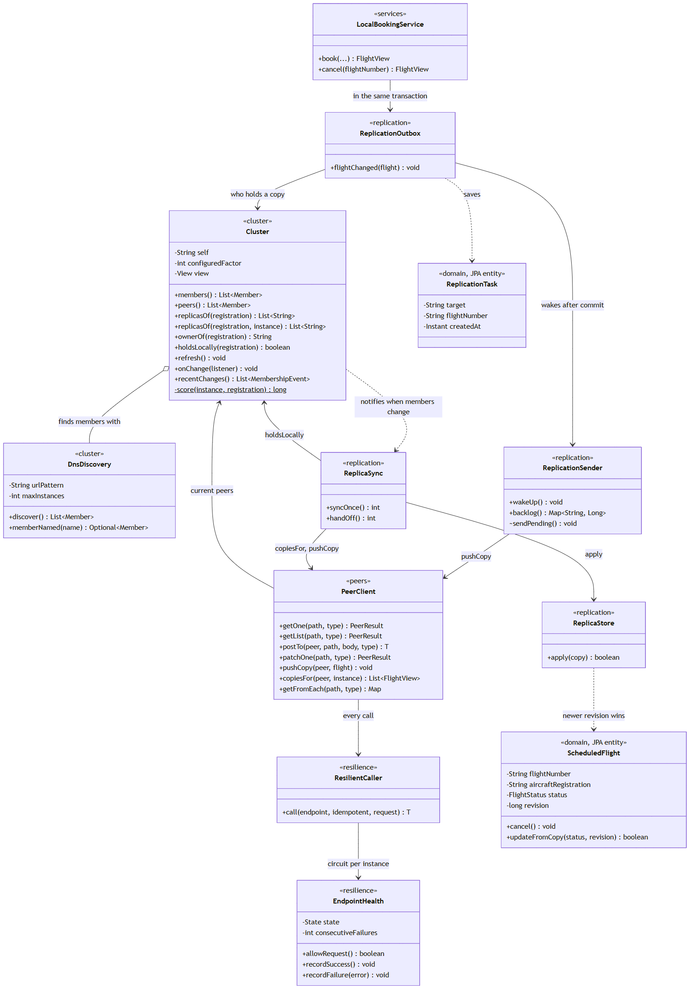

| Class | Source |
|---|---|
| `Cluster`, `DnsDiscovery` | [cluster/](../src/main/java/pt/isep/sidis/flightops/cluster) |
| `PeerClient` | [peers/PeerClient.java](../src/main/java/pt/isep/sidis/flightops/peers/PeerClient.java) |
| `ReplicationOutbox`, `ReplicationSender`, `ReplicaStore`, `ReplicaSync` | [replication/](../src/main/java/pt/isep/sidis/flightops/replication) |
| `ResilientCaller`, `EndpointHealth` | [resilience/](../src/main/java/pt/isep/sidis/flightops/resilience) |
| `LocalBookingService` | [services/LocalBookingService.java](../src/main/java/pt/isep/sidis/flightops/services/LocalBookingService.java) |
| `ScheduledFlight`, `ReplicationTask` | [domain/](../src/main/java/pt/isep/sidis/flightops/domain) |

Design points visible here:

* **Rendezvous hashing** (`Cluster.score`): SHA-256 of instance name + registration; adding an instance only moves
  the aircraft the new one wins (`ClusterTest`).
* **Transactional outbox**: `LocalBookingService` calls `ReplicationOutbox.flightChanged` inside the booking's
  transaction, so the change and the "copy it to X" task are saved together or not at all.
* **Revisions**: `ScheduledFlight.updateFromCopy` accepts a copy only if its revision is higher, so copies
  converge whatever the order they arrive in (eventual consistency).
* **Circuit breaker per instance**: `ResilientCaller` asks `EndpointHealth.allowRequest()` before every call.

## Logical view (UML)

*For developers and reviewers: what Flight Operations stores, and what it only reads from the other services.*

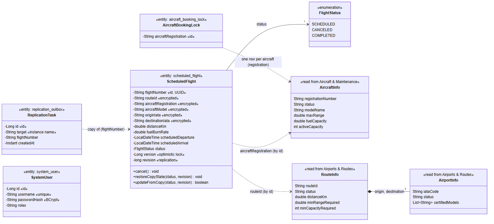

* **`ScheduledFlight`** is the only business entity. Its id is a UUID, so instances create flights independently
  without clashes. Route, aircraft, model and airports are stored encrypted. `version` guards against two updates of
  the same row on one instance (optimistic lock); `revision` orders the copies of a flight across instances (the
  newest wins).
* **`AircraftBookingLock`** has one row per aircraft; a booking locks it (`SELECT ... FOR UPDATE`) so two bookings of
  the same aircraft on one instance can't both pass the overlap check.
* **`ReplicationTask`** is the outbox: "send the current state of flight X to instance Y", saved in the same
  transaction as the change.
* **`SystemUser`** holds the users who sign in (password as a BCrypt hash, roles as a list).
* **`AircraftInfo`, `RouteInfo`, `AirportInfo`** are not stored: they are what the other two services answer.
  A flight refers to its aircraft and route **by id only**, with no foreign key: each service has its own database.

## Development view (packages)

*For developers: how the code is organised.* Generated from the `import` statements by
`scripts/generate-development-view.py`, so it always matches the code; the script fails if two packages import each
other or a package imports one of a higher layer. Arrows: how many package dependencies go from one group to the
other. Every package may use `common`.

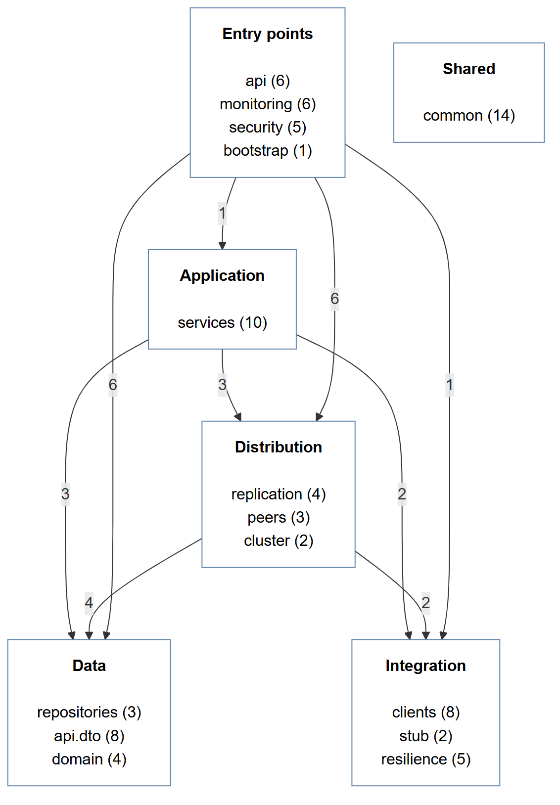

<!-- development-view:start -->
| Group | Package | Classes | Purpose | Imports (besides `common`) |
|---|---|---|---|---|
| Entry points | `api` | 6 | REST controllers | `api.dto`, `cluster`, `replication`, `repositories`, `services` |
| Entry points | `monitoring` | 6 | monitoring API, dashboard | `cluster`, `domain`, `peers`, `replication`, `repositories`, `resilience` |
| Entry points | `security` | 5 | sign-in, users | - |
| Entry points | `bootstrap` | 1 | sample data | `cluster`, `domain`, `repositories`, `security` |
| Application | `services` | 10 | business logic | `api.dto`, `clients`, `cluster`, `domain`, `peers`, `replication`, `repositories`, `resilience` |
| Distribution | `replication` | 4 | outbox, copies, catch-up | `api.dto`, `cluster`, `domain`, `peers`, `repositories`, `resilience` |
| Distribution | `peers` | 3 | calls to the other instances | `api.dto`, `cluster`, `resilience` |
| Distribution | `cluster` | 2 | instances, owner of each aircraft | - |
| Integration | `clients` | 8 | calls to the other services | `resilience` |
| Integration | `stub` | 2 | built-in data (test mode) | `clients` |
| Integration | `resilience` | 5 | retry, circuit breaker, health | - |
| Data | `repositories` | 3 | Spring Data JPA | `domain` |
| Data | `api.dto` | 8 | request / response objects | `domain` |
| Data | `domain` | 4 | entities | - |
| Shared | `common` | 14 | crypto, exceptions, HTTP client, JWT, metrics, tracing | - |

No package cycles: no two packages import each other.
<!-- development-view:end -->

## +1 – Scenarios

*For everyone: the architecture at work, step by step.* Each one is tested (`ReplicationIntegrationTest`,
`TwoInstancesIntegrationTest`, the Postman collection, or the Kubernetes test in [architecture.md](architecture.md)).

### Reading a flight stored on another instance (PL3 p.11)

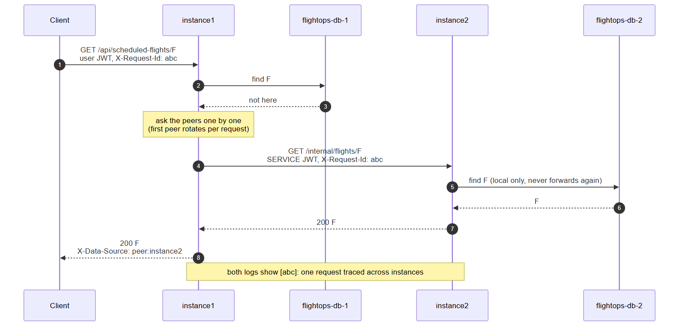

### Booking: made on the aircraft's owner, copied to its backup (P1 p.15)

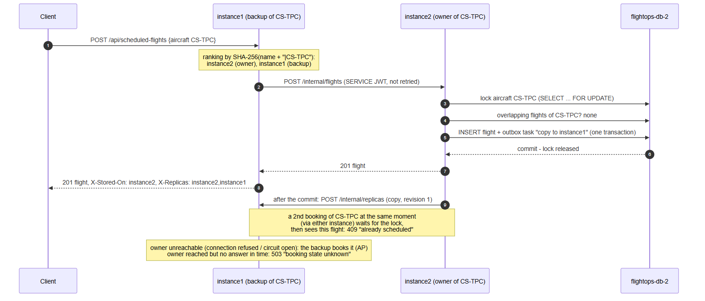

### Replication: how a change reaches every copy

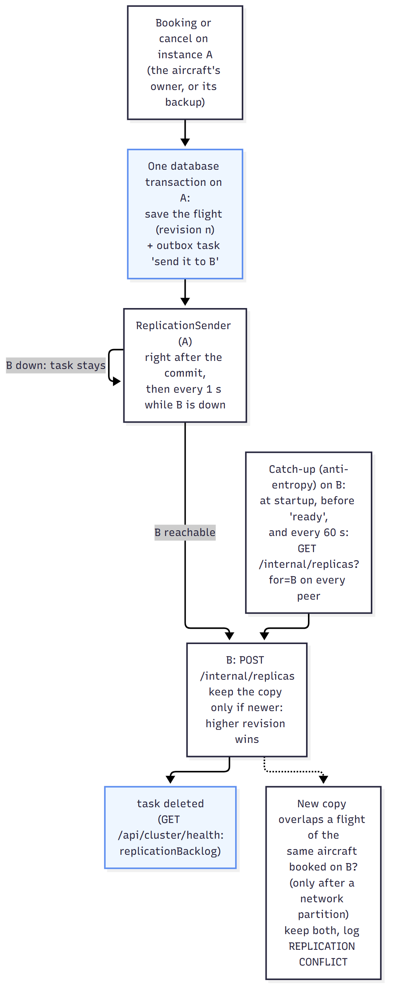

### An instance fails and recovers (PL3 p.14, P1 p.2)

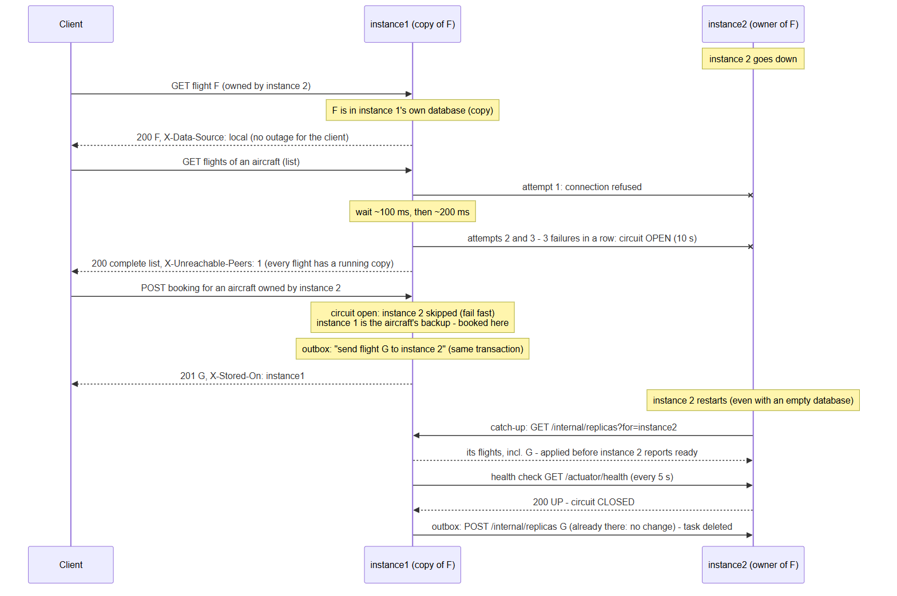

### Auto-scaling: a pod is added on Kubernetes

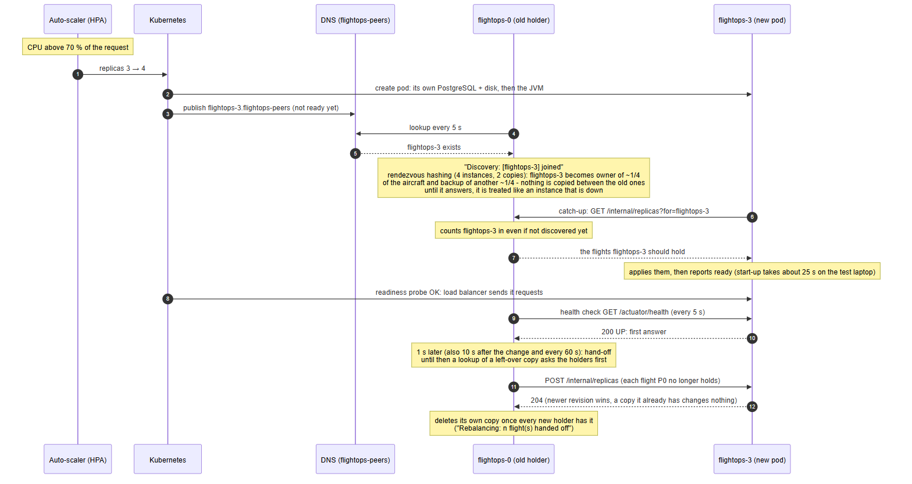

## Deployment

### Kubernetes (`k8s/`)

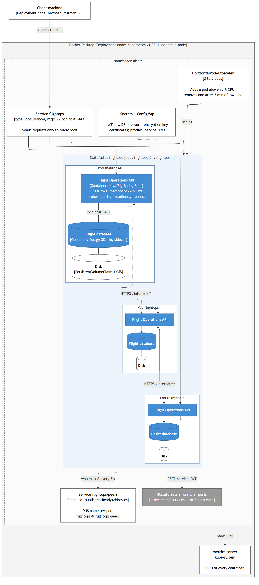

Each instance is a pod of a StatefulSet: a stable name (rendezvous hashing needs it), the API and its own PostgreSQL
side by side, its own disk. The headless Service gives every pod a DNS name, which is how the instances find each
other. Details and test results: [architecture.md – Kubernetes and auto-scaling](architecture.md#kubernetes-and-auto-scaling).

### Docker Compose (`docker-compose.yml`)

Three API containers, each with its own PostgreSQL container and named volume, behind nginx on
https://localhost:8443; the instances know each other from a fixed list (`CLUSTER`).
