# Flight Operations – C4+1 model

[Documentation guide](README.md) · [Architecture](architecture.md) · [Decision records](decisions/README.md)

The architecture of the Flight Operations service at four zoom levels (C4: Context, Containers, Components, Code),
plus the views of Kruchten's 4+1 model (logical, development, process, physical) and the scenarios that tie them
together (the "+1"). The other two AISafe services are shown as external systems: they belong to other teams.

Contents: [Notation](#notation) · [L1 Context](#level-1--system-context) · [L2 Containers](#level-2--containers) ·
[L3 Components](#level-3--components) · [L4 Code](#level-4--code) · [Logical view](#logical-view-uml) ·
[Development view](#development-view-packages) · [+1 Scenarios](#1--scenarios) · [Deployment](#deployment)

| 4+1 view (Week 5 slides p.8) | Where |
|---|---|
| Logical view: entities and their relationships | [Logical view (UML)](#logical-view-uml) |
| Development view: packages, modules, dependencies | [Development view](#development-view-packages) |
| Process view: runtime behaviour, HTTP flows between instances | the sequence diagrams in [+1 Scenarios](#1--scenarios) |
| Physical view: deployment topology, containers, ports | [Deployment](#deployment) |
| +1 Scenarios: use cases tying the views together | [+1 Scenarios](#1--scenarios) |

Each level answers a different question for a different reader, like a map that zooms in: what the system is for
(L1), what runs where (L2), how one part is built (L3), which classes do the work (L4). Every diagram stays on one
level and leaves the rest to the next one.

## Notation

| Element | Colour | Meaning |
|---|---|---|
| Person | dark blue | someone who uses the system |
| Software system in scope | blue | Flight Operations |
| Container | mid blue | something that runs on its own: an application, a database, a page in the browser |
| Component | light blue | a group of classes inside a container, with one responsibility (the Java package is in brackets) |
| External | grey | another team's system, or infrastructure we use but don't build |
| Shown in another diagram | white, dashed | a placeholder that points to the diagram that details it |
| Dashed frame | – | the boundary of the system or container being zoomed into |

Arrows read "uses"; the label says what for and, from L2 down, how (`[protocol, authentication]`).
Sources: `docs/c4/*.mmd` and `docs/diagrams/*.mmd` (Mermaid, kept in git next to the code). Images:
`npx @mermaid-js/mermaid-cli -i <file>.mmd -o <file>.png -b white -s 2`.

## Level 1 – System context

*For anyone: what Flight Operations is for, who uses it and what it depends on. No technology.*

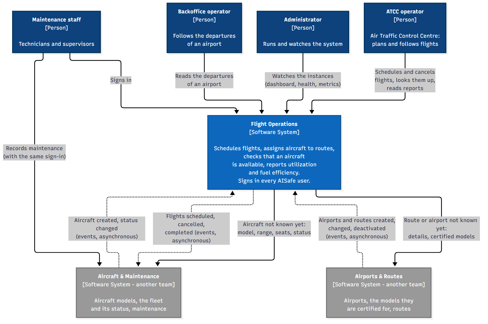

* **ATCC operators** schedule and cancel flights, look them up and read the utilization and fuel-efficiency
  reports. **Backoffice operators** read an airport's departures. **Administrators** watch the instances.
* **Every AISafe user signs in here.** The token is accepted by the other two services as well (same signing key),
  which is why maintenance staff, who work in Aircraft & Maintenance, also sign in through Flight Operations.
* Before a flight is booked, Flight Operations checks that the aircraft is available and can fly the route (model,
  range, seats), that the route is active and that both airports are certified for the model. Since Assignment 2 it
  answers these questions from **its own copies** of the other services' data, which **Aircraft & Maintenance** and
  **Airports & Routes** keep up to date with **events** (dashed lines, asynchronous, through the message broker). It
  calls their REST APIs only for an aircraft, route or airport it has not copied yet.
* Flight Operations announces every flight scheduled, cancelled or completed as an event; **Aircraft & Maintenance**
  uses `flight.completed` to add the flight's hours to the aircraft. Neither service calls Flight Operations
  synchronously.

## Level 2 – Containers

*For developers and operators: what runs, and how the parts talk.*

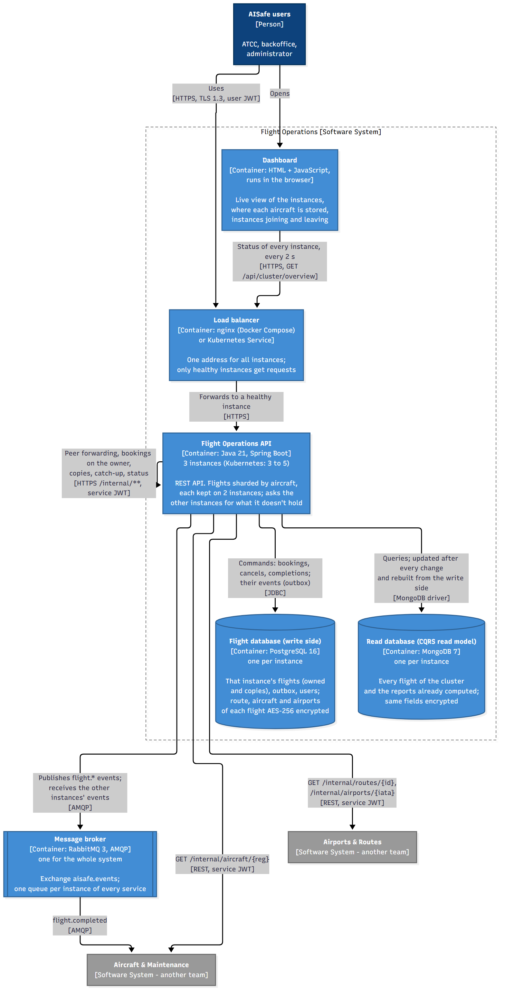

| Container | Technology | Responsibility |
|---|---|---|
| Flight Operations API | Java 21, Spring Boot | REST API. **3 instances** (Kubernetes: 3 to 5, auto-scaled). Flights are sharded by aircraft and each is kept on 2 instances (owner + backup); an instance asks the others for what it doesn't hold |
| Flight database (write side) | PostgreSQL 16 | **one per instance**: that instance's flights, the replication outbox, the users. Route, aircraft and airports of each flight are encrypted (AES-256). Changed by commands only |
| Message broker | RabbitMQ 3 (AMQP) | **one for the whole system**: exchange `aisafe.events`, one queue per instance of every service (`flight.events.<instance>`), dead letters in `flight.events.dlq`. Carries every change as an event: to the other flight-ops instances' read models and to the other services ([Messaging](architecture.md#messaging-assignment-2)) |
| Read database (CQRS read model) | MongoDB 7 | **one per instance**: every flight of the cluster and the reports already computed (`flights`, `aircraft_stats`, `route_stats`), the same fields encrypted. Answers the queries; updated after every change and rebuilt from the write side ([CQRS](architecture.md#cqrs-assignment-2)) |
| Load balancer | nginx (Docker Compose) or a Kubernetes Service | one address for the clients; requests go to healthy instances only |
| Dashboard | HTML + JavaScript in the browser (served by the API) | live view of all instances, refreshed every 2 s |

Clients, the load balancer and the API instances talk HTTPS with TLS 1.3 only. Calls to the other two services
use HTTPS with TLS 1.3 too (the same dev CA), also between their own instances. Users carry a user
JWT; instances calling each other or the other services carry a short-lived service JWT (role `SERVICE`), and
`/internal/**` accepts only that.

## Level 3 – Components

*For developers: how one instance of the API is built.* Split in three so that each diagram stays readable: the path
of a client request (commands and queries apart), the parts that make the instances work together, and the events
that keep the read model and the local copies up to date.

### 3a – A client request (bookings, queries, reports)

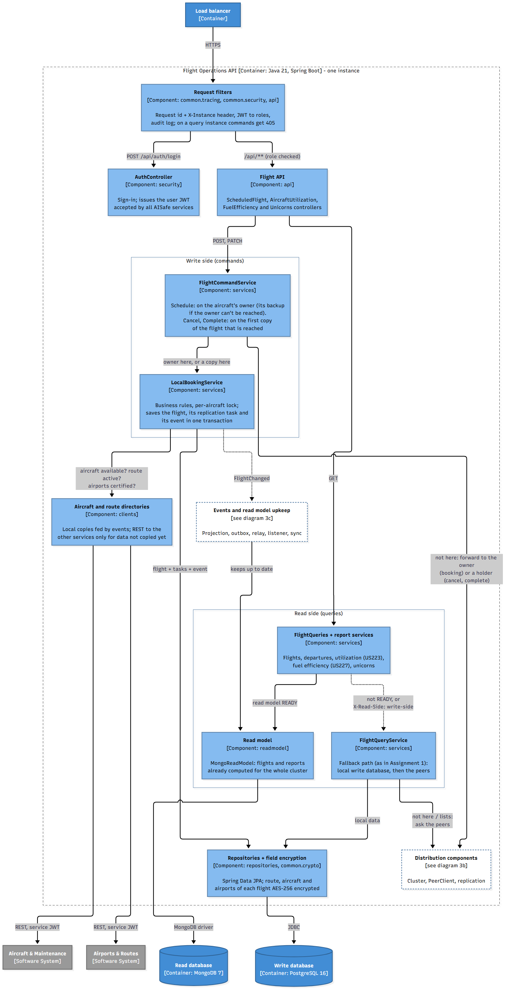

* **Commands** (`POST`, `PATCH`) go to `FlightCommandService`. For a booking it asks `Cluster` who owns the
  aircraft. If it is this instance, `LocalBookingService` checks the business rules (with the local copies of the
  other services' data), locks the aircraft and saves, in one transaction, the flight, its replication task and its
  event; otherwise the booking is forwarded to the owner (diagram 5). A cancel or a completion is applied on this
  instance when it holds a copy of the flight (owner or backup), and forwarded to a holder otherwise; replication
  brings the change to the other copy. On a query instance, commands are refused with `405` before they reach the
  API.
* **Queries** (`GET`) go to `FlightQueries` and the report services (utilization, fuel efficiency, unicorns), which
  answer from the **read model** while it is `READY`: one local MongoDB query, no peer involved.
* When the read model is not `READY`, or the client asks for `X-Read-Side: write-side`, the query takes the
  **fallback path** of Assignment 1, `FlightQueryService`: the local write database first, then the peers. Lists ask
  every peer at once and keep the newest copy of each flight. A left-over copy of an aircraft this instance no
  longer holds (after instances joined, before its hand-off) is not answered while one of its holders can be asked.

### 3b – Working with the other instances (sharding, replication, resilience)

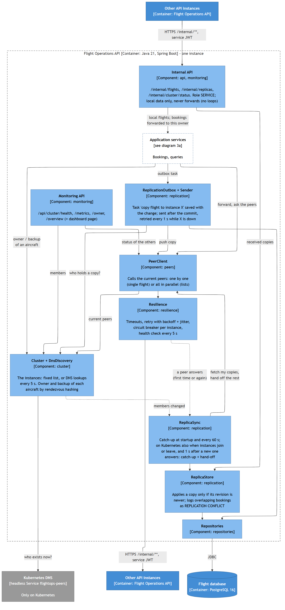

* `Cluster` knows the instances (a fixed list, or DNS lookups on Kubernetes) and ranks them for each aircraft by
  rendezvous hashing: the first is the owner, the second the backup. Every instance computes the same ranking
  without asking anyone.
* Replication: the outbox task saved with a change is sent by `ReplicationSender` after the commit (retried while
  the target is down); `ReplicaStore` keeps a copy only if its revision is newer; `ReplicaSync` catches up at
  startup and every 60 s and, on Kubernetes, rebalances when instances join or leave and as soon as a new
  instance answers.
* The **Internal API** answers from local data only and never forwards, so a query can't loop between instances.
* Every call to another instance goes through `PeerClient` and **Resilience** (timeouts, retries for reads,
  circuit breaker per instance, health checks).

### 3c – Events and the read model (CQRS, AMQP)

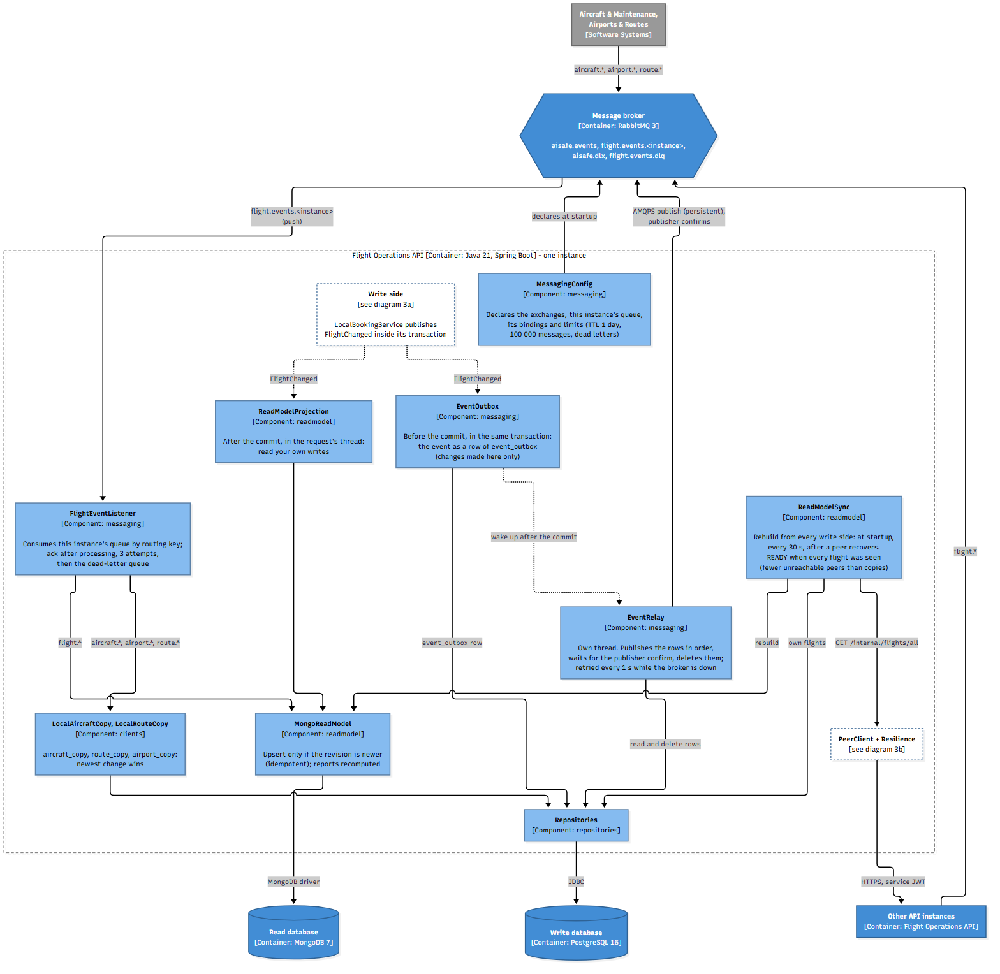

* Every change made on the write side raises a `FlightChanged` domain event inside its transaction. Two components
  listen to it: `ReadModelProjection` updates this instance's read model **after** the commit (the client reads its
  own write at once), and `EventOutbox` saves the event as a row of `event_outbox` **before** the commit, in the same
  transaction, so a change and its event are saved together or not at all.
* `EventRelay`, on its own thread, publishes the waiting rows to `aisafe.events` over AMQPS, waits for the publisher
  confirm and only then deletes them; while the broker is down it retries every second, and requests are not
  delayed ([ADR 0012](decisions/0012-event-outbox-and-publisher-confirms.md)).
* `MessagingConfig` declares this instance's queue `flight.events.<instance>`, its bindings and its limits.
  `FlightEventListener` consumes it: `flight.*` from the other instances go into the read model, `aircraft.*`,
  `airport.*` and `route.*` from the other services into the local copies. Both are idempotent (newest revision or
  newest change wins); a message that fails 3 times goes to the dead-letter queue
  ([ADR 0013](decisions/0013-at-least-once-idempotent-consumers.md)).
* `ReadModelSync` is the safety net: it rebuilds the read model from every instance's write side at startup, every
  30 s and after a peer recovers, and marks it `READY` only when no flight can have been missed
  ([ADR 0010](decisions/0010-read-model-fallback.md)).

## Level 4 – Code

*For developers changing the code: the significant classes only.* Two diagrams, as at level 3: the distribution
(sharding, replication, peer calls) and CQRS with messaging.

### 4a – Sharding, replication and peer calls

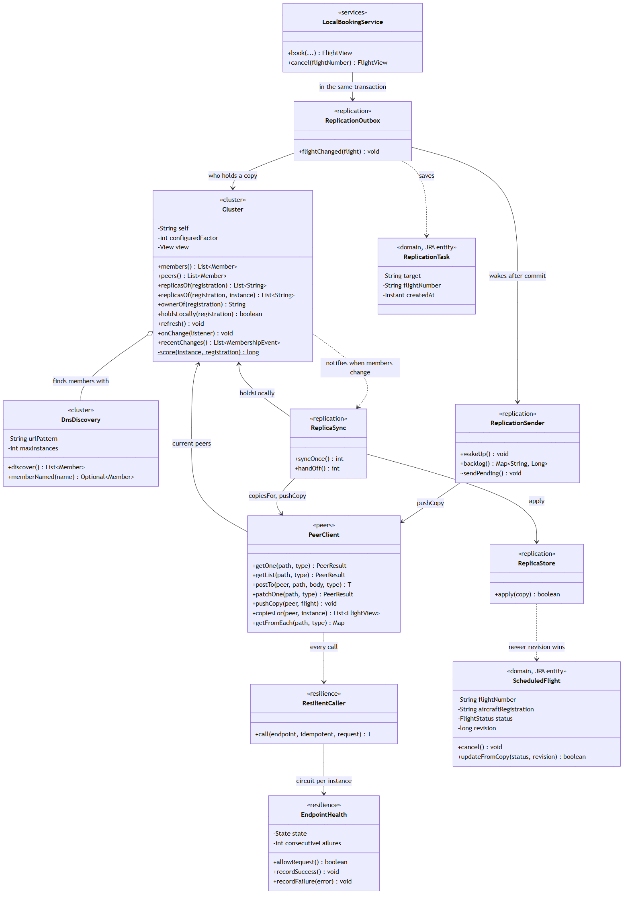

| Class | Source |
|---|---|
| `Cluster`, `DnsDiscovery` | [cluster/](../src/main/java/pt/isep/sidis/flightops/cluster) |
| `PeerClient` | [peers/PeerClient.java](../src/main/java/pt/isep/sidis/flightops/peers/PeerClient.java) |
| `ReplicationOutbox`, `ReplicationSender`, `ReplicaStore`, `ReplicaSync` | [replication/](../src/main/java/pt/isep/sidis/flightops/replication) |
| `ResilientCaller`, `EndpointHealth` | [resilience/](../src/main/java/pt/isep/sidis/flightops/resilience) |
| `LocalBookingService` | [services/LocalBookingService.java](../src/main/java/pt/isep/sidis/flightops/services/LocalBookingService.java) |
| `ScheduledFlight`, `ReplicationTask` | [domain/](../src/main/java/pt/isep/sidis/flightops/domain) |

Design points visible here:

* **Rendezvous hashing** (`Cluster.score`): SHA-256 of instance name + registration; adding an instance only moves
  the aircraft the new one wins (`ClusterTest`).
* **Transactional outbox**: `LocalBookingService` calls `ReplicationOutbox.flightChanged` inside the booking's
  transaction, so the change and the "copy it to X" task are saved together or not at all.
* **Revisions**: `ScheduledFlight.updateFromCopy` accepts a copy only if its revision is higher, so copies
  converge whatever the order they arrive in (eventual consistency).
* **Circuit breaker per instance**: `ResilientCaller` asks `EndpointHealth.allowRequest()` before every call.

### 4b – CQRS and messaging

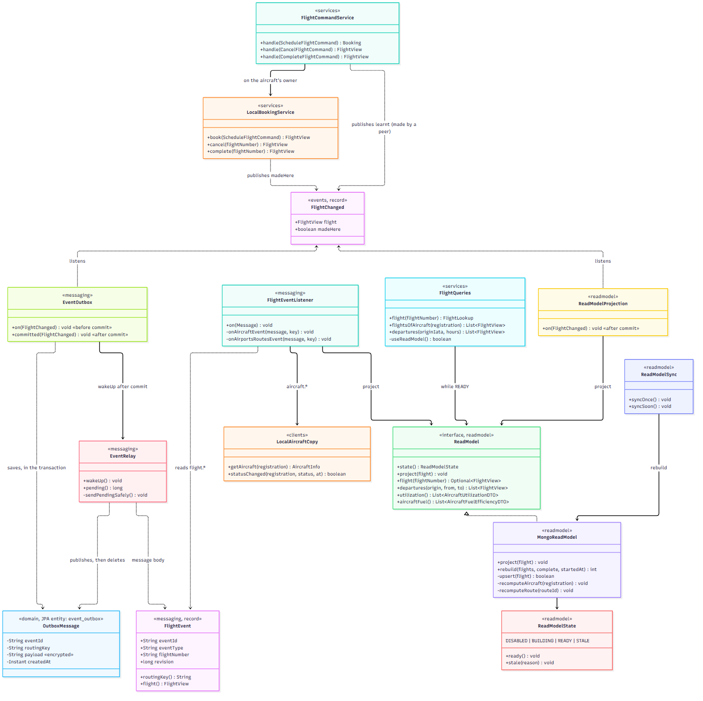

| Class | Source |
|---|---|
| `FlightCommandService`, `LocalBookingService`, `FlightQueries` | [services/](../src/main/java/pt/isep/sidis/flightops/services) |
| `FlightChanged` | [events/FlightChanged.java](../src/main/java/pt/isep/sidis/flightops/events/FlightChanged.java) |
| `ReadModel`, `MongoReadModel`, `ReadModelState`, `ReadModelProjection`, `ReadModelSync` | [readmodel/](../src/main/java/pt/isep/sidis/flightops/readmodel) |
| `EventOutbox`, `EventRelay`, `FlightEvent`, `FlightEventListener` | [messaging/](../src/main/java/pt/isep/sidis/flightops/messaging) |
| `OutboxMessage` | [domain/OutboxMessage.java](../src/main/java/pt/isep/sidis/flightops/domain/OutboxMessage.java) |
| `LocalAircraftCopy` | [clients/LocalAircraftCopy.java](../src/main/java/pt/isep/sidis/flightops/clients/LocalAircraftCopy.java) |

Design points visible here:

* **One domain event, two listeners**: the write side knows nothing about the read model or the broker; it only
  raises `FlightChanged`. `madeHere` tells a change this instance made (announced on the broker) from one it learnt
  from a peer (only projected), so an event is published once, by the instance that made the change.
* **Transaction phases**: `EventOutbox.on` runs before the commit (the row is part of the transaction),
  `EventOutbox.committed` and `ReadModelProjection.on` after it (nothing is published or projected for a change
  that is rolled back).
* **Idempotent read model**: `MongoReadModel.upsert` replaces a flight only if the stored copy is older, as a
  condition of the upsert itself, so duplicates and late events change nothing.
* **Queries choose their side**: `FlightQueries.useReadModel` checks `ReadModelState` (and the `X-Read-Side`
  header) before each query.

## Logical view (UML)

*For developers and reviewers: what Flight Operations stores in its write database (PostgreSQL) and in its read
database (MongoDB), and what it only reads from the other services.*

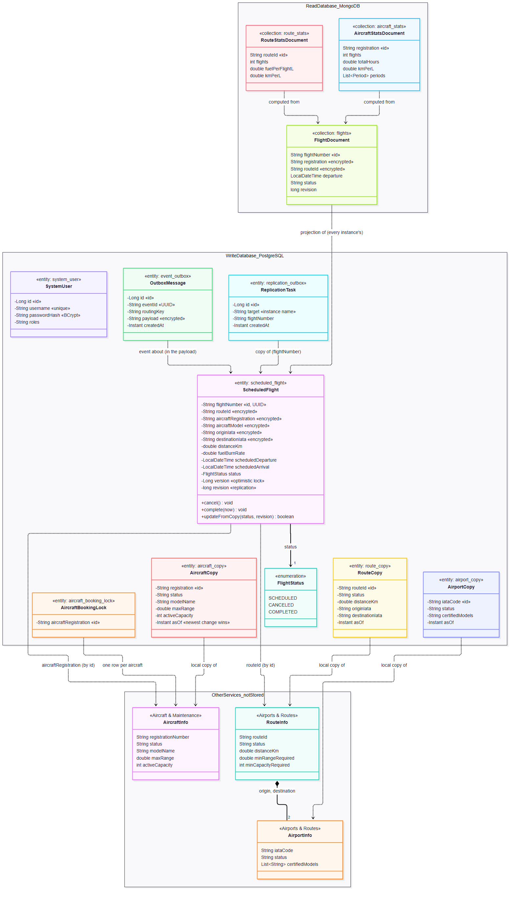

* **`ScheduledFlight`** is the only business entity. Its id is a UUID, so instances create flights independently
  without clashes. Route, aircraft, model and airports are stored encrypted. `version` guards against two updates of
  the same row on one instance (optimistic lock); `revision` orders the copies of a flight across instances (the
  newest wins).
* **`AircraftBookingLock`** has one row per aircraft; a booking locks it (`SELECT ... FOR UPDATE`) so two bookings of
  the same aircraft on one instance can't both pass the overlap check.
* **`ReplicationTask`** is the outbox: "send the current state of flight X to instance Y", saved in the same
  transaction as the change.
* **`OutboxMessage`** is the event outbox (Assignment 2): an event to publish on the broker, saved in the same
  transaction as the change and deleted once the broker confirms it. Its payload is encrypted.
* **`SystemUser`** holds the users who sign in (password as a BCrypt hash, roles as a list).
* **`AircraftInfo`, `RouteInfo`, `AirportInfo`** are what the other two services answer. A flight refers to its
  aircraft and route **by id only**, with no foreign key: each service has its own database.
* **`AircraftCopy`, `RouteCopy`, `AirportCopy`** (Assignment 2) are this instance's copies of that data, kept up to
  date by the other services' events; `asOf` keeps only the newest change, so events applied twice or out of order
  change nothing.
* **Read database.** `FlightDocument` holds every flight of the cluster (not only this instance's shard), shaped
  for the queries; `AircraftStatsDocument` and `RouteStatsDocument` are the utilization and fuel-efficiency reports,
  recomputed whenever one of their flights changes. All three can be rebuilt from the write side at any time.

## Development view (packages)

*For developers: how the code is organised.* Generated from the `import` statements by
`scripts/generate-development-view.py`, so it always matches the code; the script fails if two packages import each
other or a package imports one of a higher layer. Arrows: how many package dependencies go from one group to the
other. Every package may use `common`.

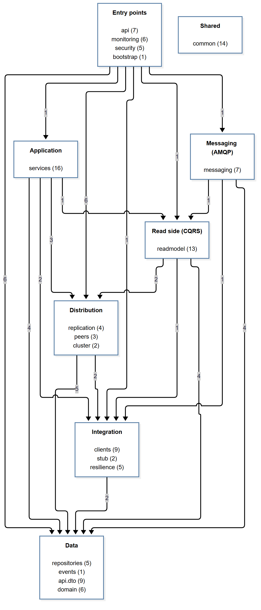

<!-- development-view:start -->
| Group | Package | Classes | Purpose | Imports (besides `common`) |
|---|---|---|---|---|
| Entry points | `api` | 8 | REST controllers | `api.dto`, `cluster`, `replication`, `repositories`, `services` |
| Entry points | `monitoring` | 6 | monitoring API, dashboard | `cluster`, `domain`, `messaging`, `peers`, `readmodel`, `replication`, `repositories`, `resilience` |
| Entry points | `security` | 5 | sign-in, users | - |
| Entry points | `bootstrap` | 1 | sample data | `cluster`, `domain`, `repositories`, `security` |
| Application | `services` | 16 | business logic | `api.dto`, `clients`, `cluster`, `domain`, `events`, `peers`, `readmodel`, `replication`, `repositories`, `resilience` |
| Messaging (AMQP) | `messaging` | 8 | AMQP (RabbitMQ): outbox relay, events of every service, consumer | `api.dto`, `clients`, `domain`, `events`, `readmodel`, `repositories` |
| Read side (CQRS) | `readmodel` | 13 | CQRS read side: read database (MongoDB), projections, sync | `api.dto`, `cluster`, `domain`, `events`, `peers`, `repositories`, `resilience` |
| Distribution | `replication` | 4 | outbox, copies, catch-up | `api.dto`, `cluster`, `domain`, `events`, `peers`, `repositories`, `resilience` |
| Distribution | `peers` | 3 | calls to the other instances | `api.dto`, `cluster`, `resilience` |
| Distribution | `cluster` | 2 | instances, owner of each aircraft | - |
| Integration | `clients` | 10 | calls to the other services, local copies of their data | `domain`, `repositories`, `resilience` |
| Integration | `stub` | 2 | built-in data (test mode) | `clients` |
| Integration | `resilience` | 5 | retry, circuit breaker, health | - |
| Data | `repositories` | 7 | Spring Data JPA | `domain` |
| Data | `events` | 1 | domain events (write side -> read side) | `api.dto` |
| Data | `api.dto` | 9 | request / response objects | `domain` |
| Data | `domain` | 9 | entities | - |
| Shared | `common` | 14 | crypto, exceptions, HTTP client, JWT, metrics, tracing | - |

No package cycles: no two packages import each other.
<!-- development-view:end -->

## +1 – Scenarios

*For everyone: the architecture at work, step by step.* Each one is tested (`ReplicationIntegrationTest`,
`TwoInstancesIntegrationTest`, `CqrsIntegrationTest`, `MessagingIntegrationTest`, `QueryInstanceIntegrationTest`, the
Postman collection, or the Kubernetes test in [architecture.md](architecture.md)).

| Scenario | Assignment | Evidence |
|---|---|---|
| [Reading a flight stored on another instance](#reading-a-flight-stored-on-another-instance-pl3-p11) | A1 | Postman 02 |
| [Booking on the aircraft's owner](#booking-made-on-the-aircrafts-owner-copied-to-its-backup-p1-p15) | A1 | Postman 09 |
| [Replication](#replication-how-a-change-reaches-every-copy) | A1 | `ReplicationIntegrationTest` |
| [An instance fails and recovers](#an-instance-fails-and-recovers-pl3-p14-p1-p2) | A1 | Postman 03, 11b-11d |
| [Auto-scaling](#auto-scaling-a-pod-is-added-on-kubernetes) | A1 | Kubernetes test |
| [A command and a query take different paths](#a-command-and-a-query-take-different-paths-cqrs-p2-p2) | A2 | Postman 12 |
| [An event reaches every consumer](#an-event-reaches-every-consumer-p2-p2) | A2 | Postman 13 |
| [The broker is down](#the-broker-is-down-and-comes-back) | A2 | Postman 11f-11g |
| [Queries served by query instances](#queries-served-by-query-instances-optional) | A2 | Postman 17 |

### Reading a flight stored on another instance (PL3 p.11)

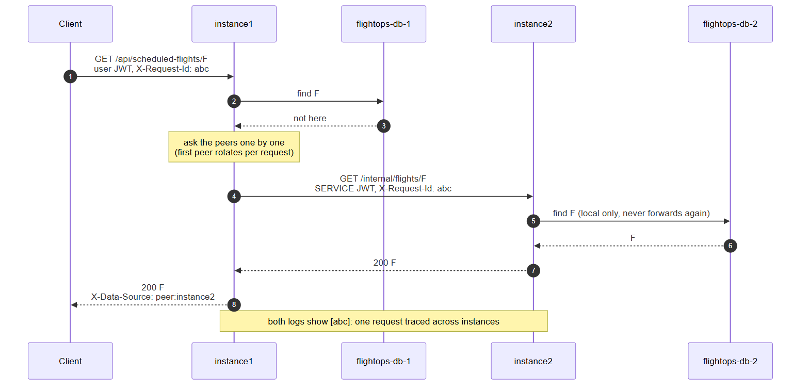

### Booking: made on the aircraft's owner, copied to its backup (P1 p.15)

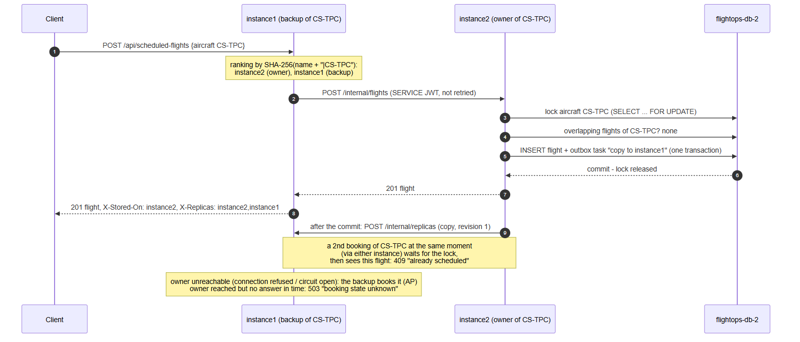

### Replication: how a change reaches every copy

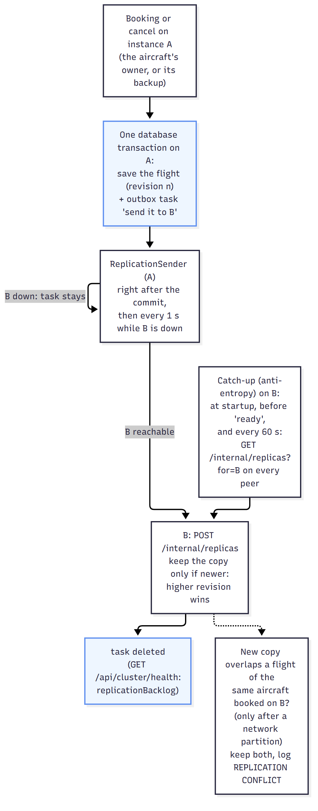

### An instance fails and recovers (PL3 p.14, P1 p.2)

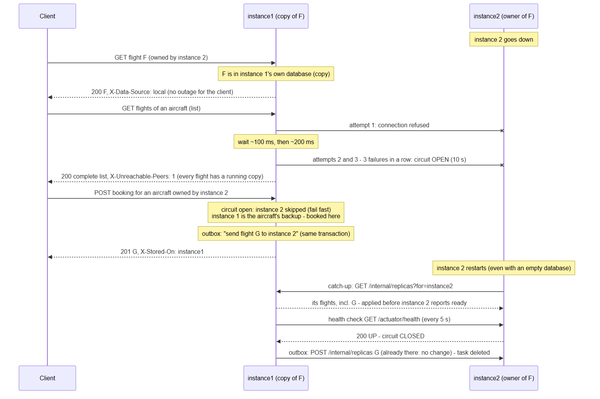

### Auto-scaling: a pod is added on Kubernetes

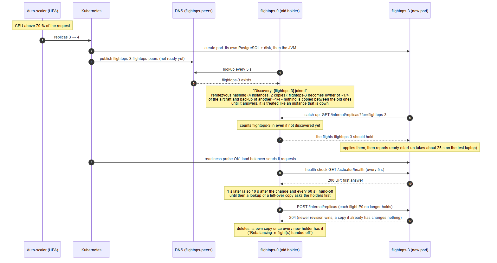

### A command and a query take different paths (CQRS, P2 p.2)

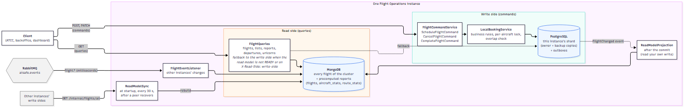

A command changes the write database of an instance that holds the aircraft (the owner for a booking, either copy
for a cancel or a completion); a query reads the instance's own read database, which holds every flight of the
cluster. The two meet only through events: the projection after the commit, the broker, and the periodic sync.

### An event reaches every consumer (P2 p.2)

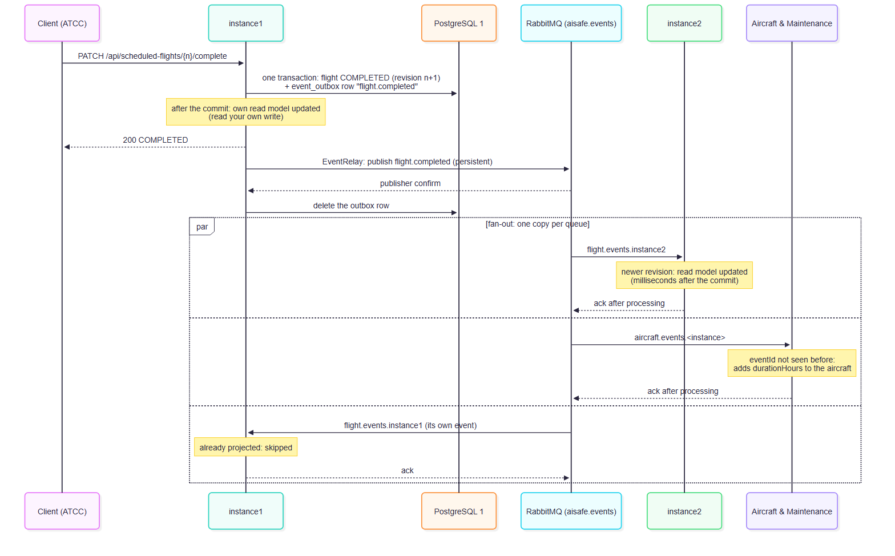

The topology the event travels through:

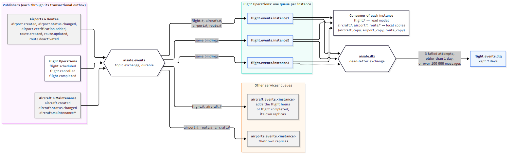

### The broker is down and comes back

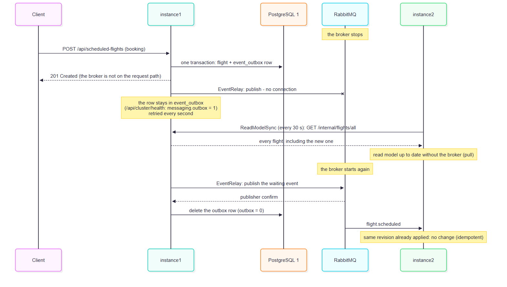

### Queries served by query instances (optional)

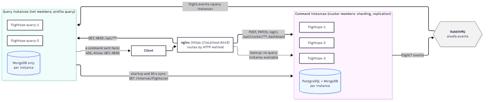

## Deployment

### Kubernetes (`k8s/`)

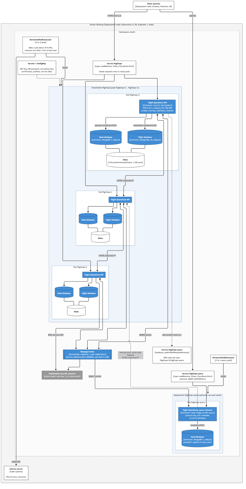

Each instance is a pod of a StatefulSet: a stable name (rendezvous hashing needs it), the API with its own PostgreSQL
(write side) and MongoDB (read side) next to it, and their own disks. The headless Service gives every pod a DNS name, which is how the instances find each
other. Details and test results: [architecture.md – Kubernetes and auto-scaling](architecture.md#kubernetes-and-auto-scaling).

### Docker Compose (`docker-compose.yml`)

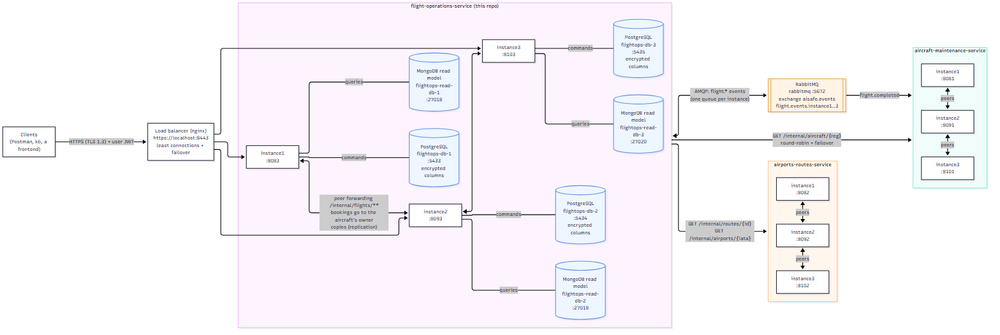

Three API containers, each with its own PostgreSQL container (write side) and MongoDB container (read side) and
their named volumes, behind nginx on
https://localhost:8443; the instances know each other from a fixed list (`CLUSTER`).
