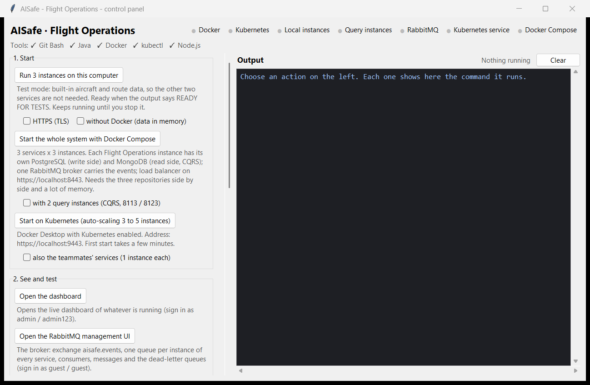

# Running and deployment

[Documentation guide](README.md) · [Running](running.md) · [Testing](testing.md) · [Operations](operations.md) · [Security](security.md) · [Limitations](limitations.md)

How to start Flight Operations: on one machine without containers, with Docker Compose (alone or with the
whole AISafe system) and on Kubernetes with auto-scaling. Ports, instances and scaling decisions:
[architecture.md, Horizontal scaling](architecture.md#horizontal-scaling).

## Control panel (no commands needed)

**Windows:** double-click `Launcher.cmd`. **Mac / Linux:** `python3 launcher.py`. (Needs Python 3; the panel says
which other tools it finds: Git Bash, Java, Docker, kubectl, Node.js.)

A window with buttons to start the system (on this computer, with Docker Compose, or on Kubernetes), open the
dashboard, run the Postman and JUnit tests, generate load, and stop everything. Each button explains what it does
and shows the exact command it runs, so the commands below can also be learned from it. The lights at the top show
what is running.



## Run

```bash
# one standalone instance, plain HTTP, H2 in memory (port 8083) - handy while developing
./mvnw spring-boot:run

# certificates for HTTPS (once; output in certs/, which is git-ignored)
./scripts/generate-dev-certs.sh

# 3 instances without Docker (8083, 8093, 8103); Ctrl+C stops them. Add --tls for HTTPS, -n 2 for only two.
# Prints "READY FOR TESTS" once every instance has fully started.
./scripts/run-local.sh

# CQRS with separate processes: also 2 query instances (8113, 8123), read database only, no commands
./scripts/run-local.sh --stub --queries 2

# instances started another way (e.g. VS Code): wait until they are ready (-n 2, --tls as above)
./scripts/wait-ready.sh

# whole system, 3 instances per service (needs the 3 repos side by side)
docker compose up --build
# failure tests on the whole system (stops and starts containers; see testing.md, Postman)
./scripts/test-failures.sh

# only flight ops: 3 instances + their databases behind the load balancer (https://localhost:8443)
docker compose up --build flightops-lb
# the same plus 2 query instances: the load balancer sends the queries (GET /api/**) to them
docker compose --profile queries up --build flightops-lb flightops-query-1 flightops-query-2

# Kubernetes (Docker Desktop) with auto-scaling between 3 and 5 instances: see "Kubernetes" below
./k8s/deploy.sh --stub

# load test (k6 in Docker, 1 CPU per instance); results in loadtest/results/
./loadtest/run.sh 2
./loadtest/run.sh 3
# the same requests on the write side (X-Read-Side: write-side), the Assignment 1 path, for comparison
READ_SIDE=write-side ./loadtest/run.sh 3

# local vs forwarded latency, availability while an instance is killed (with and without the load balancer)
./loadtest/performance.sh latency
./loadtest/performance.sh availability
./loadtest/performance.sh availability-lb
```

**Instances = Spring profiles.** Each instance has its own file with its own port, database and the list of all
instances (`flightops.cluster`): `application-instance1.properties` (8083, `flightops_db_1`), `application-instance2.properties`
(8093, `flightops_db_2`) and `application-instance3.properties` (8103, `flightops_db_3`). Start one with
`java -jar target/flight-operations-service-*.jar --spring.profiles.active=instance1` (add `,tls` for HTTPS).
Environment variables override the files, and docker-compose uses them for container hostnames.

**VS Code:** Run and Debug panel → "Flight Ops: 3 instances (HTTP)" or "(HTTPS)" starts the 3 instances
(`.vscode/launch.json`).

In docker-compose clients use the **load balancer**, https://localhost:8443 (nginx, `lb/nginx.conf`: least
connections, an instance that fails is left out for 10 s, failover to another instance). The instances also stay
reachable directly on https://localhost:8083, https://localhost:8093 and https://localhost:8103, **HTTPS only (TLS 1.3)**. Docker checks
each instance's health every 10 s (`docker compose ps`) and restarts an instance whose process stops.
Swagger UI: https://localhost:8083/swagger-ui.html

To trust the dev CA: import `certs/ca.crt` into Postman (Settings → Certificates → CA certificates) or use
`curl --cacert certs/ca.crt` (on Windows also add `--ssl-no-revoke`, because a dev CA has no revocation list).

Login: `POST /api/auth/login` with `{"username":"atcc","password":"atcc123"}` (also `operator/operator123`, `admin/admin123`).

## Spring profiles

Each run mode above is a combination of Spring profiles; the scripts choose them.

| Profile | Effect | Set by |
|---|---|---|
| `instance1` .. `instance3` | port, write database and the list of instances of that instance | `run-local.sh`, VS Code, Docker Compose |
| `postgres` | PostgreSQL as the write database (otherwise H2 in memory) | `run-local.sh` without `--h2`, Docker Compose, Kubernetes |
| `tls` | HTTPS with TLS 1.3 only, AMQPS to the broker | `--tls`, Docker Compose, Kubernetes |
| `cqrs` | the read database (MongoDB) and the read model; without it every query takes the fallback path | Docker Compose, Kubernetes, `run-local.sh` without `--h2` |
| `amqp` | the message broker: events published and consumed, local copies of the other services' data; without it the read models rely on the 30 s sync | Docker Compose, Kubernetes, `run-local.sh` without `--h2` |
| `query` | a query instance: read database only, not a cluster member, commands refused (`405`) | `--queries N`, `docker compose --profile queries`, `QUERY_INSTANCES` |
| `k8s` | DNS discovery of the instances instead of a fixed list | Kubernetes |
| `stub` | built-in aircraft and route data, so the service runs without the other two services | `--stub` |

## Kubernetes (auto-scaling)

`k8s/` runs the system on the Kubernetes of Docker Desktop (Settings → Kubernetes → Create cluster, **kubeadm**):

```bash
./scripts/generate-dev-certs.sh   # once (keeps an existing CA; adds the pod names to the certificates)
./k8s/deploy.sh --stub            # only Flight Operations (stub data); without --stub also the other two services
OTHER_INSTANCES=1 ./k8s/deploy.sh # all 3 services, 1 pod of each of the other two (less memory)
QUERY_INSTANCES=2 ./k8s/deploy.sh --stub   # plus 2 query pods (CQRS with separate processes), https://localhost:9444
kubectl -n aisafe get pods,hpa -w # watch the instances and the auto-scaler
./k8s/deploy.sh --down            # remove everything
```

Clients use https://localhost:9443 (a Kubernetes `LoadBalancer` Service: it only sends requests to pods whose
readiness probe passes).

**Windows / WSL:** Kubernetes 1.35+ needs cgroup v2. If Docker Desktop stays on "Starting Kubernetes" and its log
(`%LOCALAPPDATA%\Docker\log\vm\init.log`) says `kubelet is configured to not run on a host using cgroup v1`, create
`%USERPROFILE%\.wslconfig` with

```ini
[wsl2]
kernelCommandLine = cgroup_no_v1=all
```

then quit Docker Desktop, run `wsl --shutdown`, and start it again (or update WSL: `wsl --update`).

* **Each instance is a pod** of the StatefulSet `flightops` (`k8s/flightops.yaml`): `flightops-0`, `flightops-1`, ...
  The pod name is the instance name, so an aircraft keeps its owner when a pod restarts. The pod also runs the
  instance's **own PostgreSQL** (write side) and **own MongoDB** (read side, CQRS), each with its own disk: a pod
  added by the auto-scaler brings its databases along.
* **Message broker**: one RabbitMQ pod (`k8s/rabbitmq.yaml`, StatefulSet with its own disk) at `rabbitmq:5671`
  (AMQPS; its certificate and `rabbitmq/tls.conf` come from a Secret and a ConfigMap made by `deploy.sh`); each
  instance has its queue `flight.events.flightops-<i>` (`kubectl -n aisafe exec rabbitmq-0 -- rabbitmqctl
  list_queues name consumers messages`). The pods run with `enableServiceLinks: false`: otherwise Kubernetes would
  set `RABBITMQ_PORT=tcp://<ip>:5672` for the `rabbitmq` Service and break the port setting.
* **Upgrading an Assignment 1 deployment**: `deploy.sh` sees that the StatefulSet's disks changed (the read database
  was added), deletes the StatefulSet and creates it again. The disks are kept, so no data is lost, but Flight
  Operations is down for about a minute, once.
* **Service discovery instead of a fixed list** (PL3 p.25): the `k8s` profile replaces `flightops.cluster` by
  `flightops.discovery.url-pattern`. Every 5 s each instance looks up `flightops-{i}.flightops-peers` (the DNS names
  the headless Service gives the pods); the names that exist are the instances (`cluster.DnsDiscovery`).
* **Auto-scaling** (`k8s/hpa.yaml`): a HorizontalPodAutoscaler keeps 3 to 5 instances, adding one when the average
  CPU of the application containers passes 70 % of what they request, and removing one after 2 minutes of low load,
  one pod at a time.
* **Rebalancing**: when an instance joins, rendezvous hashing gives it only the aircraft it wins; it fetches their
  flights before it reports ready. As soon as the new instance answers its first health check (and also 10 s after
  any change, and every 60 s) the others run their catch-up again and hand off the flights they no longer hold
  (send them to the new holders, then delete their own copy). Until then, a lookup of such a left-over copy asks the
  aircraft's holders first, so it never answers an out-of-date copy while a holder can be reached. When an instance is removed,
  each of its flights is still on its other holder, which copies it to the new one. `GET /api/cluster/health` and the
  logs (`Discovery: ... joined`, `Rebalancing: ...`) show it happening.
* **Self-healing**: Kubernetes restarts a container whose liveness probe fails and recreates a deleted pod
  (`kubectl -n aisafe delete pod flightops-1`: it comes back with the same name and disk, then catches up).
* **Query pods** (optional, `QUERY_INSTANCES=2`, `k8s/flightops-query.yaml`): a Deployment, not a StatefulSet. They
  hold no flights, so they need no stable name and no disk: their MongoDB is an `emptyDir`, rebuilt at every start
  from the command pods (found by the same DNS discovery) before the pod is ready. Their own auto-scaler (2 to 4) and
  their own `LoadBalancer` Service on https://localhost:9444 for the queries; commands stay on 9443 (a Kubernetes
  Service can't route by HTTP method, nginx does that in Docker Compose). Their label is `app: flightops-query`, so
  the command Services never send them a request. Each pod's queue is removed by the broker a minute after the pod
  goes (`x-expires`).
* Secrets (JWT key, database password, encryption key, certificates) are Kubernetes Secrets created by `deploy.sh`,
  never in the manifests.
